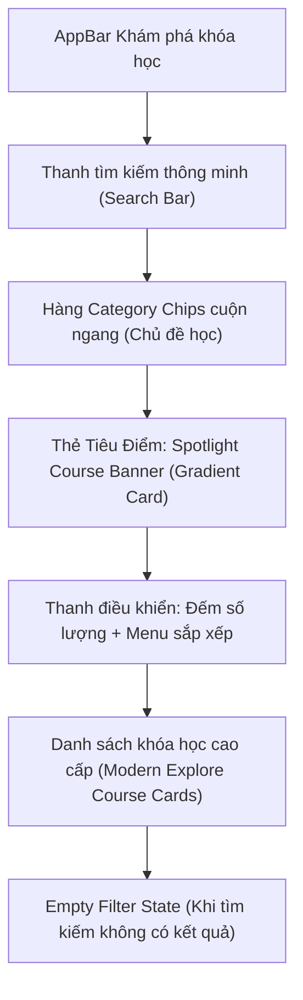

# Kế Hoạch Nâng Cấp Giao Diện Màn Hình Khám Phá Khóa Học
*(Explore Courses Screen Refinement Plan)*

---

## 1. Tổng Quan & Hiện Trạng

### 1.1 Hiện trạng UI hiện tại (Ảnh emulator)
Màn hình **Khám phá khóa học** ([`explore_courses_screen.dart`](file:///C:/ForteX/mobile/lib/features/student/presentation/learning/explore_courses_screen.dart)) hiện tại sử dụng khung [`AsyncListScaffold`](file:///C:/ForteX/mobile/lib/widgets/async_list_scaffold.dart), bộc lộ các nhược điểm:
1. **Thiếu công cụ tìm kiếm & điều hướng:** Không có thanh tìm kiếm, học viên không thể tra cứu khóa học mong muốn.
2. **Thiếu bộ lọc phân loại:** Không thể lọc theo chủ đề (Lập trình, Thiết kế, Dữ liệu...), không lọc được theo mức giá (Miễn phí / Trả phí) hay trình độ.
3. **Bố cục đơn điệu, phẳng lỳ:** Toàn bộ trang chỉ là một danh sách dọc các thẻ chữ nhật lặp đi lặp lại, không có điểm nhấn thị giác (Featured / Hero Banner).
4. **Thẻ khóa học nghèo nàn thông tin:**
   - Nhãn trình độ đang để tiếng Anh thô (`beginner`, `intermediate`, `advanced`).
   - Chưa tận dụng dữ liệu phong phú có sẵn trong `CourseModel`: `averageRating`, `totalRatings`, `totalStudents`, `categoryName`, `discountPrice`.
   - Thiếu các chỉ số tin cậy (Rating sao ⭐, số học viên đã học).

---

## 2. Mục Tiêu Thiết Kế (Design Objectives)

Biến màn hình từ một danh sách tĩnh đơn giản thành **Trung tâm Khám phá Tri thức (Interactive Discovery Hub)** theo chuẩn SaaS/EdTech hiện đại (Coursera / Udemy / MasterClass):

---

## 3. Kiến Trúc & Thiết Kế Thành Phần Chi Tiết

### 3.1 Header & Search Bar thông minh
- **Ô tìm kiếm:** Nền `#F1F5F9`, bo tròn `AppRadius.full`, icon kính lúp `#3D5FC4`, placeholder *"Tìm khóa học, giảng viên, kỹ năng..."*, nút xóa nhanh `x` khi có text.
- Phản hồi tìm kiếm tức thì theo tiêu đề, giảng viên, danh mục và mô tả ngắn.

### 3.2 Hàng Category Chips (Chủ đề khóa học)
- Cuộn ngang mượt mà:
  - `Tất cả` (hiển thị tổng số khóa học)
  - `Lập trình & Web` 💻
  - `Mobile App` 📱
  - `Khoa học Dữ liệu` 📊
  - `Thiết kế UI/UX` 🎨
  - *(Tự động tổng hợp động từ `course.categoryName` có trong dữ liệu)*

### 3.3 Bộ lọc nhanh & Menu sắp xếp
- **Lọc theo phí:** Toggle Pills `Tất cả` | `🎁 Miễn phí` | `💳 Trả phí`.
- **Sắp xếp linh hoạt (Sort Dropdown):**
  - Phổ biến nhất (theo số học viên / rating)
  - Mới nhất (theo `createdAt`)
  - Giá: Thấp đến Cao
  - Giá: Cao đến Thấp

### 3.4 Khóa học Tiêu điểm (Spotlight Course Banner)
- Khi ở chế độ *"Tất cả"* (không có query tìm kiếm), hiển thị 1 khóa học nổi bật nhất ở đầu trang dạng Card Gradient Academic Blue (`#1E3A8A` -> `#3D5FC4`):
  - Tag phát sáng: `🔥 KHÓA HỌC NỔI BẬT`
  - Tên khóa học nổi bật, rating ⭐, số học viên
  - Nút bấm *"Khám phá ngay"* dạng Capsule Pill trắng

### 3.5 Thiết kế lại Thẻ Khóa Học (`_ExploreCourseCard`)
1. **Thumbnail:**
   - Kích thước 96x96dp, bo góc 12dp.
   - Badge nổi đè lên góc ảnh: Tag Trình độ (`Cơ bản` xanh ngọc, `Trung cấp` xanh dương, `Nâng cao` cam hổ phách) hoặc tag `MIỄN PHÍ`.
2. **Khối thông tin chính:**
   - Tiêu đề khóa học: Font `14.5px`, đậm nét `w700`, tối đa 2 dòng.
   - Giảng viên: Avatar tròn nhỏ kèm tên giảng viên `#334155`.
   - **Social Proof & Specs:**
     - Rating sao: `⭐ 4.9 (120)` với sao vàng hổ phách `#F59E0B`.
     - Số học viên: `👥 1.2k học viên`.
     - Số bài học: `⏱ 9 bài`.
3. **Giá & Tương tác:**
   - Nút Bookmark trái tim yêu thích ở góc phải.
   - Giá tiền in đậm rõ ràng (hỗ trợ giá giảm `discountPrice` và gạch ngang giá gốc nếu có).
   - Nút `chevron_right` dẫn lối điều hướng.

---

## 4. Kế Hoạch Triển Khai Chi Tiết (4 Bước)

| Bước | Nhiệm vụ cụ thể | File tác động | Tiêu chí hoàn thành |
| :--- | :--- | :--- | :--- |
| **Bước 1** | Tái cấu trúc State Management cho màn hình khám phá | [`explore_courses_screen.dart`](file:///C:/ForteX/mobile/lib/features/student/presentation/learning/explore_courses_screen.dart) | Quản lý query tìm kiếm, category được chọn, bộ lọc giá và tiêu chí sắp xếp |
| **Bước 2** | Xây dựng Search Bar & Horizontal Category Filter Chips | [`explore_courses_screen.dart`](file:///C:/ForteX/mobile/lib/features/student/presentation/learning/explore_courses_screen.dart) | Thanh tìm kiếm tức thì, thanh danh mục cuộn ngang mượt mà |
| **Bước 3** | Xây dựng Spotlight Hero Card & thiết kế lại `_ExploreCourseCard` | [`explore_courses_screen.dart`](file:///C:/ForteX/mobile/lib/features/student/presentation/learning/explore_courses_screen.dart) | Card cao cấp có rating sao, số học viên, level Việt hóa, giá tiền nổi bật |
| **Bước 4** | Xây dựng Zero-state cho bộ lọc & Kiểm thử hồi quy | Test suite student | Empty state có nút "Xóa bộ lọc", 34/34 tests pass 100% |

---

## 5. Đảm Bảo An Toàn & Không Regression (Zero Regression)
- Không can thiệp vào `diContainer` và logic nạp dữ liệu của `LearningBloc`.
- Tương thích 100% với việc bấm vào thẻ để mở `CourseDetailScreen`.
- Chạy kiểm thử tự động `flutter test test/features/student/` đảm bảo toàn bộ tests pass trước khi nghiệm thu.
