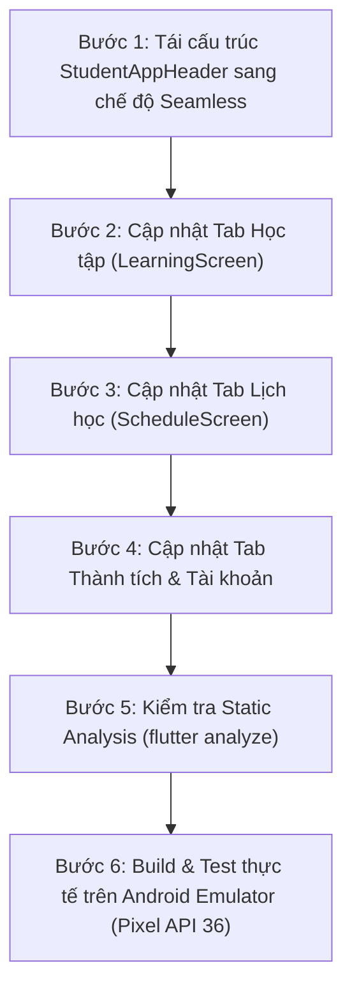

# Kế Hoạch Tái Thiết Kế Header Các Màn Hình Chính: Phương Án Seamless Open Header

> **Mã tài liệu:** `HEADER_REDESIGN_MAIN_SCREENS_PLAN.md`  
> **Phiên bản:** `2.0`  
> **Trạng thái:** `Đề xuất & Chờ duyệt (Planning / Draft)`  
> **Phạm vi áp dụng:** Phân hệ Học sinh (Student Portal) - Các màn hình chính: **Học tập** (`LearningScreen`), **Lịch học** (`ScheduleScreen`), **Thành tích** (`AchievementScreen`), và **Tài khoản** (`ProfileScreen`).  
> **Phương án thực hiện:** **Phương án A (Seamless Open Header – Header Hòa Tan Không Viền / Phong Cách Apple Modern & Notion)**.

---

## 1. Bối cảnh & Nhận diện vấn đề cốt lõi

### 1.1. Phản hồi thực tế từ phiên bản trước
- Ở phiên bản trước, việc áp dụng cạnh đáy bo cong `22px` và đổ bóng phân tầng lên khối Header màu trắng trên nền xám `#F8FAFC` đã vô tình biến Header thành **một chiếc Card lớn treo ngược từ trên đỉnh**.
- Khi cả Header lẫn các component bên dưới (Khóa học, Lịch, Thành tích) đều là các "thẻ Card", giao diện rơi vào hội chứng **"Lạm dụng Card" (Card Overuse / Everything-is-a-box syndrome)**. Màn hình bị chia cắt vụn vặt, mất đi sự thoáng đạt và chiều sâu không gian.

### 1.2. Mục tiêu của Phương án A (Seamless Open Header)
1. **Triệt tiêu hoàn toàn cảm giác "Card":** Xóa bỏ 100% đường viền bao quanh, đổ bóng và nền trắng đóng hộp riêng biệt.
2. **Hòa tan tự nhiên vào dòng chảy trang:** Nền Header hòa cùng màu nền trang (`context.surfaceBg` `#F8FAFC`), tạo không gian mở (Open Whitespace) phóng khoáng, cao cấp.
3. **Typography to bản hiện đại (Large Title):** Nâng cấp tiêu đề trang lên kích thước `24sp - 26sp` đậm đà, tự tin theo chuẩn thiết kế Modern Native (tương tự Apple Music, iOS Settings, Notion, Duolingo).
4. **Giữ trọn vẹn bản sắc Semantic Pastel:** Leading Icon và Trailing Action nổi tự nhiên như các điểm nhấn trực quan tinh xảo trên nền trang.

---

## 2. Đặc tả Thiết Kế Phương Án A (Design Specifications)

### 2.1. Cấu trúc Khối & Bề mặt (Surface & Geometry)
- **Nền Header:** Hòa tan 100% vào nền trang:
  ```dart
  backgroundColor: Colors.transparent // hoặc context.surfaceBg
  ```
- **Không viền đáy (No Border):** `border: null` (loại bỏ hoàn toàn mọi đường cắt 180° ngang màn hình).
- **Không đổ bóng (No BoxShadow):** `boxShadow: null` (xóa bỏ hoàn toàn hiệu ứng card nổi treo ngược).
- **Không bo góc đáy (No Bottom Radius):** `borderRadius: null` (không cần giả lập hình khối).
- **Khoảng đệm (Padding):**
  ```dart
  padding: const EdgeInsets.fromLTRB(
    AppSpacing.screenPadding, // 16px
    AppSpacing.sm,            // 8px
    AppSpacing.screenPadding, // 16px
    AppSpacing.sm,            // 8px
  )
  ```

---

### 2.2. Phân Cấp Typography To Bản (Large Title Hierarchy)
- **Category Label:**
  - Tracking rộng: `letterSpacing: 1.2`
  - Font size: `11sp`
  - Font weight: `FontWeight.w700` (In hoa)
  - Color: `cs.slate500`
- **Screen Large Title:**
  - Font size: `25sp` (to rõ, uy nghi, hiện đại)
  - Font weight: `FontWeight.w800`
  - Letter spacing: `-0.6`
  - Color: `cs.slate900`
  - Chiều cao dòng (height): `1.15`

---

### 2.3. Semantic Squircle & Trailing Action Nổi Tự Nhiên
- **Leading Squircle (40×40, Radius 12px):**
  Vì nền Header trong suốt, Leading Icon nổi lên như một biểu tượng định vị sắc nét với viền hairline mờ `0.6px`:
  - 🎓 **Học tập:** Indigo Pastel (Nền `#EEF2FF`, viền `#E0E7FF`, icon `#4F46E5`).
  - 📅 **Lịch học:** Sky Pastel (Nền `#E0F2FE`, viền `#BAE6FD`, icon `#0284C7`).
  - 🏆 **Thành tích:** Amber Pastel (Nền `#FEF3C7`, viền `#FDE68A`, icon `#D97706`).
  - 👤 **Tài khoản:** Lavender Pastel (Nền `#F3E8FF`, viền `#E9D5FF`, icon `#7E22CE`).
- **Trailing Action (Nút Squircle Trắng Nổi 38×38):**
  Nút Tìm kiếm hoặc nút Hôm nay được bọc trong Squircle nền trắng tinh khôi (`Colors.white`), viền hairline `cs.outlineVariant.withValues(alpha: 0.35)`, đổ bóng siêu nhẹ `0.02`, đặt đối xứng thanh lịch bên phải tiêu đề.

---

## 3. So Sánh Bố Cục Trước vs Mới (Visual ASCII Wireframes)

### 3.1. Phiên bản trước (Cảm giác giống 1 chiếc Card treo đỉnh):
```
┌────────────────────────────────────────────────────────┐
│  [🎓] HỌC PHẦN & KHÓA HỌC                      [ 🔍 ]  │  <- Nền trắng đóng hộp
│       Học tập của tôi                                  │
╰────────────────────────────────────────────────────────╯  <- Đáy cong 22px + Đổ bóng -> GIỐNG CARD!
  ░░░░░░░░░░░░░░░░░░░░░░░░░░░░░░░░░░░░░░░░░░░░░░░░░░░░░░    <- Nền xám nhạt bên dưới
  ┌────────────────┐   ┌────────────────┐
  │ Card khóa học  │   │ Card khóa học  │
```

### 3.2. Phương án A Mới (Seamless Open Header – Không viền, Không Card, Thoáng Đãng):
```
  ░░░░░░░░░░░░░░░░░░░░░░░░░░░░░░░░░░░░░░░░░░░░░░░░░░░░░░    <- Toàn bộ đỉnh màn hình hòa vào nền trang
  [🎓]  HỌC PHẦN & KHÓA HỌC                      [ 🔍 ]  <- Action & Icon nổi tự do, tinh tế
        Học tập của tôi                                   <- Large Title 25sp to bản, thoáng đãng
  ░░░░░░░░░░░░░░░░░░░░░░░░░░░░░░░░░░░░░░░░░░░░░░░░░░░░░░    <- Dòng chảy tự nhiên, KHÔNG ranh giới
  ┌────────────────┐   ┌────────────────┐
  │ Card khóa học  │   │ Card khóa học  │
```

---

## 4. Chi Tiết Thay Đổi Trên Từng Màn Hình

| Màn hình / Tab | Leading Icon & Màu Pastel | Tiêu đề Large Title | Trailing Action | Hiệu ứng thị giác |
| :--- | :--- | :--- | :--- | :--- |
| **Học tập** (`learning_screen.dart`) | `Icons.school_rounded`<br>Indigo Pastel (`#EEF2FF`, `#4F46E5`) | `Học tập của tôi`<br>(25sp, bold 800) | Nút Squircle Tìm kiếm trắng mờ nổi nhẹ | Nền xám liền mạch, các Card khóa học bên dưới nổi bật rõ nét |
| **Lịch học** (`schedule_screen.dart`) | `Icons.calendar_month_rounded`<br>Sky Pastel (`#E0F2FE`, `#0284C7`) | `Lịch học`<br>(25sp, bold 800) | Nút Squircle "Hôm nay" trắng mờ nổi nhẹ | Khối tóm tắt tháng và Calendar trượt mượt mà lên trên |
| **Thành tích** (`achievement_screen.dart`) | `Icons.emoji_events_rounded`<br>Amber Pastel (`#FEF3C7`, `#D97706`) | `Thành tích & Điểm thưởng`<br>(25sp, bold 800) | Không có trailing | Thẻ Overview Stats kết nối tự nhiên với tiêu đề |
| **Tài khoản** (`profile_screen.dart`) | `Icons.person_rounded`<br>Lavender Pastel (`#F3E8FF`, `#7E22CE`) | `Thông tin cá nhân`<br>(25sp, bold 800) | Không có trailing | ProfileCard chào đón người dùng trực quan |

---

## 5. Lộ Trình Triển Khai Chi Tiết (Implementation Roadmap)



### Chi tiết từng bước:

#### Bước 1: Tái cấu trúc `StudentAppHeader` (`student_app_header.dart`)
1. Bổ sung tham số `isSeamless`: mặc định `true` cho phong cách Seamless Open Header.
2. Khi `isSeamless = true`:
   - `backgroundColor = Colors.transparent` (hoặc `context.surfaceBg`).
   - `borderRadius = null`, `border = null`, `boxShadow = null`.
   - Title được chuyển sang kiểu chữ Large Title: `fontSize: 25`, `fontWeight: FontWeight.w800`, `letterSpacing: -0.6`.
   - Kích thước Squircle leading điều chỉnh sang `40×40 (Radius 12px)` tinh gọn.

#### Bước 2: Cập nhật Tab Học tập (`learning_screen.dart`)
- Truyền `isSeamless: true` (hoặc dùng mặc định).
- Nút Trailing Search sử dụng thẻ Squircle trắng `38×38` nổi trên nền xám.
- Cân chỉnh khoảng đệm đầu trang `CustomScrollView` cho cân xứng.

#### Bước 3: Cập nhật Tab Lịch học (`schedule_screen.dart`)
- Truyền `isSeamless: true`.
- Nút Trailing Hôm nay sử dụng thẻ Squircle trắng `38×38` nổi trên nền xám.
- Cân chỉnh top padding của `ListView` thành `AppSpacing.xs` / `AppSpacing.sm` để không gian liền lạc.

#### Bước 4: Cập nhật Tab Thành tích & Tài khoản (`achievement_screen.dart`, `profile_screen.dart`)
- Đồng bộ `isSeamless: true`.
- Header hòa tan 100% vào nền trang.

#### Bước 5: Static Analysis & Linting
- Chạy `flutter analyze` đảm bảo đạt 0 lỗi, 0 warnings.

#### Bước 6: Build & Kiểm thử thực tế trên Android Emulator
- Build `app-dev-debug.apk`, cài đặt lên `emulator-5554`.
- Chụp ảnh màn hình thực tế cả 4 tab lưu vào artifacts làm bằng chứng hoàn thành (Done Evidence).
- Đánh giá trực quan: Đảm bảo 100% không còn cảm giác "card", không gian thoáng đãng, rộng mở.

---

## 6. Tiêu Chí Nghiệm Thu (Acceptance Criteria)

- [ ] **Hoàn toàn không có cảm giác Card:** Header không có viền bao quanh, không có góc cong đáy giả lập, không có đổ bóng.
- [ ] **Nền hòa tan liền mạch:** Màu nền Header đồng nhất 100% với màu nền trang (`context.surfaceBg` `#F8FAFC`).
- [ ] **Typography to bản, ấn tượng:** Tiêu đề màn hình hiển thị dạng Large Title (25sp, bold 800) rõ ràng, sang trọng.
- [ ] **Độ sắc nét của thành phần nổi:** Leading Squircle pastel và Trailing Action trắng nổi tự nhiên trên nền xám.
- [ ] **Chất lượng code:** `flutter analyze` đạt 0 lỗi, 0 warnings.
- [ ] **Bằng chứng kiểm thử:** Ảnh chụp trực tiếp 4 tab trên Android Emulator thể hiện phong cách Seamless Open Header hoàn chỉnh.
