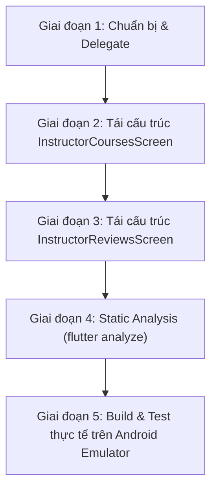

# Kế Hoạch Tái Thiết Kế & Nâng Cấp Giao Diện Nhóm Hồ Sơ Giảng Viên (Instructor Profile Screens)

> **Mã tài liệu:** `INSTRUCTOR_PROFILE_SCREENS_REDESIGN_PLAN.md`  
> **Phiên bản:** `1.0`  
> **Trạng thái:** `Đề xuất & Chờ duyệt (Planning / Draft)`  
> **Mục tiêu:** Tái thiết kế màn hình **Khóa học của giảng viên** (bỏ hero banner dư thừa, nâng cấp hiệu ứng thị giác hiện đại - không dùng gradient đậm, bổ sung horizontal swipe) và màn hình **Đánh giá từ học viên** (bổ sung horizontal swipe).

---

## 1. Bối cảnh & Mục tiêu dự án

### 1.1. Bối cảnh
Người dùng truy cập vào nhóm tính năng này từ màn hình **Chi tiết giảng viên (Instructor Detail Screen)** thông qua các nút "Xem tất cả":
1. **Khóa học của giảng viên (`InstructorCoursesScreen`)**: Hiển thị toàn bộ các khóa học do giảng viên trực tiếp giảng dạy kèm bộ lọc danh mục (`Tất cả`, `UI/UX Design`, `Product Design`, `User Research`...).
2. **Đánh giá từ học viên (`InstructorReviewsScreen`)**: Hiển thị bảng tổng kết điểm đánh giá (4.8⭐, phân bổ 5★ đến 1★) cùng danh sách phản hồi chi tiết từ học viên kèm bộ lọc số sao.

### 1.2. Nhận diện các vấn đề UI/UX hiện tại
- **Màn hình Khóa học của giảng viên:**
  - *Dư thừa thông tin:* Hero banner hiển thị avatar, tên giảng viên, chức danh và rating lặp lại nguyên xi từ màn hình chi tiết trước đó, chiếm tới 25% chiều cao màn hình một cách vô ích.
  - *Thiếu thao tác mobile đặc trưng:* Chuyển đổi giữa các danh mục bắt buộc phải chạm ngón tay lên thanh chip, chưa hỗ trợ thao tác lướt ngang (horizontal swipe) thuận tiện.
  - *Giao diện quá đơn điệu (Boring & Flat):* Mọi khóa học đều dùng chung 1 khung thumbnail xanh nhạt 80x80 với 1 icon sách `Icons.menu_book_rounded` giống hệt nhau; không có nhịp điệu thị giác (visual rhythm), thiếu sự phân cấp giữa khóa đang học và khóa chưa mua.
- **Màn hình Đánh giá từ học viên:**
  - *Thiếu thao tác lướt ngang:* Hiện tại phải bấm từng chip điểm sao (`Tất cả`, `5 Sao`, `4 Sao`...) để lọc, thiếu trải nghiệm vuốt ngang toàn diện trên danh sách đánh giá.

---

## 2. Đề xuất giải pháp thiết kế (Design Proposal)

### 2.1. Nâng cấp màn hình Khóa học của giảng viên (`InstructorCoursesScreen`)

#### A. Loại bỏ hoàn toàn Hero Banner giảng viên
- Loại bỏ khối Card thông tin giảng viên lặp lại ở đầu danh sách.
- Giữ thanh `AppBar` gọn gàng với tiêu đề `Khóa học của giảng viên` (và nút Back bo tròn mềm mại).
- Dưới thanh Category Filter Tabs, bố trí thanh chỉ báo số lượng tinh gọn: `Hiển thị X khóa học` với chữ xám nhạt thanh thoát, tập trung toàn bộ không gian cho danh sách khóa học.

#### B. Tăng cường hiệu ứng thị giác cho Course Card (KHÔNG dùng Gradient đậm)
Tuân thủ nghiêm ngặt nguyên tắc: **Phẳng sáng (Flat Light), Nhẹ nhàng, Tinh tế, Hiện đại, Mang phong cách công nghệ & học thuật**.

1. **Thumbnail đa sắc thái theo chuyên môn (Category-Themed Pastel Squircle):**
   - Thay vì dùng 1 icon sách đơn điệu cho mọi khóa học, mỗi môn học có icon chuyên biệt và nền Squircle pastel dịu mắt (`14px` radius, viền hairline siêu mảnh):
     - *UI/UX Design*: Nền Indigo pastel (`0xFFEEF2FF`), viền (`0xFFE0E7FF`), Icon `Icons.palette_outlined` / `Icons.auto_awesome_mosaic_rounded` màu xanh chàm (`0xFF4F46E5`).
     - *Product Design*: Nền Emerald pastel (`0xFFF0FDF4`), viền (`0xFFDCFCE7`), Icon `Icons.layers_outlined` / `Icons.design_services_rounded` màu xanh ngọc (`0xFF059669`).
     - *User Research*: Nền Lavender pastel (`0xFFFAF5FF`), viền (`0xFFF3E8FF`), Icon `Icons.psychology_outlined` / `Icons.person_search_rounded` màu tím lavender (`0xFF9333EA`).
     - *Design System / Khác*: Nền Sky/Amber pastel (`0xFFF0F9FF`), viền (`0xFFE0F2FE`), Icon `Icons.widgets_outlined` / `Icons.dashboard_customize_rounded` màu xanh lam (`0xFF0284C7`).
   - Bổ sung **Badge cấp độ mini** (`Cơ bản` / `Nâng cao` / `Thực chiến`) đặt tinh gọn ở góc thumbnail giúp phân cấp độ khó của khóa học.

2. **Phân cấp thẻ Khóa học theo trạng thái (Visual Differentiation):**
   - **Khóa học đang học (`isEnrolled = true`):**
     - Pill trạng thái `Đang học 65%` màu xanh dương nhẹ (`0xFFEFF6FF`), text xanh đậm (`0xFF1D4ED8`), kèm dot trạng thái xanh dương tươi sáng.
     - Thanh tiến độ học tập Slim Minimalist `5px` bo tròn góc với track nền xám nhạt (`0xFFF1F5F9`) và thanh chỉ báo xanh dương.
     - Bổ sung chỉ số tiến độ chi tiết dạng chữ nhỏ: `Đã hoàn thành 8/12 bài`.
     - Icon nút tròn `Tiếp tục học` mini ở góc phải định hướng hành động rõ ràng.
   - **Khóa học chưa mua (`isEnrolled = false`):**
     - Hiển thị giá học phí rõ nét với định dạng typography đậm đà (`499.000 đ`).
     - Pill danh mục chuyên ngành thanh lịch.
     - Nút/icon mũi tên tròn nhỏ định hướng chi tiết khóa học.

3. **Bề mặt Card và Chi tiết hoàn thiện:**
   - Nền thẻ phẳng màu trắng (`Colors.white`), viền hairline mỏng `0.8px` (`cs.outlineVariant.withValues(alpha: 0.6)`), độ bo cong `16px`.
   - Đổ bóng phân lớp dịu nhẹ (`blurRadius: 10`, `offset: (0, 2)`, `color: shadow.withValues(alpha: 0.035)`).
   - Hàng Metadata trực quan: Rating sao vàng ấm `#F59E0B` kèm số học viên (`⭐ 4.9 (1.2k+ học viên)`), số bài học và tổng thời lượng (`12 bài • 6h 40m`).

---

### 2.2. Bổ sung cơ chế Horizontal Swipe cho cả 2 màn hình

#### Kiến trúc cốt lõi áp dụng:
```
Scaffold
  └── NestedScrollView
        ├── headerSliverBuilder:
        │     ├── [InstructorCoursesScreen]:
        │     │     └── SliverPersistentHeader(pinned: true) -> Category Tabs Row
        │     └── [InstructorReviewsScreen]:
        │           ├── SliverToBoxAdapter -> Rating Breakdown Summary Card (cuộn tự nhiên)
        │           └── SliverPersistentHeader(pinned: true) -> Rating Star Filter Chips (ghim cố định)
        └── body:
              └── PageView.builder (lướt ngang đổi tab mượt mà)
                    └── Tab Content: ListView với PageStorageKey độc lập + Empty State
```

#### Cơ chế đồng bộ 2 chiều (Bi-directional Sync):
1. **Lướt ngang trên màn hình:**
   - Người dùng vuốt ngón tay sang trái/phải trên danh sách $\rightarrow$ `PageView` chuyển trang.
   - Callback `onPageChanged(int index)` được kích hoạt: cập nhật active chip và tự động scroll thanh chips ngang (`ScrollController.animateTo`) sao cho chip được chọn luôn trượt vào giữa/vị trí dễ nhìn nhất.
2. **Chạm chip bộ lọc:**
   - Khi người dùng bấm trực tiếp vào chip bất kỳ $\rightarrow$ `_pageController.animateToPage(index, duration: 300ms, curve: Curves.easeInOutCubic)` chuyển ngay đến đúng trang.
3. **Ghim thanh lọc (Pinned Header):**
   - Khi cuộn dọc danh sách xuống dưới, thanh Filter Chips tự động ghim sát dưới AppBar nhờ `SliverPersistentHeader(pinned: true)`, giúp người dùng luôn chủ động đổi bộ lọc hoặc lướt ngang bất kỳ lúc nào.

---

## 3. Bản đồ Tabs và Dữ liệu

### 3.1. Tabs màn hình Khóa học của giảng viên (`InstructorCoursesScreen`)
- Tab 0: `Tất cả` (All - 5 khóa học)
- Tab 1: `UI/UX Design` (2 khóa học: UI/UX Design Fundamentals, Design Thinking for UX)
- Tab 2: `Product Design` (2 khóa học: Product Design Masterclass, Design System & Component Library)
- Tab 3: `User Research` (1 khóa học: User Research Methods)

### 3.2. Tabs màn hình Đánh giá từ học viên (`InstructorReviewsScreen`)
- Tab 0: `Tất cả (1,248)` (lọc toàn bộ review)
- Tab 1: `5 Sao (1,050)` (lọc các review có `rating == 5`)
- Tab 2: `4 Sao (145)` (lọc các review có `rating == 4`)
- Tab 3: `3 Sao (35)` (lọc các review có `rating == 3` - hiển thị Empty State nếu chưa có mock)
- Tab 4: `2 Sao (12)` (lọc các review có `rating == 2` - hiển thị Empty State nếu chưa có mock)
- Tab 5: `1 Sao (6)` (lọc các review có `rating == 1` - hiển thị Empty State nếu chưa có mock)

---

## 4. Kế hoạch triển khai chi tiết từng bước (Step-by-Step Roadmap)



### Giai đoạn 1: Chuẩn bị Widget & Thư viện dùng chung
- [ ] Tái sử dụng hoặc import `CategoryTabsHeaderDelegate` (từ `achievement/widgets/` hoặc đặt vào thư mục widgets dùng chung của `learning/widgets/`).
- [ ] Bổ sung các hằng số màu sắc Pastel & Icon helper cho từng category khóa học (`getCategoryIcon`, `getCategoryPastelColor`, `getCategoryLevel`).

### Giai đoạn 2: Tái cấu trúc `InstructorCoursesScreen`
- [ ] **Bỏ hero banner:** Xóa bỏ `SliverToBoxAdapter` chứa card thông tin giảng viên lặp lại.
- [ ] **Thiết kế Card khóa học nâng cao:**
  - Tạo layout thumbnail mới với squircle pastel đa sắc thái theo môn học.
  - Phân biệt rõ nét 2 trạng thái: Đang học (tiến độ slim bar + badge trạng thái) vs Chưa mua (giá tiền nổi bật + pill danh mục).
  - Bổ sung thông số rating, học viên, bài học và thời lượng với iconography tinh tế.
- [ ] **Tích hợp Horizontal Swipe:**
  - Khởi tạo `PageController` và `ScrollController` cho thanh chips.
  - Triển khai `NestedScrollView` + `SliverPersistentHeader(pinned: true)` + `PageView.builder`.
  - Kết nối cơ chế đồng bộ 2 chiều (Swipe $\leftrightarrow$ Tap Chip).
  - Bổ sung `PageStorageKey` bảo toàn vị trí cuộn cho từng tab.
  - Bổ sung Empty State khi danh mục không có khóa học.

### Giai đoạn 3: Tái cấu trúc `InstructorReviewsScreen`
- [ ] **Tích hợp Horizontal Swipe cho 6 mức đánh giá sao:**
  - Khởi tạo `PageController` và `ScrollController` cho thanh filter chips sao.
  - Giữ khối Rating Summary Card trong `headerSliverBuilder` (cuộn lên trên).
  - Đặt thanh filter chips vào `SliverPersistentHeader(pinned: true)` để ghim lại khi cuộn.
  - Bố trí `PageView.builder` gồm 6 trang tương ứng với các bộ lọc `[0, 5, 4, 3, 2, 1]`.
  - Kết nối cơ chế đồng bộ 2 chiều (Swipe $\leftrightarrow$ Tap Chip) và auto-scroll thanh chips.
  - Xây dựng Empty State chuyên nghiệp cho các tab sao không có dữ liệu đánh giá.

### Giai đoạn 4: Phân tích mã nguồn tĩnh & Lint
- [ ] Chạy `flutter analyze lib/features/student/presentation/learning` để đảm bảo 0 errors, 0 warnings.
- [ ] Kiểm tra chuẩn code style, không duplicate code, tối ưu `const` constructors.

### Giai đoạn 5: Build & Kiểm thử thực tế trên Android Emulator
- [ ] Build và cài đặt APK lên thiết bị emulator Android API 36 (`1080x1920`).
- [ ] Mở màn hình `InstructorCoursesScreen`:
  - Kiểm tra hero banner đã được loại bỏ gọn gàng.
  - Kiểm tra giao diện thumbnail pastel đa dạng, card khóa học đẹp mắt, không dùng gradient đậm.
  - Vuốt ngang qua lại các tab (`Tất cả` $\leftrightarrow$ `UI/UX Design` $\leftrightarrow$ `Product Design` $\leftrightarrow$ `User Research`).
  - Chạm chip bất kỳ và kiểm tra animation chuyển trang.
- [ ] Mở màn hình `InstructorReviewsScreen`:
  - Kiểm tra Rating Summary Card hiển thị đẹp mắt và cuộn lên bình thường.
  - Vuốt ngang qua lại các tab sao (`Tất cả` $\leftrightarrow$ `5 Sao` $\leftrightarrow$ `4 Sao` $\leftrightarrow$ `3 Sao`...).
  - Kiểm tra hiển thị Empty State trên các tab không có đánh giá.
- [ ] Chụp ảnh màn hình lưu vào artifacts làm bằng chứng nghiệm thu trực quan.

---

## 5. Tiêu chí nghiệm thu (Acceptance Criteria)

| STT | Hạng mục | Tiêu chí đánh giá |
|:---:|---|---|
| 1 | **Bỏ Hero Banner** | Màn hình `InstructorCoursesScreen` không còn card lặp lại thông tin giảng viên; giao diện mở ra tập trung ngay vào khóa học. |
| 2 | **Nâng cấp hiệu ứng thị giác** | Card khóa học không còn icon sách đơn điệu; có thumbnail pastel phân biệt theo danh mục, phân cấp rõ ràng giữa "Đang học" và "Chưa mua", hoàn toàn không dùng gradient tối/đậm. |
| 3 | **Horizontal Swipe (Khóa học)** | Người dùng vuốt ngang trái/phải màn hình chuyển mượt mà giữa các danh mục khóa học; chip tương ứng tự động active và cuộn vào tầm nhìn. |
| 4 | **Horizontal Swipe (Đánh giá)** | Người dùng vuốt ngang chuyển đổi trơn tru giữa 6 mức lọc sao; thanh lọc ghim cố định khi cuộn dọc; chip đồng bộ 2 chiều với thao tác vuốt. |
| 5 | **Chất lượng mã nguồn** | `flutter analyze` đạt 0 lỗi, 0 cảnh báo. |
| 6 | **Bằng chứng kiểm thử** | Có ảnh chụp màn hình thực tế từ Android Emulator ghi lại đầy đủ các trạng thái và cử chỉ. |
