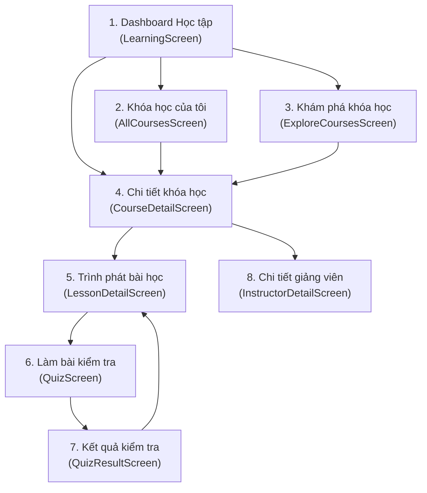
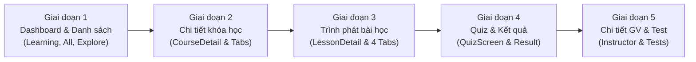

# KẾ HOẠCH CHI TIẾT TINH CHỈNH GIAO DIỆN TOÀN DIỆN LUỒNG HỌC TẬP (LEARNING FLOW UI REFINEMENT PLAN)

> **Dự án:** ForteX Mobile App (`role: Student`)  
> **Nhánh Git:** `tung/refactor_UI_Student`  
> **Thư mục tài liệu:** `mobile/docs/insight_UI_student/`  
> **Mục tiêu:** Nâng cấp toàn diện trải nghiệm thị giác và thao tác cho toàn bộ các màn hình trong luồng Học tập (`Learning Flow`), áp dụng triết lý thiết kế Kiến trúc Lai (Hybrid Architecture), chấm dứt hiện tượng lạm dụng card (Card Fatigue), chuẩn hóa 100% tiếng Việt có dấu và giữ vững 100% tính toàn vẹn của logic, Bloc, API, routing.

---

## 1. TỔNG QUAN LUỒNG HỌC TẬP (LEARNING FLOW ARCHITECTURE)

Luồng Học tập là trái tim của ứng dụng dành cho học sinh. Người học bắt đầu từ trang tổng quan học tập, tìm kiếm/khám phá khóa học, xem chi tiết lộ trình, tham gia xem video bài giảng, làm bài tập trắc nghiệm (quiz), nhận kết quả đánh giá và theo dõi thông tin giảng viên.

### Danh mục màn hình & file mã nguồn thuộc phạm vi:
| STT | Màn hình | Đường dẫn File chính | Widget con trọng yếu |
|:---:|---|---|---|
| **1** | **Dashboard Học tập** | `lib/features/student/presentation/learning/learning_screen.dart` | `ContinueLearningCard`, `MyCourseCard`, `RecentLearningItem`, `RecommendationCard`, `FilterChipsRow` |
| **2** | **Danh sách khóa học của tôi** | `lib/features/student/presentation/learning/all_courses_screen.dart` | `_CourseCard`, `AsyncListScaffold` |
| **3** | **Khám phá khóa học** | `lib/features/student/presentation/learning/explore_courses_screen.dart` | `_CourseCard`, `AsyncListScaffold` |
| **4** | **Chi tiết khóa học** | `lib/features/student/presentation/learning/course_detail/course_detail_screen.dart` | `CourseHero`, `CourseProgressCard`, `CourseContentTab` (`SectionCard`), `CourseOverviewTab`, `CourseInstructorTab`, `CourseReviewsTab`, `CourseEnrollmentBar` |
| **5** | **Trình phát bài học** | `lib/features/student/presentation/learning/lesson_detail/lesson_detail_screen.dart` | `LessonVideoPlayer`, `LessonContentSection`, `LessonDocumentsSection`, `LessonExerciseSection`, `LessonNotesSection`, `LessonBottomBar` |
| **6** | **Làm bài kiểm tra (Quiz)** | `lib/features/student/presentation/learning/quiz_screen.dart` | `QuizHeader`, `QuestionCard`, `AnswerOption`, `QuizBottomBar`, `QuizProgress` |
| **7** | **Kết quả kiểm tra** | `lib/features/student/presentation/learning/quiz_result_screen.dart` | `ScoreCircle`, `StatCard`, danh sách câu hỏi xem lại chi tiết |
| **8** | **Chi tiết giảng viên** | `lib/features/student/presentation/learning/instructor_detail_screen.dart` | Hero section, `InstructorStatItem`, `InstructorCourseCard`, `InstructorRatingSummaryCard`, `InstructorReviewItem` |

---

## 2. ĐÁNH GIÁ HIỆN TRẠNG & CÁC VẤN ĐỀ CẦN GIẢI QUYẾT (GAP ANALYSIS)

### 2.1. Màn hình Dashboard Học tập (`LearningScreen`)
* **Thành tựu đã có:** Đã khôi phục thông tin giảng viên trên thẻ khóa học (`MyCourseCard`) và thẻ tiếp tục học (`ContinueLearningCard`), đẩy tên giảng viên nằm sát ngay trên thanh tiến trình chuẩn theo `main`.
* **Vấn đề còn tồn đọng:**
  - Nửa dưới (từ Filter chips, danh sách Gần đây tới Gợi ý cho bạn) vẫn đang thả các Card rời rạc trên nền xám trơn, chưa có Khay Bề Mặt Cong (`CurvedSurfaceTray`) đồng bộ như ở `HomeScreen`.
  - Empty states khi filter không có kết quả còn đơn điệu, cần bo góc mềm mại và icon nổi bật.

### 2.2. Hai màn hình danh sách (`AllCoursesScreen` & `ExploreCoursesScreen`)
* **Vấn đề cấu trúc:** Đang sử dụng widget nội bộ `_CourseCard` riêng biệt trong từng file, gây trùng lặp mã nguồn (code duplication).
* **Vấn đề thẩm mỹ:**
  - Vòng tròn tiến độ (`CircularProgressIndicator`) bao quanh thumbnail 64x64 tạo cảm giác chật chội, khó nhìn ở màn hình nhỏ.
  - Thẻ dùng bo góc 12px cũ, đổ bóng cứng, thiếu phân tầng thị giác so với phong cách thẻ bo 16px mới.
  - Cần quy về dùng chung `CourseCard` chuẩn hóa (`widgets/course_card.dart`).

### 2.3. Màn hình Chi tiết khóa học (`CourseDetailScreen`)
* **Hero Section (`CourseHero`):** Thumbnail hiển thị nút Play nhỏ mờ; cụm badge trạng thái "Đang học / Chưa bắt đầu" chưa nổi bật; thông tin giảng viên và học phí nằm sát nhau.
* **Thẻ tiến độ (`CourseProgressCard`):** Bị đóng thành một Card riêng biệt thả ngay dưới Hero khiến luồng thị giác bị ngắt quãng trước khi tới TabBar. Cần gom nhóm liền mạch với phần Hero.
* **Tab Giáo trình (`CourseContentTab`):**
  - Các thẻ buổi học (`SectionCard`): Tiêu đề và số thứ tự buổi học còn khô khan; vạch tiến độ buổi học quá mỏng.
  - Danh sách bài học con (`SectionLessonItem`): Cần làm rõ trạng thái đã học (icon tích xanh), đang học (icon play nổi bật) và bị khóa (icon ổ khóa xám nhạt).
* **Tab Giảng viên & Đánh giá:** Avatar và các chỉ số sao cần được làm nét, typography phân tầng rõ ràng.
* **Thanh Bottom CTA (`CourseEnrollmentBar`):** Cần đảm bảo cố định dưới đáy màn hình với gradient hoặc viền nổi thanh thoát.

### 2.4. Màn hình Trình phát bài học (`LessonDetailScreen`)
* **LỖI NGHIÊM TRỌNG - Tiếng Việt không dấu:**
  - Trong `TabBar`: `Noi dung`, `Tai lieu`, `Bai tap`, `Ghi chu`.
  - Trong thanh tiêu đề: `Bai ${index + 1}. ${title}`.
  - Trong `LessonBottomBar`: `Bai truoc`, `Gioi thieu khoa hoc`, `Bai hoc`, `Bai tiep`.
  - Trong các dialogs: `Chuc mung!`, `Chua xem het video`, `Chua hoan thanh bai tap`, `Bo qua`, `Xem tiep`, `Lam bai tap`.
  - Trong `LessonDocumentsSection`: `Tai tat ca tai lieu`, `4 tep • 12.5 MB`, `Tai ve`.
  - Trong `LessonNotesSection`: `Ghi chu cua ban`, `Viet ghi chu...`.
  - Trong `LessonExerciseSection`: `Tra loi cau hoi trac nghiem`.
* **Vấn đề bố cục & tương tác:**
  - `LessonBottomBar`: Nút bài trước và bài tiếp dùng style hình hộp thô, thiếu nút tròn/pill thanh thoát.
  - Tab Ghi chú (`LessonNotesSection`): Ô nhập ghi chú chưa có nút Lưu nhanh hoặc tự động lưu chỉ báo mượt mà.

### 2.5. Luồng Kiểm tra & Kết quả Quiz (`QuizScreen` & `QuizResultScreen`)
* **`QuizScreen`:**
  - Thanh đếm ngược thời gian và thanh tiến độ cần tạo cảm giác tập trung, tránh áp lực tiêu cực.
  - Các thẻ lựa chọn đáp án (`AnswerOption`): Cần hiệu ứng active (viền xanh, nền xanh pastel) và ký tự A, B, C, D to bản, rõ ràng.
* **`QuizResultScreen`:**
  - Vòng tròn điểm số `ScoreCircle`: Cần cải thiện gradient và badge đạt/chưa đạt.
  - Thẻ thống kê (`StatCard`): Cần tương phản màu sắc rõ giữa câu đúng (xanh ngọc) và câu sai (đỏ nhạt).
  - Khối xem lại câu hỏi: Cần trực quan hóa đáp án học sinh đã chọn vs đáp án chính xác kèm lời giải thích.

### 2.6. Màn hình Chi tiết giảng viên (`InstructorDetailScreen`)
* Header, bio, chỉ số học viên, rating và danh sách khóa học giảng dạy cần kiểm tra và chuẩn hóa đồng bộ với design token của hệ thống.

---

## 3. TRIẾT LÝ THIẾT KẾ ÁP DỤNG TRONG LUỒNG HỌC TẬP

1. **Khay Bề Mặt Cong (Curved Surface Tray - Radius 24-28px):**
   - Áp dụng trên `LearningScreen` và các màn hình cuộn dài để gom các nhóm tác vụ phụ vào một vùng bề mặt thống nhất, giúp các Card bên trong nổi bật tự nhiên mà không cần viền dày hay bóng gắt.
2. **Loại bỏ Card lồng Card (Zero Nested Boxes):**
   - Bên trong một section đã có bề mặt phân tách, các phần tử con dùng dạng danh sách phẳng (`ListTile` / `ItemRow`) với đường phân cách mờ 0.5px thay vì bọc thêm một lớp Card viền xám bên ngoài.
3. **Phân cấp màu sắc & Trạng thái có ý nghĩa (Semantic Colors):**
   - **Xanh dương chủ đạo (`#2563EB` / `cs.blue600`):** Cho CTA hành động (Học tiếp, Bắt đầu làm bài, Nộp bài).
   - **Xanh ngọc hoàn thành (`#059669` / `#ECFDF5`):** Cho trạng thái hoàn thành bài học, quiz đạt điểm, chứng chỉ.
   - **Hổ phách cảnh báo (`#D97706` / `#FEF3C7`):** Cho bài tập cần làm, thời gian sắp hết.
   - **Đỏ lỗi (`#DC2626` / `#FEF2F2`):** Cho câu trả lời sai, bài thi chưa đạt.
   - **Slate trung tính (`cs.slate900` cho tiêu đề, `cs.slate500` cho mô tả phụ).**
4. **Chuẩn mực ngôn ngữ 100% tiếng Việt có dấu:**
   - Mọi chuỗi hiển thị trên UI, dialogs, thông báo SnackBar, tab labels đều phải có dấu tiếng Việt chuẩn ngữ pháp và giàu tính sư phạm.

---

## 4. KẾ HOẠCH TRIỂN KHAI CHI TIẾT THEO 5 GIAI ĐOẠN

---

### GIAI ĐOẠN 1: Chuẩn hóa Dashboard Học tập & Màn hình Danh sách khóa học
* **Mục tiêu:** Đồng bộ giao diện `LearningScreen` với khay bề mặt cong và nâng cấp giao diện thẻ danh sách khóa học ở `AllCoursesScreen` & `ExploreCoursesScreen`.
* **Các bước triển khai:**
  - [x] **Bước 1.1:** Tinh chỉnh nửa dưới của `LearningScreen`: Gom cụm Filter chips, danh sách "Gần đây" và "Gợi ý cho bạn" vào vùng bề mặt liền mạch (`CurvedSurfaceTray` hoặc container bề mặt cong dịu), loại bỏ viền xám thừa.
  - [x] **Bước 1.2:** Chuẩn hóa widget `CourseCard` trong `lib/features/student/presentation/learning/widgets/course_card.dart`:
    - Layout ngang chuẩn: Thumbnail bo 12px, Tiêu đề 2 dòng đậm nét, Cụm avatar giảng viên + tên giảng viên, Thanh tiến trình mảnh + số bài đã hoàn thành.
  - [x] **Bước 1.3:** Tái cấu trúc `AllCoursesScreen` (`all_courses_screen.dart`):
    - Thay thế `_CourseCard` nội bộ cũ bằng `CourseCard` chuẩn hóa đã nâng cấp.
    - Cải thiện thanh tìm kiếm / lọc nếu có, bổ sung Empty State thân thiện.
  - [x] **Bước 1.4:** Tái cấu trúc `ExploreCoursesScreen` (`explore_courses_screen.dart`):
    - Thay thế `_CourseCard` nội bộ cũ bằng thẻ khám phá chuẩn hóa hiển thị rõ học phí, rating sao, cấp độ và giảng viên.
  - [x] **Bước 1.5:** Chạy kiểm thử tự động xác nhận Phase 1.
* **Commit dự kiến:** `refactor(student-learning): chuẩn hóa dashboard học tập và danh sách khóa học`

---

### GIAI ĐOẠN 2: Nâng cấp màn hình Chi tiết khóa học (`CourseDetailScreen`)
* **Mục tiêu:** Tạo trải nghiệm khám phá và theo dõi tiến độ khóa học trực quan, liền mạch, hiện đại.
* **Các bước triển khai:**
  - [x] **Bước 2.1:** Tinh chỉnh `CourseHero` (`course_detail/widgets/course_hero.dart`):
    - Thumbnail sắc nét với nút Play tròn nổi bật (icon trắng trên nền xanh hoặc mờ kính frosted glass).
    - Cụm tiêu đề, pill trạng thái ("Đang học" / "Hoàn thành"), avatar giảng viên và rating star được bố trí thoáng đãng.
  - [x] **Bước 2.2:** Tinh chỉnh `CourseProgressCard` (`course_detail/widgets/course_progress_card.dart`):
    - Với khóa học đang học: Thẻ tiến độ nhỏ gọn, thanh tiến trình màu xanh bo tròn, nút CTA "Học tiếp" rõ ràng.
    - Với khóa học đã hoàn thành: Banner màu xanh ngọc trang trọng với nút "Xem chứng chỉ".
    - Với khóa chưa đăng ký: Khối học phí và nút "Đăng ký ngay" nổi bật.
  - [x] **Bước 2.3:** Nâng cấp Tab Giáo trình `CourseContentTab` & `SectionCard`:
    - Header mỗi buổi học (`SectionCard`): Số thứ tự buổi học tròn, vạch tiến độ buổi học rõ nét, icon mở rộng chevron mềm mại.
    - Danh sách bài học con (`SectionLessonItem`): Icon tích tròn xanh cho bài đã xong, icon play xanh cho bài đang học, icon khóa xám mờ cho bài chưa mở.
  - [x] **Bước 2.4:** Nâng cấp Tab Tổng quan (`CourseOverviewTab`), Tab Giảng viên (`CourseInstructorTab`) và Tab Đánh giá (`CourseReviewsTab`):
    - Chuẩn hóa các bullet points mục tiêu khóa học, khung giới thiệu giảng viên và thẻ review học viên.
  - [x] **Bước 2.5:** Tinh chỉnh thanh cố định dưới đáy `CourseEnrollmentBar`:
    - Shadow hắt lên dịu nhẹ, nút bấm full-width với touch target chuẩn 48dp.
  - [x] **Bước 2.6:** Chạy kiểm thử tự động xác nhận Phase 2.
* **Commit dự kiến:** `refactor(student-course-detail): nâng cấp giao diện chi tiết khóa học và giáo trình bài học`

---

### GIAI ĐOẠN 3: Tinh chỉnh màn hình Trình phát bài học (`LessonDetailScreen`)
* **Mục tiêu:** Xử lý triệt để 100% lỗi tiếng Việt không dấu và tối ưu không gian học bài tập trung (Focused Learning).
* **Các bước triển khai:**
  - [x] **Bước 3.1:** Khắc phục toàn bộ chuỗi không dấu trong `lesson_detail_screen.dart`:
    - TabBar: `Nội dung`, `Tài liệu`, `Bài tập`, `Ghi chú`.
    - Tiêu đề AppBar: `Bài ${index + 1}. ${title}`.
    - Các AlertDialog: `Chúc mừng!`, `Chưa xem hết video`, `Chưa hoàn thành bài tập`, `Bỏ qua`, `Xem tiếp`, `Làm bài tập`, `Quay lại`.
  - [x] **Bước 3.2:** Khắc phục chuỗi không dấu và nâng cấp giao diện `LessonBottomBar` (`widgets/lesson_bottom_bar.dart`):
    - Đổi thành: `Bài trước`, `Bài tiếp theo`, `Bài học`.
    - Thiết kế nút tròn mũi tên hoặc pill button hiện đại thay thế cho hình hộp chữ nhật thô.
  - [x] **Bước 3.3:** Khắc phục chuỗi không dấu và tinh chỉnh `LessonDocumentsSection`:
    - Đổi thành: `Tải tất cả tài liệu`, `Tải về`, danh sách tệp đính kèm với icon định dạng tệp (PDF, Video, Slide) rõ nét.
  - [x] **Bước 3.4:** Khắc phục chuỗi không dấu và tinh chỉnh `LessonNotesSection`:
    - Đổi thành: `Ghi chú của bạn`, `Viết ghi chú...`.
    - Bổ sung nút "Lưu ghi chú" hoặc thanh trạng thái "Đã tự động lưu".
  - [x] **Bước 3.5:** Khắc phục chuỗi không dấu và tinh chỉnh `LessonExerciseSection`:
    - Đổi thành: `Bài tập trắc nghiệm`, `Trả lời câu hỏi trắc nghiệm`.
    - Thẻ Quiz `QuizCardFromModel`: Hiển thị số lượng câu hỏi, thời gian dự kiến và badge trạng thái đã làm / chưa làm.
  - [x] **Bước 3.6:** Chạy kiểm thử tự động xác nhận Phase 3.
* **Commit dự kiến:** `refactor(student-lesson): chuẩn hóa tiếng Việt có dấu và tinh chỉnh trình phát bài học`

---

### GIAI ĐOẠN 4: Tinh chỉnh luồng Kiểm tra & Kết quả Quiz (`QuizScreen` & `QuizResultScreen`)
* **Mục tiêu:** Mang lại trải nghiệm làm bài tập hiện đại, giảm bớt căng thẳng thị giác, phản hồi kết quả trực quan và kích thích tinh thần học tập.
* **Các bước triển khai:**
  - [x] **Bước 4.1:** Tinh chỉnh `QuizScreen` & `QuizHeader`:
    - Thanh tiến độ làm bài (ví dụ `Câu 3/10`) với thanh bar mảnh bo tròn.
    - Đồng hồ đếm ngược với icon đồng hồ cát / hẹn giờ, tự đổi màu vàng/cam khi còn dưới 1 phút.
  - [x] **Bước 4.2:** Nâng cấp thẻ câu hỏi (`QuestionCard`) & các lựa chọn (`AnswerOption`):
    - Typography câu hỏi to rõ (`16-17sp`, `FontWeight.w600`).
    - Lựa chọn đáp án: Khối bo góc `12px`, ký hiệu A/B/C/D tròn nổi bật; khi học sinh chọn chuyển sang viền xanh `cs.blue600` và nền pastel `0xFFEFF6FF`.
  - [x] **Bước 4.3:** Tinh chỉnh thanh điều hướng dưới `QuizBottomBar`:
    - Nút "Câu trước" (outline/ghost), nút "Câu tiếp theo" (filled), nút "Nộp bài" (nổi bật màu xanh đậm hoặc cam khi ở câu cuối).
  - [x] **Bước 4.4:** Nâng cấp màn hình Kết quả `QuizResultScreen`:
    - Vòng tròn điểm số `ScoreCircle`: Hiệu ứng vòng tròn tiến độ sắc nét, hiển thị rõ điểm số (ví dụ: `80%`), lời khen phù hợp ("Xuất sắc!", "Chúc mừng bạn đã đạt!", "Cần cố gắng thêm!").
    - Thẻ chỉ số `StatCard`: Số câu đúng (xanh ngọc `Icons.check_circle_rounded`), số câu sai (đỏ nhạt `Icons.cancel_rounded`), thời gian hoàn thành.
    - Danh sách câu hỏi xem lại: Phân biệt rõ ràng đáp án học viên đã chọn và đáp án đúng với lời giải thích.
    - Hai nút CTA: "Làm lại bài kiểm tra" (outlined) và "Quay về bài học" (filled).
  - [x] **Bước 4.5:** Chạy kiểm thử tự động xác nhận Phase 4.
* **Commit dự kiến:** `refactor(student-quiz): tối ưu giao diện làm bài kiểm tra và màn hình kết quả quiz`

---

### GIAI ĐOẠN 5: Hoàn thiện màn hình Chi tiết Giảng viên & Kiểm thử toàn diện
* **Mục tiêu:** Hoàn thiện mắt xích cuối cùng trong luồng học tập và đảm bảo toàn bộ hệ sinh thái học tập vận hành hoàn hảo, không có lỗi tiềm ẩn.
* **Các bước triển khai:**
  - [x] **Bước 5.1:** Tinh chỉnh `InstructorDetailScreen` (`instructor_detail_screen.dart`):
    - Hero profile: Avatar tròn lớn với viền trang trọng, tên giảng viên, chức danh học vị, bio giới thiệu.
    - Khối chỉ số uy tín: Thống kê số học viên theo học, số khóa học đã giảng dạy, đánh giá trung bình sao.
    - Kỹ năng chuyên môn (`InstructorSkillChip`): Chip pill bo tròn thanh thoát.
    - Danh sách khóa học của giảng viên (`InstructorCourseCard`): Áp dụng chuẩn thiết kế thẻ khóa học mới.
  - [x] **Bước 5.2:** Viết bộ kiểm thử Widget Test & Golden Test toàn diện:
    - Bổ sung test cho `CourseDetailScreen` và các tab con.
    - Bổ sung test cho `LessonDetailScreen` và `LessonBottomBar`.
    - Bổ sung test cho `QuizScreen` và `QuizResultScreen`.
  - [x] **Bước 5.3:** Kiểm tra tổng thể (Regression Check):
    - Đảm bảo 100% tests trong `test/features/student/` chạy pass (mục tiêu 30+ tests pass).
    - Đảm bảo không còn bất kỳ chuỗi tiếng Việt không dấu nào trong toàn bộ thư mục `lib/features/student/presentation/learning/`.
  - [x] **Bước 5.4:** Commit hoàn thiện giai đoạn cuối.
* **Commit dự kiến:** `refactor(student-instructor): hoàn thiện màn hình giảng viên và kiểm thử toàn diện luồng học tập`

---

## 5. BẢNG MA TRẬN THEO DÕI TIẾN ĐỘ (PROGRESS TRACKING MATRIX)

| Giai đoạn | Nội dung chính | File tác động | Số bước | Trạng thái |
|:---:|---|---|:---:|:---:|
| **Phase 1** | Dashboard & Danh sách khóa học | `learning_screen.dart`, `all_courses_screen.dart`, `explore_courses_screen.dart`, `course_card.dart` | 5 | ✅ Hoàn thành (`4a264b2`) |
| **Phase 2** | Chi tiết khóa học & Giáo trình | `course_detail_screen.dart`, `course_hero.dart`, `course_progress_card.dart`, `course_content_tab.dart`, `section_widgets.dart` | 6 | ✅ Hoàn thành (`d6637d2`) |
| **Phase 3** | Trình phát bài học & Tiếng Việt có dấu | `lesson_detail_screen.dart`, `lesson_bottom_bar.dart`, `lesson_documents_section.dart`, `lesson_notes_section.dart`, `lesson_exercise_section.dart` | 6 | ✅ Hoàn thành (`82f66ad`) |
| **Phase 4** | Làm bài kiểm tra & Kết quả Quiz | `quiz_screen.dart`, `quiz_result_screen.dart`, `question_card.dart`, `answer_option.dart`, `score_circle.dart` | 5 | ✅ Hoàn thành (`39d20c6`) |
| **Phase 5** | Chi tiết Giảng viên & Test toàn diện | `instructor_detail_screen.dart`, `test/features/student/...` | 4 | ✅ Hoàn thành (`2b78e20`) |

---

## 6. TIÊU CHUẨN ĐÁNH GIÁ NGHIỆM THU (DEFINITION OF DONE)

1. **Nguyên vẹn Logic 100%:** Tuyệt đối không thay đổi contract, API, Bloc state/event, database hay routing.
2. **Loại bỏ Card Fatigue:** Mọi màn hình cuộn đều có nhịp điệu thị giác cân bằng, không còn hiện tượng hộp lồng trong hộp.
3. **100% Tiếng Việt có dấu:** Không còn bất kỳ từ tiếng Việt không dấu nào xuất hiện trên giao diện luồng học tập.
4. **Kiểm thử tự động:** Tất cả unit/widget test chạy pass 100% không có lỗi hoặc warning mới.
5. **Kỷ luật Git:** Sau khi hoàn thành từng Phase, tạo một commit với thông điệp ngắn gọn bằng tiếng Việt có dấu đầy đủ.
