# KẾ HOẠCH NÂNG CẤP HỖ TRỢ TRẮC NGHIỆM CHỌN NHIỀU ĐÁP ÁN & XEM LẠI CHI TIẾT BÀI LÀM TỪ MÀN HÌNH BÀI HỌC

> **Tài liệu tham khảo chuyên sâu & Kế hoạch kỹ thuật**  
> **Dự án:** 40Study Mobile App (Role: Student)  
> **Phạm vi tác động:** `mobile/lib/features/student/` (Bloc, Data Models, Repository, UI Presentation)  
> **Cam kết tuyệt đối:** **100% Mobile Flutter — TUYỆT ĐỐI KHÔNG SỬA BACKEND**. Tận dụng toàn bộ API, DTO và logic đã có sẵn của Backend Go.

---

## 1. BỐI CẢNH & PHÂN TÍCH NGUYÊN NHÂN GỐC RỄ (ROOT CAUSE ANALYSIS)

Dựa trên quá trình kiểm thử thực tế phân hệ Quiz trên Mobile Emulator với bài kiểm tra demo 3 câu hỏi của khoá học Git & GitHub, phát hiện 2 hạn chế chức năng và trải nghiệm người dùng (UX) nghiêm trọng:

### 1.1. Vấn đề 1: Trắc nghiệm chọn nhiều đáp án (Multiple-Choice Questions) chỉ chọn được 1 đáp án

#### Hiện trạng thực tế:
* Bài kiểm tra demo gồm 3 câu hỏi:
  1. Câu 1: Loại `single_choice` (Chọn 1 đáp án: `git init`).
  2. Câu 2: Loại `true_false` (Đúng/Sai: `Đúng`).
  3. Câu 3: Loại `multiple_choice` — *"Những lệnh nào dưới đây liên quan tới việc đưa thay đổi lên remote repository? (chọn nhiều đáp án)"*. Câu này có **2 đáp án đúng** trong cơ sở dữ liệu (`git push` và `git push origin main`).
* **Hành vi lỗi trên UI Mobile:** Khi học sinh chạm vào đáp án thứ hai, lựa chọn trước đó bị huỷ bỏ (bị ghi đè). Học sinh chỉ có thể chọn duy nhất 1 đáp án. Khi nộp bài, Backend chấm câu này bị **Sai** vì Backend yêu cầu phải chọn đủ tất cả các đáp án đúng của câu hỏi `multiple_choice`.

#### Bóc tách nguyên nhân kỹ thuật:
1. **Kiến trúc State trong `QuizReady`:**
   * Trong `mobile/lib/features/student/bloc/quiz/quiz_state.dart`:
     ```dart
     final Map<int, int> answers; // Map giữa questionIndex -> answerIndex (chỉ lưu 1 int duy nhất!)
     ```
   * Cấu trúc `Map<int, int>` không thể lưu trữ nhiều hơn 1 chỉ mục đáp án cho một câu hỏi.
2. **Logic xử lý sự kiện trong `QuizBloc._onAnswerSelected`:**
   * Trong `mobile/lib/features/student/bloc/quiz/quiz_bloc.dart`:
     ```dart
     final newAnswers = Map<int, int>.from(current.answers);
     newAnswers[event.questionIndex] = event.answerIndex; // Luôn ghi đè giá trị cũ
     ```
   * Không có nhánh rẽ kiểm tra loại câu hỏi `question_type` (`single_choice` vs `multiple_choice`) để xử lý toggle (chọn/bỏ chọn).
3. **Logic ánh xạ Payload nộp bài trong `QuizBloc._onSubmitted`:**
   * Hiện tại:
     ```dart
     apiAnswers.add({
       'question_id': question.id,
       'selected_answer_ids': [question.answers[answerIndex].id], // Mảng chỉ có 1 phần tử
     });
     ```
4. **Giao diện người dùng (`AnswerOption` & `QuestionCard`):**
   * `AnswerOption` hiển thị icon Radio tròn (`Icons.radio_button_unchecked_rounded` và `Icons.check_circle_rounded`) cho mọi câu hỏi, vi phạm quy ước UI/UX chuẩn (Radio = chọn 1, Checkbox = chọn nhiều).
   * `QuestionCard` không có huy hiệu (Badge) hay nhãn cảnh báo để học sinh biết đây là câu hỏi chọn nhiều đáp án, gây nhầm lẫn khi làm bài.

---

### 1.2. Vấn đề 2: Không xem được chi tiết bài làm khi bấm "Xem điểm" từ màn hình Bài học

#### Hiện trạng thực tế:
* Ngay sau khi nộp bài xong tại màn hình làm bài (`QuizScreen`), học sinh được chuyển sang `QuizResultScreen` và xem được đầy đủ danh sách câu đúng/sai, đáp án đã chọn và lời giải chi tiết.
* Tuy nhiên, khi học sinh thoát ra màn hình chi tiết bài học (`LessonDetailScreen`), tại mục bài tập (`LessonExerciseSection`) hoặc widget bài tập (`ExerciseWidgets`), nút **"Xem điểm"** mở lại `QuizResultScreen`, nhưng:
  * Màn hình chỉ hiển thị: Vòng tròn điểm số (%) và 3 thẻ tóm tắt (Số câu đúng, Số câu sai, Tổng số câu).
  * **Toàn bộ danh sách câu hỏi chi tiết bên dưới biến mất hoàn toàn!** Học sinh không thể xem lại mình đã làm đúng hay sai câu nào, câu nào cần ôn tập.

#### Bóc tách nguyên nhân kỹ thuật:
1. **Dữ liệu truyền từ `LessonExerciseSection` và `ExerciseWidgets`:**
   * Trong `lesson_exercise_section.dart` (dòng 396-403) và `exercise_widgets.dart` (dòng 419-426):
     ```dart
     QuizResultScreen(
       title: quiz.title,
       correct: result.correctCount,
       total: result.totalCount,
       score: result.score,
       quizId: quiz.id,
       duration: quiz.timeLimitMinutes ?? 10,
       // KHÔNG HỀ TRUYỀN reviewItems, questions hay userAnswers!
     )
     ```
2. **Cờ điều kiện hiển thị trong `QuizResultScreen`:**
   * Trong `mobile/lib/features/student/presentation/learning/quiz_result_screen.dart` (dòng 122 & 313):
     ```dart
     final hasContent = _hasReviewItems || widget.questions.isNotEmpty;
     ...
     if (hasContent) ...[
       // Question review list or Zero state
     ]
     ```
   * Vì `widget.reviewItems` rỗng và `widget.questions` rỗng, `hasContent == false`. Toàn bộ khối danh sách câu hỏi review bị bỏ qua, không được render!
3. **Thiếu sót trong bộ nhớ cục bộ `QuizResultStorage`:**
   * Trong `mobile/lib/features/student/data/quiz_result_storage.dart`:
     ```dart
     final data = {
       'correctCount': correctCount,
       'totalCount': totalCount,
       'score': score,
       'completedAt': DateTime.now().toIso8601String(),
     };
     ```
   * `QuizResultStorage` **chưa lưu `attemptId`** của lần làm bài gần nhất, dẫn đến khi mở từ bài học, ứng dụng không biết ID lượt nộp bài để gọi API lấy lại chi tiết bài làm.

---

## 2. PHÂN TÍCH BACKEND SCHEMA & HỢP ĐỒNG API (KHÔNG SỬA BACKEND)

Khảo sát mã nguồn Backend Go (`backend/internal/`): **Hệ thống Backend đã hỗ trợ hoàn hảo cả 2 tính năng**, Mobile chỉ cần kết nối và định dạng đúng dữ liệu!

### 2.1. Về câu hỏi Multiple Choice:
* **Database Check Constraint (`backend/internal/model/quiz.go` dòng 62):**
  ```go
  QuestionType string `check:question_type IN ('single_choice', 'multiple_choice', 'true_false', 'fill_blank', 'essay')`
  ```
* **Logic chấm điểm trong `backend/internal/service/quiz_service.go` (dòng 1328-1343):**
  ```go
  case "multiple_choice":
      correctSet := make(map[string]bool)
      for _, a := range question.Answers {
          if a.IsCorrect {
              correctSet[a.ID.String()] = true
          }
      }
      if len(answer.SelectedAnswerIDs) != len(correctSet) {
          return false
      }
      for _, id := range answer.SelectedAnswerIDs {
          if !correctSet[id] {
              return false
          }
      }
      return true
  ```
  > **Ý nghĩa:** Backend yêu cầu mảng `selected_answer_ids` phải chứa **chính xác và đầy đủ** tất cả các ID đáp án đúng, không được thừa đáp án sai và không được thiếu đáp án đúng. Mọi cấu trúc DTO phía backend đều nhận `[]string` cho `selected_answer_ids`.

### 2.2. Về API lấy lịch sử bài làm & chi tiết bài làm:
* `GET /api/quizzes/:id/attempts`: Trả về danh sách tất cả các lần làm bài của học sinh (đã có handler `GetMyAttempts` trong `quiz_handler.go:747`).
* `GET /api/quizzes/:id/attempts/:attemptId`: Trả về `QuizAttemptDetailDTO` gồm danh sách câu trả lời chi tiết (`question_id`, `selected_answer_ids`, `is_correct`, `points_earned`, `correct_answer_ids`, `explanation`).
* `GET /api/quizzes/:id/questions`: Trả về toàn bộ câu hỏi và danh sách các lựa chọn (`answers: [id, answer_text]`).

---

## 3. KIẾN TRÚC GIẢI PHÁP KỸ THUẬT PHÍA MOBILE (FLUTTER)

```mermaid
flowchart TD
    subgraph S1["1. QUIZ ACTIVE FLOW (Làm bài)"]
        Q1["QuestionCard: Hiển thị Badge [✓ Chọn nhiều đáp án]"]
        AO["AnswerOption: Checkbox UI thay vì Radio UI"]
        QB["QuizBloc: State lưu Map<int, Set<int>>"]
        QSubmit["QuizSubmitted: Gửi selected_answer_ids: [id1, id2, ...]"]
        SaveStorage["QuizResultStorage: Lưu attemptId cùng điểm số"]
        
        Q1 --> AO --> QB --> QSubmit --> SaveStorage
    end

    subgraph S2["2. LESSON DETAIL FLOW (Xem lại từ bài học)"]
        LessonBtn["Bấm 'Xem điểm' tại LessonExerciseSection"]
        QRScreen["Mở QuizResultScreen (kèm quizId & attemptId)"]
        FetchReview["QuizResultScreen tự fetch getQuizReviewDetails"]
        Shimmer["Hiển thị Shimmer Skeleton trong khi tải"]
        DisplayReview["Render QuestionReviewCard với 4 trạng thái chi tiết"]
        
        LessonBtn --> QRScreen --> FetchReview --> Shimmer --> DisplayReview
    end
```



---

## 4. CHI TIẾT THIẾT KẾ & THỰC THI (DETAILED SPECIFICATIONS)

### 4.1. Nhiệm vụ 1: Nâng cấp Trắc nghiệm chọn nhiều đáp án (Multiple-Choice)

#### A. Cập nhật Data Model (`QuizQuestionModel`):
Bổ sung các helper getters trên `QuizQuestionModel` (`quiz_question_model.dart`):
```dart
bool get isMultipleChoice => questionType == 'multiple_choice';
bool get isSingleChoice => questionType == 'single_choice' || questionType == 'true_false';
bool get isTrueFalse => questionType == 'true_false';
```

#### B. Cập nhật State & Bloc (`QuizState`, `QuizBloc`):
1. **Trong `QuizState`:**
   * Thay đổi kiểu dữ liệu của `answers`:
     ```dart
     // Từ:
     final Map<int, int> answers;
     // Sang:
     final Map<int, Set<int>> answers; // questionIndex -> Set các answerIndex đã chọn
     ```
   * Cập nhật helper getters trong `QuizReady`:
     ```dart
     Set<int> getSelectedAnswers(int questionIndex) => answers[questionIndex] ?? const {};
     bool isAnswerSelected(int questionIndex, int answerIndex) =>
         answers[questionIndex]?.contains(answerIndex) ?? false;
     int get answeredCount => answers.values.where((s) => s.isNotEmpty).length;
     ```
   * Cập nhật `QuizCompleted.userAnswers`: kiểu `Map<int, Set<int>>`.

2. **Trong `QuizBloc._onAnswerSelected`:**
   * Phân biệt hành vi theo loại câu hỏi:
     ```dart
     void _onAnswerSelected(QuizAnswerSelected event, Emitter<QuizState> emit) {
       final current = state;
       if (current is! QuizReady) return;
       if (event.questionIndex < 0 || event.questionIndex >= current.questions.length) return;
       final question = current.questions[event.questionIndex];
       if (event.answerIndex < 0 || event.answerIndex >= question.answers.length) return;

       final newAnswers = Map<int, Set<int>>.from(
         current.answers.map((k, v) => MapEntry(k, Set<int>.from(v))),
       );

       final currentSet = newAnswers[event.questionIndex] ?? <int>{};

       if (question.isMultipleChoice) {
         // Toggle lựa chọn cho câu nhiều đáp án
         if (currentSet.contains(event.answerIndex)) {
           currentSet.remove(event.answerIndex);
         } else {
           currentSet.add(event.answerIndex);
         }
         if (currentSet.isEmpty) {
           newAnswers.remove(event.questionIndex);
         } else {
           newAnswers[event.questionIndex] = currentSet;
         }
       } else {
         // Câu 1 đáp án (single_choice hoặc true_false): ghi đè 1 giá trị duy nhất
         newAnswers[event.questionIndex] = {event.answerIndex};
       }

       emit(current.copyWith(answers: newAnswers));
     }
     ```

3. **Trong `QuizBloc._onSubmitted`:**
   * Đóng gói toàn bộ các ID trong `Set<int>` vào `selected_answer_ids`:
     ```dart
     final apiAnswers = <Map<String, dynamic>>[];
     for (final entry in current.answers.entries) {
       final questionIndex = entry.key;
       final selectedIndices = entry.value;
       if (selectedIndices.isEmpty) continue;

       final question = current.questions[questionIndex];
       final selectedIds = <String>[];
       for (final idx in selectedIndices) {
         if (idx < question.answers.length) {
           selectedIds.add(question.answers[idx].id);
         }
       }
       if (selectedIds.isNotEmpty) {
         apiAnswers.add({
           'question_id': question.id,
           'selected_answer_ids': selectedIds,
         });
       }
     }
     ```

#### C. Thiết kế lại UI Thẻ câu hỏi (`QuestionCard`):
* Bổ sung nhãn phân loại câu hỏi trực quan:
  * Nếu là `multiple_choice`: Hiển thị Pill Badge màu Tonal tím/indigo (`bg: #EDE9FE`, `text: #6366F1`) mang nội dung `✓ Chọn nhiều đáp án`.
  * Hiển thị dòng gợi ý nhỏ dưới tiêu đề câu hỏi: *"Lưu ý: Câu hỏi này có thể có nhiều hơn một đáp án đúng"*.
  * Nếu là `single_choice`: Hiển thị Badge `Chọn 1 đáp án` (neutral) hoặc để trống.

#### D. Thiết kế lại UI Thẻ đáp án (`AnswerOption`):
* Thêm thuộc tính `isMultipleChoice: bool`:
  * **Hình dạng Icon chỉ báo:**
    * `isMultipleChoice == false` (Single Choice): Icon Radio tròn `Icons.radio_button_unchecked_rounded` (chưa chọn) $\rightarrow$ `Icons.check_circle_rounded` (đã chọn).
    * `isMultipleChoice == true` (Multiple Choice): Icon Checkbox vuông bo góc `Icons.check_box_outline_blank_rounded` (chưa chọn) $\rightarrow$ `Icons.check_box_rounded` (đã chọn).
  * **Huy hiệu đầu dòng (Leading Badge):**
    * Single Choice: Hình tròn bo tròn 36px với chữ cái A, B, C, D.
    * Multiple Choice: Hình Squircle (hình vuông bo góc 10px) để đồng bộ với tính chất Checkbox của câu hỏi.

---

### 4.2. Nhiệm vụ 2: Chế độ Xem lại Kết quả Bền vững từ Bài học (Persistent Review)

#### A. Mở rộng Bộ nhớ cục bộ (`QuizResultStorage`):
Cập nhật `QuizResultStorage` để lưu và trả về `attemptId`:
```dart
class QuizResultStorage {
  static Future<void> saveResult({
    required String quizId,
    required int correctCount,
    required int totalCount,
    required double score,
    String? attemptId, // <--- BỔ SUNG
  }) async { ... }
}

class QuizResultData {
  const QuizResultData({
    required this.correctCount,
    required this.totalCount,
    required this.score,
    this.attemptId, // <--- BỔ SUNG
  });
  final String? attemptId;
  ...
}
```
* Trong `QuizBloc._onSubmitted`: Truyền `attemptId: current.attemptId` vào `QuizResultStorage.saveResult()`.

#### B. Mở rộng API Client & Repository:
1. **Trong `StudentApiClient` (`student_api_client.dart`):**
   * Khai báo thêm endpoint lấy danh sách lần làm bài:
     ```dart
     @GET('/api/quizzes/{quizId}/attempts')
     Future<HttpResponse<dynamic>> getMyAttempts(@Path('quizId') String quizId);
     ```
2. **Trong `StudentRepository` & `StudentRepositoryImpl`:**
   * Thêm phương thức hợp nhất:
     ```dart
     Future<ApiResult<List<QuizReviewItemModel>>> getQuizReviewDetails(
       String quizId, {
       String? attemptId,
     });
     ```
   * **Thuật toán xử lý bên trong `getQuizReviewDetails`:**
     1. Bước 1: Xác định `targetAttemptId`:
        * Nếu `attemptId != null && attemptId.isNotEmpty`: Dùng trực tiếp.
        * Nếu `attemptId == null`: Gọi `_studentApi.getMyAttempts(quizId)`, trích xuất danh sách attempts, sắp xếp theo thời gian hoặc lấy lần làm bài hoàn thành gần nhất (`completed_at != null`).
     2. Bước 2: Tải danh sách câu hỏi: Gọi `getQuizQuestions(quizId)` để lấy đầy đủ các options và đáp án gốc (do DTO attempt của quiz thường không kèm options text).
     3. Bước 3: Gọi `getQuizAttemptReview(quizId, targetAttemptId, questions)` để ánh xạ dữ liệu thành danh sách `List<QuizReviewItemModel>`.
     4. Bước 4: Trả về kết quả hoàn chỉnh cho UI.

#### C. Tự chủ hoá Màn hình Kết quả (`QuizResultScreen`):
`QuizResultScreen` chuyển thành màn hình thông minh có khả năng tự nạp dữ liệu khi được mở từ Bài học:
1. Nhận thêm tham số tuỳ chọn: `final String? attemptId;`.
2. Khai báo state nội bộ:
   ```dart
   List<QuizReviewItemModel> _reviewItems = [];
   bool _isLoadingReview = false;
   String? _reviewError;
   ```
3. Trong `initState`:
   * Nếu `widget.reviewItems.isNotEmpty`: Gán `_reviewItems = widget.reviewItems;` (hiển thị ngay tức thì khi vừa làm xong bài).
   * Nếu `widget.reviewItems.isEmpty && widget.quizId != null`:
     * Đặt `_isLoadingReview = true;`
     * Gọi `_fetchReviewDetails()`: Sử dụng `diContainer<StudentRepository>().getQuizReviewDetails(widget.quizId!, attemptId: widget.attemptId)`.
     * Khi có dữ liệu: `setState(() { _reviewItems = items; _isLoadingReview = false; })`.
4. **Trải nghiệm giao diện khi đang tải (Loading Skeleton):**
   * Vòng tròn điểm số và 3 thẻ thống kê (Đúng/Sai/Tổng) vẫn hiển thị ngay lập tức từ dữ liệu cache cục bộ.
   * Khu vực danh sách câu hỏi bên dưới hiển thị 3 thẻ Shimmer Skeleton giả lập (Hiệu ứng nhấp nháy êm dịu), tránh giật màn hình hoặc cảm giác trống trải.
5. **Xử lý trạng thái lỗi (Error State):**
   * Nếu mất mạng hoặc không thể tải chi tiết: Hiển thị Banner thân thiện: *"Không thể tải chi tiết bài làm. [Thử lại]"* mà không làm sập ứng dụng.

#### D. Nâng cấp Hiển thị Đáp án Câu hỏi Multiple Choice trong `QuestionReviewCard`:
Khi xem lại câu hỏi `multiple_choice`, giao diện phải thể hiện rõ 4 trạng thái sư phạm:
1. **Đáp án ĐÚNG mà học sinh ĐÃ CHỌN:**
   * Nền xanh lục nhạt (`#ECFDF5`), viền xanh đậm (`#059669`).
   * Trailing badge: `✓ Bạn đã chọn đúng`.
2. **Đáp án ĐÚNG mà học sinh BỎ SÓT (Chưa chọn):**
   * Nền xanh lục nhạt nhạt (`#F0FDF4`), viền đứt nét/outline xanh.
   * Trailing badge: `! Đáp án đúng (Chưa chọn)` — Giúp học sinh hiểu ngay lý do câu hỏi bị chấm Sai do thiếu đáp án.
3. **Đáp án SAI mà học sinh LỠ CHỌN:**
   * Nền đỏ nhạt (`#FEF2F2`), viền đỏ (`#DC2626`).
   * Trailing badge: `✗ Bạn đã chọn (Sai)`.
4. **Đáp án SAI học sinh KHÔNG CHỌN:**
   * Nền neutral xám mờ tiêu chuẩn.

---

## 5. LỘ TRÌNH THỰC THI TUẦN TỰ (IMPLEMENTATION PHASES)

### Phase 1: Mở rộng Data Models & Cập nhật Repository
* [ ] Cập nhật `QuizQuestionModel`: Thêm các getters `isMultipleChoice`, `isSingleChoice`.
* [ ] Mở rộng `QuizResultStorage` & `QuizResultData` để lưu trữ thêm `attemptId`.
* [ ] Khai báo `getMyAttempts` trong `StudentApiClient` và chạy `build_runner` (nếu cần) hoặc gọi Dio trực tiếp.
* [ ] Triển khai phương thức `getQuizReviewDetails` trong `StudentRepositoryImpl`.

### Phase 2: Nâng cấp QuizBloc & Xử lý Set<int> Multiple Choice
* [ ] Chuyển đổi `QuizReady.answers` và `QuizCompleted.userAnswers` từ `Map<int, int>` sang `Map<int, Set<int>>`.
* [ ] Cập nhật logic toggle trong `QuizBloc._onAnswerSelected`.
* [ ] Cập nhật `QuizBloc._onSubmitted` để đóng gói `selected_answer_ids` dạng mảng nhiều phần tử.
* [ ] Lưu `attemptId` vào `QuizResultStorage` khi nộp bài thành công.
* [ ] Cập nhật `QuizProgress` và bottom sheet `QuestionPalette` để tương thích với `Map<int, Set<int>>`.

### Phase 3: Hoàn thiện UI/UX Làm bài & Xem lại
* [ ] Thêm Pill Badge "Chọn nhiều đáp án" trên `QuestionCard`.
* [ ] Hỗ trợ icon Checkbox và Squircle badge trên `AnswerOption`.
* [ ] Nâng cấp `QuestionReviewCard` hiển thị rõ 4 trạng thái cho câu hỏi multiple choice (đặc biệt là trạng thái bỏ sót đáp án đúng).
* [ ] Tích hợp tính năng tự động tải dữ liệu review trong `QuizResultScreen` kèm hiệu ứng Shimmer Skeleton.
* [ ] Truyền `attemptId` khi mở `QuizResultScreen` từ `LessonExerciseSection` và `ExerciseWidgets`.

### Phase 4: Kiểm thử, Tối ưu & Nghiệm thu
* [ ] Cập nhật toàn bộ unit tests trong `quiz_bloc_test.dart` thích ứng với kiểu dữ liệu `Map<int, Set<int>>`.
* [ ] Bổ sung unit tests cho trường hợp chọn nhiều đáp án, toggle chọn/bỏ chọn, và submit nhiều đáp án.
* [ ] Cập nhật và bổ sung widget tests trong `quiz_flow_widgets_test.dart`.
* [ ] Chạy kiểm thử tự động toàn bộ test suite (`flutter test`).
* [ ] Xác thực thực tế trên Emulator:
  * Làm bài quiz demo 3 câu: Kiểm tra câu 3 chọn được cả 2 đáp án `git push` và `git push origin main`.
  * Nộp bài: Đạt 100% điểm số (3/3 câu đúng).
  * Thoát ra bài học, bấm "Xem điểm": Kiểm tra danh sách câu hỏi và bài làm hiển thị đầy đủ, không bị biến mất.

---

## 6. TIÊU CHÍ NGHIỆM THU AN TOÀN (ACCEPTANCE CRITERIA)

| STT | Tiêu chí nghiệm thu | Trạng thái mong đợi |
| :---: | :--- | :--- |
| **AC-01** | **Chọn nhiều đáp án trên câu Multiple Choice** | Trên câu số 3 (hoặc câu bất kỳ có `question_type == 'multiple_choice'`), học sinh có thể chạm để chọn đồng thời 2 hoặc nhiều đáp án. Chạm lại vào đáp án đã chọn sẽ bỏ chọn đáp án đó. |
| **AC-02** | **Bảo toàn chọn 1 đáp án trên Single Choice** | Trên câu số 1 và 2 (`single_choice`, `true_false`), khi chọn đáp án mới thì đáp án cũ bị thay thế (chỉ giữ đúng 1 lựa chọn). |
| **AC-03** | **Chỉ báo UI phân biệt rõ ràng** | Câu Multiple Choice hiển thị huy hiệu `[✓ Chọn nhiều đáp án]` và icon Checkbox thay vì Radio. |
| **AC-04** | **Backend chấm điểm chính xác** | Khi chọn đủ cả 2 đáp án đúng của câu số 3 và nộp bài, Backend ghi nhận điểm câu 3 là Đúng (Điểm đạt 100% thay vì bị sai như trước). |
| **AC-05** | **Lưu trữ attemptId bền vững** | Khi nộp bài xong, `attemptId` được lưu đồng bộ vào SharedPreferences qua `QuizResultStorage`. |
| **AC-06** | **Xem lại chi tiết từ Bài học** | Khi bấm nút "Xem điểm" tại `LessonExerciseSection` hoặc `ExerciseWidgets`, toàn bộ danh sách câu hỏi và bài làm hiển thị đầy đủ, có thể tương tác lọc Câu đúng / Câu sai / Tổng câu. |
| **AC-07** | **Trải nghiệm tải mượt mà (Shimmer)** | Trong lúc tải chi tiết bài làm từ API, màn hình hiển thị Shimmer Skeleton cards, không giật màn hình, không văng ứng dụng. |
| **AC-08** | **Không ảnh hưởng Backend & 100% Tests Pass** | Không có bất kỳ thay đổi nào trong thư mục `backend/`. Toàn bộ test suite `flutter test` chạy thành công 100%. |
