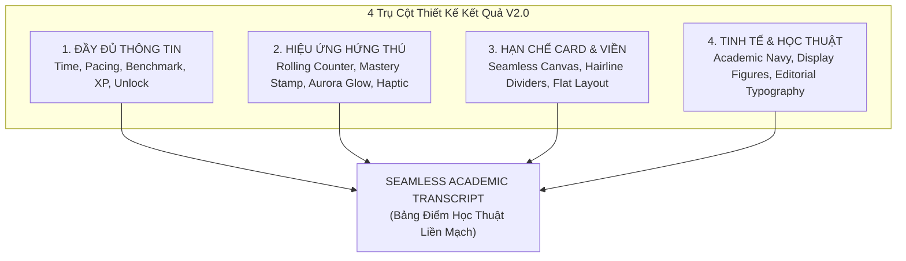

# PHÂN TÍCH UI HIỆN TẠI & ĐỀ XUẤT TÁI THIẾT KẾ TOÀN DIỆN PHÂN HỆ QUIZ (ROLE STUDENT)
## TRỌNG TÂM: ĐỘT PHÁ UI/UX MÀN HÌNH KẾT QUẢ ĐIỂM SỐ — PHONG CÁCH "BẢNG ĐIỂM HỌC THUẬT TINH TẾ" (SEAMLESS ACADEMIC TRANSCRIPT)

> **Dự án:** 40Study Mobile App (`mobile/`)  
> **Phân hệ:** Student Experience — Module Làm bài kiểm tra & Xem kết quả (Quiz Flow)  
> **Tài liệu tham chiếu:**  
> - Mã nguồn Quiz hiện tại: `mobile/lib/features/student/presentation/learning/widgets/quiz/*`  
> - Màn hình kết quả: `mobile/lib/features/student/presentation/learning/quiz_result_screen.dart`  
> - BLoC & Data Layer: `mobile/lib/features/student/bloc/quiz/*`, `mobile/lib/features/student/data/models/*`  
> - Kế hoạch trước đó: `QUIZ_UI_UX_REFINEMENT_AND_RESULT_FIX_PLAN.md`, `QUIZ_MULTIPLE_CHOICE_AND_PERSISTENT_REVIEW_PLAN.md`  
> - Hệ thống Theme & Design Tokens: `mobile/lib/theme/*` (`app_colors.dart`, `style.dart`, `app_spacing.dart`)  
> **Ngày cập nhật:** 28/10/2026 (Phiên bản V2.0 — Chuyên sâu Màn hình Kết quả)  
> **Phạm vi cam kết:** **Nghiên cứu & Đặc tả giải pháp thiết kế UI/UX (Design & Interaction Proposal) — TUYỆT ĐỐI KHÔNG CODE trong bước này**.  

---

## MỤC LỤC
1. [TỔNG QUAN & BỐI CẢNH NÂNG CẤP V2.0](#1-tổng-quan--bối-cảnh-nâng-cấp-v20)
2. [TÔN VINH NỀN TẢNG UX LÀM BÀI: NHỮNG ĐIỂM CHẠM ĐÃ ĐẠT CHUẨN](#2-tôn-vinh-nền-tảng-ux-làm-bài-những-điểm-chạm-đã-đạt-chuẩn)
3. [MỔ XẺ GỐC RỄ: TẠI SAO UI LẠI BỊ NHẬN XÉT LÀ "QUÁ NHỰA"?](#3-mổ-xẻ-gốc-rễ-tại-sao-ui-lại-bị-nhận-xét-là-quá-nhựa)
   - 3.1. [Khái niệm "UI Nhựa" (The Plasticky / Toy-like Syndrome) trong EdTech](#31-khái-niệm-ui-nhựa-the-plasticky--toy-like-syndrome-trong-edtech)
   - 3.2. [6 Triệu chứng thẩm mỹ nhựa trên giao diện làm bài](#32-6-triệu-chứng-thẩm-mỹ-nhựa-trên-giao-diện-làm-bài)
4. [CHUYÊN ĐỀ ĐẶC BIỆT: TÁI THIẾT KẾ ĐỘT PHÁ MÀN HÌNH KẾT QUẢ ĐIỂM SỐ (UI & UX)](#4-chuyên-đề-đặc-biệt-tái-thiết-kế-đột-phá-màn-hình-kết-quả-điểm-số-ui--ux)
   - 4.1. [Bóc tách 4 điểm nghẽn nghiêm trọng của Màn hình Kết quả hiện tại](#41-bóc-tách-4-điểm-nghẽn-nghiêm-trọng-của-màn-hình-kết-quả-hiện-tại)
   - 4.2. [4 Trụ cột Đột phá cho Màn hình Kết quả mới](#42-4-trụ-cột-đột-phá-cho-màn-hình-kết-quả-mới)
     - *Trụ cột 1: Đầy đủ thông tin (Comprehensive Academic Analytics)*
     - *Trụ cột 2: Hiệu ứng gia tăng hứng thú (Emotional Design & Dopamine Hooks)*
     - *Trụ cột 3: Triệt tiêu Card & Viền bo tròn (Seamless Canvas & Editorial Layout)*
     - *Trụ cột 4: Đơn giản, Tinh tế, Học thuật (Simple, Elegant, Academic)*
   - 4.3. [Bản đồ Bố cục Wireframe ASCII: "Bảng điểm Học thuật Liền mạch" (Seamless Academic Transcript)](#43-bản-đồ-bố-cục-wireframe-ascii-bảng-điểm-học-thuật-liền-mạch-seamless-academic-transcript)
   - 4.4. [Đặc tả chi tiết từng Phân khu Chức năng trên Màn hình Kết quả](#44-đặc-tả-chi-tiết-từng-phân-khu-chức-năng-trên-màn-hình-kết-quả)
     - *Phân khu 1: Top Navigation Bar Tối giản & Nút Khoe Thành Tích*
     - *Phân khu 2: Hero Score & Con Dấu Thẩm Định Học Thuật (Mastery Stamp)*
     - *Phân khu 3: Thước đo Chuẩn Học Vụ (Academic Benchmark Line)*
     - *Phân khu 4: Bảng Đo Chỉ Số Không Viền (Frameless Metric Strip: Pacing & Time)*
     - *Phân khu 5: Cột Mốc Mở Khóa Học Phần (Milestone & Next Step Unlock)*
     - *Phân khu 6: Bộ Lọc Phân Tích Bài Thi Tối Giản (Minimalist Review Filter Strip)*
     - *Phân khu 7: Bảng Chi Tiết Bài Làm Dạng Tạp Chí (Editorial Question Review Entries)*
     - *Phân khu 8: Thanh Tác Vụ Đáy Cân Xứng (Balanced Action Dock)*
5. [TỔNG HỢP THIẾT KẾ MÀN HÌNH LÀM BÀI (ACTIVE QUIZ SCREEN)](#5-tổng-hợp-thiết-kế-màn-hình-làm-bài-active-quiz-screen)
   - 5.1. [Header Tinh giản, Monospace Timer & Hairline Progress](#51-header-tinh-giản-monospace-timer--hairline-progress)
   - 5.2. [Thẻ Đáp án Xúc giác Tinh xảo (Tactile Option Cards)](#52-thẻ-đáp-án-xúc-giác-tinh-xảo-tactile-option-cards)
   - 5.3. [Ma trận Câu hỏi Dạng Sơ đồ Chỗ ngồi (Clean Seat-Map Palette)](#53-ma-trận-câu-hỏi-dạng-sơ-đồ-chỗ-ngồi-clean-seat-map-palette)
6. [MA TRẬN ĐỐI CHIẾU TOÀN DIỆN (BEFORE VS. AFTER)](#6-ma-trận-đối-chiếu-toàn-diện-before-vs-after)
7. [LỘ TRÌNH THỰC THI & NGUYÊN TẮC BẢO TOÀN LOGIC (ZERO REGRESSION ROADMAP)](#7-lộ-trình-thực-thi--nguyên-tắc-bảo-toàn-logic-zero-regression-roadmap)

---

## 1. TỔNG QUAN & BỐI CẢNH NÂNG CẤP V2.0

Trong phân hệ Học sinh (**Student Role**) của ứng dụng **40Study Mobile**, tính năng **Quiz (Bài kiểm tra trắc nghiệm)** là mắt xích đánh giá năng lực trọng yếu. Học sinh học xong bài giảng video $\rightarrow$ làm bài quiz $\rightarrow$ đạt điểm yêu cầu ($\ge 70\%$) mới được mở khóa bài học tiếp theo hoặc nhận chứng chỉ hoàn thành.

Gần đây, phân hệ đã có bước tiến về luồng chức năng (UX) khi bổ sung chuyển câu PageView, hỗ trợ trắc nghiệm chọn nhiều đáp án (Multiple Choice), cắm cờ xem lại (Flag for Review) và tích hợp API chi tiết bài thi từ Backend.

Tuy nhiên, **màn hình Kết quả Điểm số (Quiz Result Screen)** hiện tại lại là nơi bộc lộ rõ nhất sự hụt hẫng của người dùng:
1. **Thiếu thông tin phân tích học thuật:** Chỉ hiển thị vẻn vẹn con số % điểm và đếm số câu đúng/sai, không có dữ liệu về thời gian làm bài, nhịp độ trung bình mỗi câu, ngưỡng đạt chuẩn học vụ, hay phần thưởng tiến độ.
2. **Hiệu ứng đơn điệu, không tạo được cảm xúc vinh danh:** Chỉ dùng một `CircularProgressIndicator` vẽ thô dày 12px cùng vài hạt confetti canvas rơi vụn vặt, không tạo được sự tự hào hay kích thích "dopamine học tập" cho học sinh.
3. **Lạm dụng Card & Viền bo tròn quá nhiều (Card Overuse & Pill Fatigue):** Đóng từng mẩu thông tin vào một chiếc hộp chữ nhật bo tròn lơ lửng, viền màu xanh đỏ sặc sỡ, tạo cảm giác rẻ tiền như đồ chơi bằng nhựa (*plasticky / toy-like*).
4. **Thiếu chiều sâu và đẳng cấp học thuật:** Không toát lên sự trang trọng của một bảng điểm hay chứng nhận năng lực quốc tế.

Tài liệu V2.0 này tái thiết kế toàn diện **cả về UI và UX** cho màn hình Kết quả, chuyển đổi từ mô hình *"Hộp lồng trong hộp"* sang **"Bảng điểm Học thuật Liền mạch" (Seamless Academic Transcript)**, đáp ứng trọn vẹn 4 tiêu chí cốt lõi của người dùng:
- **Tiêu chí 1: Đầy đủ thông tin (Comprehensive Academic Analytics).**
- **Tiêu chí 2: Có hiệu ứng gia tăng hứng thú của học sinh (Emotional Design & Dopamine Hooks).**
- **Tiêu chí 3: Hạn chế sử dụng Card, viền bo tròn quá nhiều (Seamless Canvas & Editorial Layout).**
- **Tiêu chí 4: Đơn giản, tinh tế, học thuật (Simple, Elegant, Academic).**

---

## 2. TÔN VINH NỀN TẢNG UX LÀM BÀI: NHỮNG ĐIỂM CHẠM ĐÃ ĐẠT CHUẨN

Quá trình làm bài hiện tại đã xây dựng được một khung tương tác nền tảng đáng tin cậy cần được bảo toàn:
* **Fluid PageView:** Lướt ngang tự nhiên giữa các câu hỏi với `BouncingScrollPhysics`.
* **Phân định rõ Single vs Multiple Choice:** Học sinh hiểu ngay câu nào chọn 1, câu nào chọn nhiều.
* **Cắm cờ câu khó (Flag for Review):** Cho phép đánh dấu câu nghi vấn để kiểm tra lại trước khi nộp.
* **Ma trận câu hỏi (Question Palette):** Xem được trạng thái tổng thể các câu qua Bottom Sheet.
* **Xác nhận nộp bài an toàn:** Có cảnh báo khi còn câu chưa làm hoặc còn câu đang cắm cờ.
* **Đồng bộ bài làm từ Server (`/attempts/:id`):** Dữ liệu câu đúng, câu sai, đáp án chọn và lời giải sư phạm hoàn toàn chính xác.

---

## 3. MỔ XẺ GỐC RỄ: TẠI SAO UI LẠI BỊ NHẬN XÉT LÀ "QUÁ NHỰA"?

### 3.1. Khái niệm "UI Nhựa" (The Plasticky / Toy-like Syndrome) trong EdTech
"UI Nhựa" là thuật ngữ miêu tả giao diện mang lại cảm giác nhân tạo, rẻ tiền và thiếu tinh tế. Nguyên nhân xuất phát từ:
* Lạm dụng các khối bo tròn tuyệt đối (`BorderRadius.circular(999)` - con nhộng/pill).
* Viền (stroke) quá dày (`1.5px - 2.0px`) với màu sắc nguyên bản có độ tương phản gắt gỏng.
* Đổ bóng màu đơn tầng (Colored Harsh Shadows) tạo cảm giác miếng nhựa dán nổi lên trên màn hình.
* Phối màu ngây ngô: Xanh lá, đỏ cờ, vàng cam, tím biếc cùng xuất hiện với độ bão hòa cao.

### 3.2. 6 Triệu chứng thẩm mỹ nhựa trên giao diện làm bài
1. **Hội chứng "Lạm dụng Pill" (Pill Overdose):** 5-6 viên nhộng chen chúc trên đầu câu hỏi (`Câu 1/10`, `Chọn nhiều`, `Đánh dấu`, `04:30`, `1/3`).
2. **Bảng màu xung đột:** Tím `0xFF6D28D9` + Vàng cam `0xFFF59E0B` + Xanh lá `0xFF059669` + Đỏ `0xFFDC2626` tranh giành thị giác.
3. **Thẻ đáp án thô cứng:** Viền xanh dày 2px bao quanh hình chữ nhật, vòng tròn A xanh đặc lặp lại vô nghĩa với icon check xanh ở cuối card.
4. **Hộp lồng trong hộp (Box-in-Box Container Fatigue):** Card tổng viền đỏ dày bọc lấy các card đáp án con viền xanh đỏ.
5. **Score Ring & Stat Cards lỗi thời:** Vòng tròn tiến độ thô 12px cùng các hộp vuông viền màu có icon check méo lệch góc.
6. **Ma trận câu hỏi như bàn cờ lô tô:** Lưới ô vuông màu mè xanh lá - xanh dương - xám dày đặc.

---

## 4. CHUYÊN ĐỀ ĐẶC BIỆT: TÁI THIẾT KẾ ĐỘT PHÁ MÀN HÌNH KẾT QUẢ ĐIỂM SỐ (UI & UX)

Đây là trọng tâm cải tiến lớn nhất của đợt thiết kế này.

### 4.1. Bóc tách 4 điểm nghẽn nghiêm trọng của Màn hình Kết quả hiện tại

```
┌────────────────────────────────────────────────────────┐
│                        KẾT QUẢ HIỆN TẠI               │
│                                                        │
│                    ╭───────────────╮                   │
│                   │      80%        │                  │ <- 1. ScoreCircle thô dày 12px, cúp vàng clip-art
│                    │   Điểm số     │                   │
│                    ╰───────────────╯                   │
│                  Chúc mừng bạn đã đạt!                 │ <- Headline chung chung, thiếu cá nhân hóa
│                                                        │
│             ┌─────────────────────────────┐            │
│             │  (✓)  Đạt yêu cầu (≥70%)    │            │ <- Pill con nhộng lơ lửng
│             └─────────────────────────────┘            │
│                                                        │
│ ┌──────────────┐   ┌──────────────┐   ┌──────────────┐ │
│ │  (✓) Đúng 8  │   │  (✕) Sai 2   │   │  (📋) Tổng 10│ │ <- 2. Ba chiếc hộp nhựa viền màu,
│ └──────────────┘   └──────────────┘   └──────────────┘ │    icon tròn bệt, tick mark lệch góc
│                                                        │
│ ┌────────────────────────────────────────────────────┐ │
│ │ ℹ️ Đang xem: 8 câu trả lời đúng        Xem tất cả  │ │ <- Hộp xám đục
│ └────────────────────────────────────────────────────┘ │
│                                                        │
│ ┌── [CARD TỔNG VIỀN XANH LÁ DÀY 1.2PX] ─────────────┐  │
│ │ Câu 1                                  [✓ Chính xác│ │ <- 3. Thẻ review bị đóng khung dày,
│ │ ┌────────────────────────────────────────────────┐│  │    bên trong lại chứa thêm 4 hộp con
│ │ │ (A) git init       [✓ Bạn đã chọn đúng]        ││  │    viền xanh lá, viền đỏ, viền xám
│ │ └────────────────────────────────────────────────┘│  │
│ └───────────────────────────────────────────────────┘  │
└────────────────────────────────────────────────────────┘
```

1. **Thiếu vắng dữ liệu học thuật quan trọng:**
   - Hoàn toàn không biết học sinh làm bài trong bao lâu (`time_spent_seconds`).
   - Không có nhịp độ làm bài (Tốc độ làm bài mỗi câu: quá nhanh hay đạt chuẩn?).
   - Không hiển thị điểm số theo thang điểm 10 chuẩn học vụ (vd: `8.0 / 10.0`).
   - Không thông báo trạng thái mở khóa học phần tiếp theo (`Next Lesson Unlocked`).
   - Không ghi nhận phần thưởng tiến độ (XP, Streak bảo toàn).
2. **Hiệu ứng "nhạt nhẽo", thiếu cảm xúc vinh danh:**
   - Điểm số hiện cái bụp mà không có chuyển động chạy số (`Rolling Counter`).
   - Confetti vẽ bằng canvas hạt màu nhỏ li ti, không tạo được cảm giác tự hào khi đạt điểm xuất sắc.
3. **Hội chứng "Đóng hộp mọi thứ" (Card Fatigue):**
   - Từ trên xuống dưới là 6-8 chiếc hộp chữ nhật bo góc lơ lửng, mỗi hộp một đường viền màu khác nhau.
4. **Trải nghiệm đọc giải thích ngột ngạt:**
   - Từng câu hỏi bị đóng khung viền đỏ/xanh bao quanh, học sinh muốn đọc lướt các câu sai thì mắt bị cản trở bởi hàng chục đường viền màu mè.

---

### 4.2. 4 Trụ cột Đột phá cho Màn hình Kết quả mới



#### Trụ cột 1: Đầy đủ thông tin (Comprehensive Academic Analytics)
* **Thời gian thực tế & Nhịp độ làm bài (Pacing Intelligence):**
  * Hiển thị chính xác thời gian đã làm: `03:42` (trên tổng thời gian quy định `15:00`).
  * Tốc độ làm bài trung bình: `~22 giây / câu`.
  * Đánh giá nhịp độ học thuật: *"Nhịp độ vững vàng"* (nếu phân bổ đều), *"Làm bài thần tốc"* (nếu nhanh mà điểm cao), hoặc *"Cần đọc kỹ đề hơn"* (nếu làm quá vội dẫn đến sai sót).
* **Thang điểm kép & Ngưỡng đạt chuẩn (Dual Grading & Benchmark):**
  * Thang điểm 10 học thuật: `8.0 / 10.0` đi kèm tỉ lệ phần trăm `80%`.
  * Hiển thị vạch ngưỡng chuẩn học vụ (**Academic Passing Benchmark tại 70%**), chỉ rõ học sinh đã vượt chuẩn bao nhiêu `%`.
* **Cột mốc học vụ & Phần thưởng (Academic Milestones & Rewards):**
  * Trạng thái mở khóa: `✓ Đã mở khóa: Bài học tiếp theo: Kiến trúc State nâng cao`.
  * Tích lũy năng lực: `+50 XP` vào hồ sơ học sinh.
  * Chuỗi chuyên cần: `🔥 Chuỗi 5 ngày học liên tiếp được duy trì!`.
  * Nếu chưa đạt ($< 70\%$): Hiển thị rõ số lượt làm lại còn lại (`Còn 2 lượt làm lại`) kèm gợi ý video cần xem lại.

#### Trụ cột 2: Hiệu ứng gia tăng hứng thú (Emotional Design & Dopamine Hooks)
* **Animated Rolling Score Counter (Đếm số điểm động):**
  * Khi mở màn hình, điểm số không xuất hiện ngay mà chạy mượt mà từ `0.0` lên `8.0` (và `0%` lên `80%`) trong 1.2 giây với đường cong gia tốc `Curves.easeOutExpo`.
  * Hiệu ứng rung xúc giác (`HapticFeedback`): Điện thoại rung nhẹ theo từng nấc điểm số và rung nhấn mạnh (Impact Feedback) khi điểm số vượt qua ngưỡng 70%.
* **Academic Stamp of Mastery (Con dấu Thẩm định Học thuật):**
  * Thay thế cúp vàng hoạt hình bằng **Con dấu thẩm định học thuật danh giá** đóng dập xuống (`Spring animation` nảy nhẹ êm ái):
    * $\ge 90\%$: Con dấu dập chìm `CHỨNG NHẬN XUẤT SẮC` (Tông Gold & Royal Blue).
    * $70\% - 89\%$: Con dấu `ĐẠT YÊU CẦU CHUẨN` (Tông Emerald Green).
    * $< 70\%$: Con dấu `CẦN BỔ SUNG KIẾN THỨC` (Tông Amber Slate).
* **Subtle Aurora Glow (Hào quang học thuật khuếch tán mềm):**
  * Phía sau khối điểm số là một dải hào quang tỏa sáng nhẹ (Radial Ambient Glow), thở nhẹ (`Subtle pulse animation`), tạo cảm giác trang trọng như nhận văn bằng danh dự.
* **Celebration Snapshot (Khoe thành tích học tập):**
  * Nút "Khoe kết quả" ở góc trên cho phép tạo nhanh một tấm thẻ tóm tắt thành tích dạng vé máy bay / card tri thức thanh nhã để học sinh chia sẻ lên nhóm học tập.

#### Trụ cột 3: Triệt tiêu Card & Viền bo tròn (Seamless Canvas & Editorial Layout)
* **Nói KHÔNG với mô hình "Mỗi thông tin là một chiếc hộp chữ nhật viền màu":**
  * Toàn bộ màn hình được thiết kế như một **Trang báo cáo học thuật phẳng (Academic Transcript Page)** trên nền trắng ngà / Slate50 tinh khiết (`#F8FAFC`).
  * Loại bỏ 100% các viền dày 2px, loại bỏ các khối bo tròn con nhộng 999px.
  * Phân tách các phần bằng **Nhịp thở không gian (Whitespace Breathing Room: 20px - 28px)** và **Đường kẻ Hairline mờ 0.6px (`slate200`)**.
* **Bảng Đo Chỉ Số Không Viền (Frameless Metric Strip):**
  * Thay thế 3 chiếc hộp `StatCard` cũ bằng một **Thanh đo 4 chỉ số phẳng**, không đóng viền hộp, ngăn cách bằng vách ngăn dọc siêu mảnh.
* **Bảng Câu hỏi Dạng Tạp chí (Editorial Review Entries):**
  * Danh sách câu hỏi không còn bị đóng khung hộp màu dày. Mỗi câu hỏi là một mục phân tách bằng đường kẻ tóc, số thứ tự câu hiển thị kiểu báo chí: `01.`, `02.` to rõ, thoáng đãng.

#### Trụ cột 4: Đơn giản, Tinh tế, Học thuật (Simple, Elegant, Academic)
* **Bảng màu Hàn lâm:**
  * Chủ đạo: **Academic Royal Blue (`#1E3A8A` / `#2563EB`)** tượng trưng cho tri thức và chiều sâu.
  * Màu đạt chuẩn: **Emerald Muted (`#059669`)**.
  * Màu chữ chính: **Slate 900 (`#0F172A`)**, chữ phụ: **Slate 500 (`#64748B`)**.
  * Màu đường kẻ tóc: **Slate 200 (`#E2E8F0`)**.
* **Typography Đẳng cấp:**
  * Con số điểm to bản uy nghi: **Display Figures 52sp, w800, Monospace Tabular Figures**.
  * Nhãn phụ mục học vụ: Chữ hoa nhỏ, tracking rộng (`letterSpacing: 1.2`, font 10.5sp w700, màu `slate500`).
* **Hộp Giải thích phong cách Notion / GitHub Callout:**
  * Nền `slate50` hoặc `blue50` mỏng, có lề thụt nhẹ bên trái với vạch màu học thuật 2px, giúp mắt tiếp thu kiến thức một cách tự nhiên và thư thái.

---

### 4.3. Bản đồ Bố cục Wireframe ASCII: "Bảng điểm Học thuật Liền mạch" (Seamless Academic Transcript)

```
┌─────────────────────────────────────────────────────────────────┐
│ [✕]                   BÁO CÁO KẾT QUẢ THI                [ ↗ ]  │ <- Top Bar phẳng, nút chia sẻ
│ ─────────────────────────────────────────────────────────────── │ <- Hairline Divider
│                                                                 │
│                      ╭─── AURORA GLOW ───╮                      │
│                      │       8.0 / 10    │                      │ <- Animated Rolling Score (52sp)
│                      │         (80%)     │                      │
│                      ╰───────────────────╯                      │
│                  ╔═══════════════════════════╗                  │
│                  ║  ✓ ĐẠT YÊU CẦU CHUẨN      ║                  │ <- Academic Stamp of Mastery
│                  ╚═══════════════════════════╝                  │    (Con dấu dập nảy nhẹ)
│                                                                 │
│             Chúc mừng bạn đã vượt qua bài kiểm tra!             │ <- Lời nhận xét sư phạm cá nhân hóa
│          Nền tảng kiến thức bài học được nắm vững vàng.         │
│                                                                 │
│   0% ────────────[ Ngưỡng đạt 70% ]────▲─────── 100%           │ <- Academic Benchmark Line (Vượt +10%)
│                                                                 │
│ ─────────────────────────────────────────────────────────────── │ <- Hairline Divider
│                                                                 │
│    THỜI GIAN       TỐC ĐỘ        ĐỘ CHÍNH XÁC     PHẦN THƯỞNG   │ <- FRAMELESS METRIC STRIP:
│      03:42        22s / câu         08 / 10         +50 XP      │    4 Chỉ số phẳng, không viền hộp,
│    Tối đa 15p    Nhịp độ chuẩn     Đúng 80%       🔥 Chuỗi 5 ngày    ngăn cách bằng hairline dọc
│                                                                 │
│ ─────────────────────────────────────────────────────────────── │ <- Hairline Divider
│                                                                 │
│   🔓 BÀI HỌC KẾ TIẾP ĐÃ MỞ KHÓA:                                │ <- Next Milestone Unlock Strip
│   Bài 04: Cấu trúc Widget & State Lifecycle                     │    (Dải thông báo cột mốc học vụ)
│                                                                 │
│ ─────────────────────────────────────────────────────────────── │ <- Hairline Divider
│                                                                 │
│   PHÂN TÍCH CHI TIẾT BÀI LÀM                                    │
│   [ Tất cả (10) ]     [ ✓ Đúng (8) ]     [ ✕ Cần xem lại (2) ]  │ <- Minimalist Segmented Tab
│                                                                 │
│   ───────────────────────────────────────────────────────────   │
│   01.  Đâu là lệnh khởi tạo một Git repository mới?  [✓ Đúng]   │ <- EDITORIAL REVIEW LIST:
│        • A. git init                         (Bạn đã chọn đúng) │    Không card viền màu,
│        ○ B. git start                                           │    dạng trang giấy báo cáo
│        ┌────────────────────────────────────────────────────┐   │
│        │ 💡 Giải thích: Lệnh git init tạo thư mục con .git  │   │ <- Notion-style Academic Footnote
│        └────────────────────────────────────────────────────┘   │
│   ───────────────────────────────────────────────────────────   │
│   02.  Lệnh git nào dùng để xem lịch sử commit?       [✕ Sai]   │
│        ✕ A. git status                        (Bạn đã chọn)     │
│        • B. git log                           (Đáp án chính xác)│
│        ┌────────────────────────────────────────────────────┐   │
│        │ 💡 Giải thích: git log hiển thị toàn bộ commit...  │   │
│        └────────────────────────────────────────────────────┘   │
│                                                                 │
├─────────────────────────────────────────────────────────────────┤
│   [ Làm lại bài kiểm tra ]             [ Tiếp tục học bài 04 > ]│ <- Balanced Action Dock
└─────────────────────────────────────────────────────────────────┘
```

---

### 4.4. Đặc tả chi tiết từng Phân khu Chức năng trên Màn hình Kết quả

#### Phân khu 1: Top Navigation Bar Tối giản & Nút Khoe Thành Tích
* **Leading Action:** Nút `Icons.close_rounded` (36×36px) viền siêu mỏng, bấm để quay về màn hình bài học.
* **Center Title:** Nhãn `BÁO CÁO KẾT QUẢ THI` (12sp, chữ hoa, `letterSpacing: 1.2`, font `FontWeight.w700`, màu `slate500`).
* **Trailing Action:** Icon `Icons.ios_share_rounded` (hoặc `share_outlined`) cho phép chụp nhanh một **Academic Transcript Snapshot** để lưu lại hoặc khoe lên mạng xã hội/nhóm lớp học.

---

#### Phân khu 2: Hero Score & Con Dấu Thẩm Định Học Thuật (Mastery Stamp)
* **Animated Score Counter (Điểm số động):**
  * Hiển thị điểm số to bản: `8.0` (font 52sp, `FontWeight.w800`, màu `brandBlueDark`), bên cạnh là mẫu số `/ 10` (font 22sp, `slate400`).
  * Ngay bên dưới là tỉ lệ phần trăm `(80%)` màu `slate600`.
  * Bộ đếm số tự động nhảy từ `0.0 -> 8.0` trong 1.2 giây khi mở màn hình, đi kèm hiệu ứng nảy nhẹ (`Spring curve`).
* **Subtle Aurora Glow (Hào quang khuếch tán):**
  * Nằm chìm phía sau con số điểm số là một `RadialGradient` mềm mại (bán kính 120px):
    * Khi Đạt ($\ge 70\%$): Gradient từ `Color(0xFF10B981).withOpacity(0.08)` ra trong suốt.
    * Khi Xuất sắc ($\ge 90\%$): Gradient từ `Color(0xFF2563EB).withOpacity(0.1)` ra trong suốt.
    * Khi Chưa đạt ($< 70\%$): Gradient từ `Color(0xFFF59E0B).withOpacity(0.06)` ra trong suốt.
* **Academic Stamp of Mastery (Con dấu thẩm định học thuật):**
  * Thiết kế hình chữ nhật bo góc nhẹ 4px (không dùng bo tròn con nhộng), viền đôi mỏng `1.2px` và `0.6px` phong cách văn bằng đại học:
    * Mức Xuất sắc: Nhãn `★ CHỨNG NHẬN XUẤT SẮC ★` màu `Color(0xFF1D4ED8)`.
    * Mức Đạt: Nhãn `✓ ĐẠT YÊU CẦU CHUẨN` màu `Color(0xFF059669)`.
    * Mức Chưa đạt: Nhãn `⚑ CẦN BỔ SUNG KIẾN THỨC` màu `Color(0xFFD97706)`.
  * Con dấu xuất hiện sau khi bộ đếm số hoàn thành, kèm hiệu ứng dập xuống nảy nhẹ (scale từ 1.15 về 1.0) và rung xúc giác nhẹ (`HapticFeedback.mediumImpact()`).
* **Personalized Pedagogical Feedback (Lời nhận xét sư phạm):**
  * Đoạn nhận xét 2 dòng đúc kết ngắn gọn, ấm áp và định hướng hành động rõ ràng.

---

#### Phân khu 3: Thước đo Chuẩn Học Vụ (Academic Benchmark Line)
* Thay vì chỉ nói "Cần $\ge 70\%$", giao diện hiển thị một **Thanh thước đo chuẩn học vụ mỏng 4px**:
  * Điểm bắt đầu `0%`, điểm kết thúc `100%`.
  * Có một vạch định vị cố định tại mốc `70%` mang nhãn `Chuẩn đạt 70%`.
  * Điểm số của học sinh được đánh dấu bằng một con trỏ tam giác nhỏ `▲` màu xanh tại mốc `80%`, kèm nhãn nhỏ `+10% vượt chuẩn`.
  * Thiết kế này cung cấp cái nhìn trực quan về mức độ an toàn của học sinh so với yêu cầu của khóa học.

---

#### Phân khu 4: Bảng Đo Chỉ Số Không Viền (Frameless Metric Strip: Pacing & Time)
Xóa bỏ hoàn toàn 3 chiếc hộp `StatCard` cũ. Thay thế bằng **Dải đo 4 chỉ số phẳng** trải ngang trên nền trang, ngăn cách nhau bằng các đường kẻ dọc `VerticalDivider(width: 1, thickness: 0.8, color: slate200)`:

```
┌────────────────────────────────────────────────────────────────────────┐
│   THỜI GIAN        TỐC ĐỘ        ĐỘ CHÍNH XÁC        PHẦN THƯỞNG       │
│     03:42         22s / câu         08 / 10            +50 XP          │
│   Tối đa 15p     Nhịp độ chuẩn      Đúng 80%       🔥 Chuỗi 5 ngày    │
└────────────────────────────────────────────────────────────────────────┘
```

1. **Thời gian làm bài:** `03:42` (lấy từ trường `time_spent_seconds` của backend). Phụ đề: `Tối đa 15p`.
2. **Tốc độ làm bài (Pacing):** `22s / câu` (tính bằng thời gian chia cho tổng số câu). Phụ đề: `Nhịp độ chuẩn` (màu xanh ngọc).
3. **Độ chính xác:** `08 / 10`. Phụ đề: `Đúng 80%`.
4. **Phần thưởng học tập:** `+50 XP`. Phụ đề: `🔥 Chuỗi 5 ngày` (ghi nhận chuỗi chuyên cần học tập).

*Toàn bộ 4 cột chỉ số nằm phẳng trực tiếp trên nền trang, không hề có viền hộp bao quanh, tạo cảm giác tinh gọn, hiện đại và đẳng cấp.*

---

#### Phân khu 5: Cột Mốc Mở Khóa Học Phần (Milestone & Next Step Unlock)
* Khi học sinh đạt ($\ge 70\%$):
  * Hiển thị một dải thông báo phẳng:  
    `🔓 BÀI HỌC TIẾP THEO ĐÃ ĐƯỢC MỞ KHÓA` (11sp, w700, màu `brandBlueDark`).  
    `Bài 04: Cấu trúc Widget & State Lifecycle` (14sp, w600, màu `slate800`).
* Khi học sinh chưa đạt ($< 70\%$):
  * Hiển thị:  
    `🔒 BÀI HỌC KẾ TIẾP ĐANG TẠM KHÓA (CẦN ĐẠT ≥ 70%)`  
    `Bạn còn 2/3 lượt làm lại bài kiểm tra này` (kèm gợi ý: *"Hãy xem lại mục 3 trong video bài giảng"*).

---

#### Phân khu 6: Bộ Lọc Phân Tích Bài Thi Tối Giản (Minimalist Review Filter Strip)
* Thay thế băng rôn xám đục cũ bằng **Segmented Tabs phẳng phong cách Apple / Notion**:
  * `[ Tất cả (10) ]` • `[ ✓ Đúng (8) ]` • `[ ✕ Cần xem lại (2) ]`.
* Không có khung viền hộp. Trạng thái tab đang chọn chỉ thể hiện bằng một **Indicator Line mỏng 2.5px** màu xanh dương bên dưới text và chữ đậm hơn (`FontWeight.w700`).

---

#### Phân khu 7: Bảng Chi Tiết Bài Làm Dạng Tạp Chí (Editorial Question Review Entries)
* **Xóa bỏ hoàn toàn hiện tượng Hộp lồng trong Hộp:**
  * Mỗi câu hỏi là một mục biên tập (Editorial Item), ngăn cách nhau bằng đường kẻ ngang mảnh `Divider(height: 1, color: slate200)`.
  * **Đầu đề câu hỏi:** Số thứ tự dạng chữ số to `01.`, `02.` (18sp, `FontWeight.w800`, màu `slate400`) đứng đầu dòng, bên cạnh là nội dung câu hỏi (15.5sp, `FontWeight.w600`, màu `slate900`, line-height 1.4). Góc phải có nhãn text tối giản: `[✓ Đúng]` (màu xanh ngọc) hoặc `[✕ Sai]` (màu đỏ mận).
  * **Các phương án đáp án:**
    * Không đóng khung viền hộp dày cho từng đáp án A, B, C, D!
    * Hiển thị dạng danh sách phẳng sạch sẽ:
      * Phương án đúng: Có dấu chấm tròn xanh `• A. git init` kèm chú thích thanh nhã `(Đáp án chính xác)`.
      * Phương án học sinh chọn sai: Có dấu gạch chéo đỏ `✕ B. git start` kèm chú thích `(Bạn đã chọn)`.
      * Các phương án khác: Hiển thị chữ màu `slate500` bình thường.
  * **Hộp Giải thích Kiến thức (Notion-style Academic Footnote):**
    * Nằm ngay dưới câu hỏi, thụt lề nhẹ vào trong (`padding-left: 12px`), có một đường viền chỉ thị màu xanh học thuật mảnh `2px` ở mép trái (`Border(left: BorderSide(width: 2, color: brandBlue))`).
    * Nền màu `slate50` hoặc `blue50` mỏng nhẹ, icon bóng đèn vàng tinh tế `💡`, chữ màu `slate700` dễ đọc. Học sinh lướt qua đọc kiến thức êm ái như đọc một cuốn cẩm nang công nghệ.

---

#### Phân khu 8: Thanh Tác Vụ Đáy Cân Xứng (Balanced Action Dock)
* Cố định ở đáy màn hình, bề mặt trắng tinh khiết với đường viền trên `0.8px` siêu mỏng:
  * **Nút phụ (Trái):** `Làm lại bài kiểm tra` (Outlined Button, bo góc 10px, màu `slate700`, icon `Icons.replay_rounded`).
  * **Nút chính (Phải):** `Tiếp tục bài học 04 >` (Filled Button màu Academic Royal Blue, bo góc 10px, chữ trắng, icon mũi tên tiến tới).

---

## 5. TỔNG HỢP THIẾT KẾ MÀN HÌNH LÀM BÀI (ACTIVE QUIZ SCREEN)

Bên cạnh đột phá ở màn hình Kết quả, màn hình làm bài cũng được đồng bộ hóa theo ngôn ngữ *Refined Academic Minimalism*:

### 5.1. Header Tinh giản, Monospace Timer & Hairline Progress
* **Monospace Timer Capsule:** Kích thước `74×32px`, nền `slate100`, font số Monospace (`FontFeature.tabularFigures()`) chống giật chữ số khi đếm ngược. Khi dưới 2 phút chỉ đổi màu chữ sang Amber/Coral và viền phát sáng nhẹ (`subtle pulse`), không biến thành khối đỏ chót.
* **Hairline Progress Bar:** Mỏng `2.5px`, dải chuyển sắc nhẹ từ `brandBlueDark` sang `brandBlueLight`.
* **Question Meta Strip:** Bỏ 3 viên pill lơ lửng, thay bằng dòng chữ hoa học thuật nhỏ gọn `CÂU 03 / 10` (11sp `slate500`) + Micro-badge `Chọn nhiều đáp án` tone Indigo Slate thanh nhã + Nút Squircle cắm cờ bookmark ở góc phải.

### 5.2. Thẻ Đáp án Xúc giác Tinh xảo (Tactile Option Cards)
* **Trạng thái mặc định:** Nền trắng sứ tinh khiết, viền Hairline `0.8px` màu `slate200`, bóng mờ khuếch tán siêu nhẹ. Letter Box A, B, C dạng **Squircle 32×32px** nền `slate100`.
* **Trạng thái khi chọn (Active):** Viền xanh `1.2px` màu `brandBlue`, nền phủ `3% Blue Tint`, Letter Box đổi sang nền `brandBlue` chữ trắng. Kèm phản hồi rung nhẹ `HapticFeedback.selectionClick()` và co nhẹ `scale(0.985)`.

### 5.3. Ma trận Câu hỏi Dạng Sơ đồ Chỗ ngồi (Clean Seat-Map Palette)
* Thiết kế lại Bottom Sheet như sơ đồ máy bay hạng thương gia:
  * Ô câu hỏi Squircle `44×44px` nền trắng tinh khiết, viền `0.8px`.
  * Câu đã làm: Đính một **chấm tròn xanh 4px (Indicator Dot)** tinh tế ở đáy ô.
  * Câu cắm cờ: Biểu tượng mini-flag màu vàng hổ phách ở góc trên.
  * Triệt tiêu hoàn toàn cảm giác bàn cờ lô tô sặc sỡ.

---

## 6. MA TRẬN ĐỐI CHIẾU TOÀN DIỆN (BEFORE VS. AFTER)

| Hạng mục so sánh | Giao diện hiện tại (Bị chê "Quá nhựa") | Giao diện đề xuất mới V2.0 (Academic Transcript) | Giá trị trải nghiệm mang lại |
| :--- | :--- | :--- | :--- |
| **Bố cục tổng thể Kết quả** | 6-8 chiếc hộp chữ nhật bo tròn lơ lửng, viền màu xanh đỏ dày cộp | **Bảng điểm phẳng liền khối (Seamless Canvas)**, ngăn cách bằng khoảng trắng và đường kẻ tóc 0.6px | Trang trọng, thanh lịch, chấm dứt hoàn toàn hội chứng "Card Fatigue" |
| **Hiển thị Điểm số** | Hiện cái bụp, vòng tròn `ScoreCircle` dày 12px thô, cúp vàng clip-art | **Animated Rolling Counter 52sp**, dải hào quang tỏa sáng nhẹ, dập con dấu **Mastery Stamp** nảy êm ái | Kích hoạt dopamine, tạo niềm tự hào và cảm xúc thành tựu đích thực |
| **Phân tích Thời gian & Pacing** | Hoàn toàn không có dữ liệu thời gian | Hiển thị chính xác thời gian đã làm (`03:42`), nhịp độ trung bình (`22s / câu`), đánh giá nhịp độ học thuật | Đầy đủ thông tin, giúp học sinh cải thiện phương pháp phân bổ thời gian |
| **Thước đo Chuẩn học vụ** | Chỉ có 1 viên pill con nhộng ghi "≥70%" | **Academic Benchmark Line** trực quan, hiển thị rõ khoảng cách vượt chuẩn (+10%) | Rõ ràng, mang đậm tính đánh giá năng lực học vụ |
| **Thống kê Đúng / Sai** | 3 hộp nhựa viền màu rực rỡ, icon bọc trong hình tròn đặc, tick mark méo góc | **Frameless Metric Strip**: 4 cột chỉ số phẳng không viền (Thời gian, Tốc độ, Độ chính xác, Thưởng XP/Streak) | Tinh tế, hiện đại như các dashboard tài chính/học thuật quốc tế |
| **Cột mốc Mở khóa (Unlock)** | Không hiển thị hoặc chìm khuất | Dải thông báo nổi bật: `Bài học tiếp theo đã mở khóa` + Tên bài học mới | Định hướng hành động tiếp theo tức thì cho học sinh |
| **Bộ lọc câu hỏi Review** | Băng rôn xám đục bọc viền | **Segmented Tabs phẳng** phong cách Apple/Notion với thanh gạch chân 2.5px | Tối giản, thao tác mượt mà không vướng víu |
| **Danh sách câu hỏi Review** | Card tổng viền đỏ dày bọc lấy các card con viền xanh/đỏ dày | **Editorial Review Entries**: Dạng trang báo cáo phân tách bằng đường kẻ tóc, chú thích đúng/sai thanh thoát | Đọc lướt nhanh, tiếp thu kiến thức nhẹ nhàng, không rối mắt |
| **Hộp giải thích sư phạm** | Đóng khung viền xanh dương lơ lửng | **Notion-style Academic Footnote**: Thụt lề nhẹ, vạch chỉ thị học thuật 2px bên trái, font chữ êm mắt | Đọc kiến thức thoải mái như tài liệu học thuật chuẩn mực |
| **Thẻ đáp án khi làm bài** | Viền xanh dày 2px, shadow bệt, tròn A đặc lặp lại với checkmark xanh | Hairline `1.2px`, nền phủ `3% Blue tint`, Squircle Letter Box 32px, haptic rung nhẹ | Sang trọng, cảm giác bấm phím cơ cao cấp |

---

## 7. LỘ TRÌNH THỰC THI & NGUYÊN TẮC BẢO TOÀN LOGIC (ZERO REGRESSION ROADMAP)

### 7.1. Cam kết nguyên tắc bảo toàn (Zero Logic Regression)
1. **Không sửa đổi Data Model & Backend:** Backend Go và các model `QuizSubmitResult`, `QuizReviewItemModel`, `QuizQuestionModel` giữ nguyên vẹn 100%. Mọi thông số mới (`time_spent_seconds`, `percentage`, `is_passed`) đều đã có sẵn trong model từ trước.
2. **Không sửa đổi BLoC Logic:** `QuizBloc`, `QuizEvent`, `QuizState` hoạt động hoàn hảo, chỉ cần truyền thêm `timeSpentSeconds` vào `QuizCompleted` và `QuizResultScreen`.
3. **100% Design Tokens:** Sử dụng bảng màu `TogetherColorsX` trong `mobile/lib/theme/app_colors.dart` và Typography chuẩn của Flutter.

---

### 7.2. Kế hoạch 4 giai đoạn triển khai khi bước vào Coding

```
┌────────────────────────────────────────────────────────────────────────┐
│                        KẾ HOẠCH TRIỂN KHAI 4 GIAI ĐOẠN                │
├────────────────────────────────────────────────────────────────────────┤
│ GIAI ĐOẠN 1: Tái cấu trúc Màn hình Kết quả (QuizResultScreen) - PHẦN 1 │
│ - Xóa bỏ ScoreCircle 12px và 3 hộp StatCard cũ.                       │
│ - Xây dựng Animated Rolling Score Counter (52sp) + Aurora Glow.       │
│ - Tích hợp Academic Stamp of Mastery (Con dấu thẩm định dập nảy nhẹ).  │
│ - Dựng thước đo chuẩn học vụ Academic Benchmark Line (mốc 70%).        │
│                                                                        │
│ GIAI ĐOẠN 2: Tái cấu trúc Màn hình Kết quả - PHẦN 2 (Analytics & List) │
│ - Dựng Frameless Metric Strip 4 cột phẳng (Time, Pacing, Accuracy, XP).│
│ - Thêm dải thông báo mở khóa bài học kế tiếp (Next Step Unlock).       │
│ - Tái thiết kế Editorial Review List (xóa card in card, dùng hairline).│
│ - Xây dựng hộp giải thích Notion-style Footnote với Left Indicator.   │
│                                                                        │
│ GIAI ĐOẠN 3: Tinh lọc Màn hình Làm bài (Active Quiz Screen)            │
│ - Chuẩn hóa AnswerOption với Hairline 0.8px và Squircle Letter Box.    │
│ - Tái tạo Header với Monospace Timer Capsule và Slim 2.5px Progress.   │
│ - Chuyển đổi Question Palette Sheet sang Clean Seat-Map Style.         │
│ - Cập nhật Bottom Dock cân xứng với trigger [ ☷ X/Y ] tại trung tâm.  │
│                                                                        │
│ GIAI ĐOẠN 4: Tinh chỉnh Animation, Haptic & Kiểm thử Toàn diện         │
│ - Tinh chỉnh nhịp đếm Animated Controller và âm phản hồi xúc giác.     │
│ - Kiểm tra Dark Mode toàn diện (tương phản màu slate và hairline).     │
│ - Chạy flutter analyze và kiểm thử trực quan trên Android Emulator.    │
└────────────────────────────────────────────────────────────────────────┘
```

---

## 8. KẾT LUẬN

Bản thiết kế V2.0 đã giải quyết triệt để bài toán: **Lấy màn hình Kết quả điểm số làm trọng tâm đột phá**, đáp ứng trọn vẹn 4 tiêu chí khắt khe:
1. **Đầy đủ thông tin:** Bổ sung trọn vẹn dữ liệu thời gian (`time_spent_seconds`), nhịp độ làm bài mỗi câu, vạch chuẩn đạt 70%, cột mốc mở khóa học phần tiếp theo và phần thưởng chuỗi ngày học.
2. **Gia tăng cảm xúc & hứng thú:** Bộ đếm số điểm động (`Rolling Counter`), con dấu thẩm định học thuật (`Mastery Stamp`), dải hào quang (`Aurora Glow`) và rung xúc giác tạo nên khoảnh khắc vinh danh xứng tầm.
3. **Triệt tiêu "UI nhựa" & Card lạm dụng:** Chuyển dịch toàn diện sang bố cục **Bảng điểm phẳng liền khối (Seamless Canvas)**, dùng đường kẻ hairline và khoảng trắng thở thay vì đóng hộp viền màu.
4. **Đơn giản, tinh tế, học thuật:** Ngôn ngữ thị giác hàn lâm với sắc xanh Academic Royal Blue, font số to bản sắc sảo, mang lại phong thái của một sản phẩm giáo dục chuẩn mực quốc tế.
