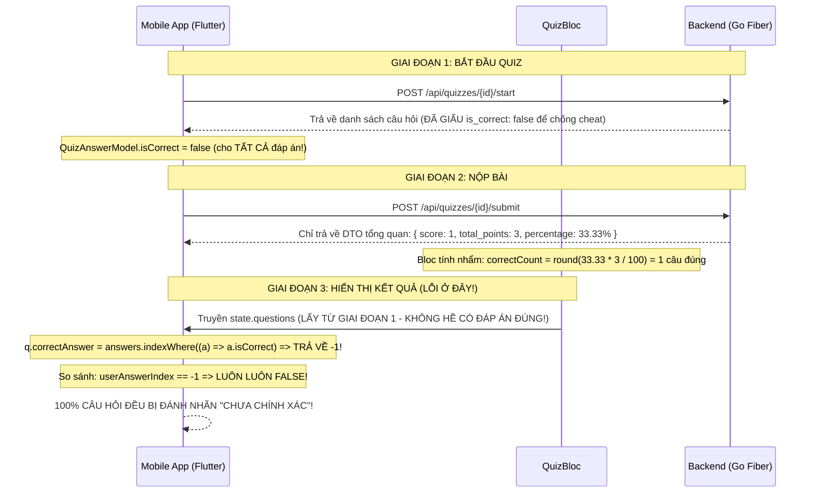

# KẾ HOẠCH NÂNG CẤP UI/UX & CHUẨN HÓA DỮ LIỆU PHÂN HỆ QUIZ (ROLE STUDENT)

> **Dự án:** 40Study Mobile App (`mobile/`)  
> **Phân hệ:** Student Experience — Module Làm bài kiểm tra & Xem kết quả (Quiz Flow)  
> **Tài liệu tham chiếu:**  
> - Mã nguồn Quiz UI: `mobile/lib/features/student/presentation/learning/widgets/quiz/*`  
> - Màn hình kết quả: `mobile/lib/features/student/presentation/learning/quiz_result_screen.dart`  
> - BLoC & Data Layer: `mobile/lib/features/student/bloc/quiz/*`, `mobile/lib/features/student/data/models/*`  
> - Backend Service: `backend/internal/service/quiz_service.go`  
> - Web Reference: `web/src/components/quiz/quiz-attempt-review.tsx`  
> **Ngày lập kế hoạch:** 15/10/2026  
> **Nguyên tắc phạm vi (Scope Boundary):** **100% Mobile Client-Side — Tuyệt đối KHÔNG sửa đổi Backend (`backend/`)**. Backend hiện tại đã có sẵn đầy đủ 100% các API cần thiết (`GET /api/quizzes/{quiz_id}/attempts/{attempt_id}`).  
> **Trạng thái:** Sẵn sàng thực thi (Chưa code)

---

## 🔒 CAM KẾT PHẠM VI (SCOPE BOUNDARY & FEASIBILITY)

**Câu hỏi đặt ra:** *"Chúng ta sẽ không động chạm tới sửa backend, chỉ sửa phần UI/UX. Nếu vậy thì có thể hay không?"*

**Khẳng định:** **HOÀN TOÀN CÓ THỂ, VÀ ĐÂY LÀ PHƯƠNG ÁN TỐI ƯU NHẤT!**

### Lý do kỹ thuật:
1. **Backend Go (`backend/internal/service/quiz_service.go`) ĐÃ CÓ SẴN 100% API:**
   - Endpoint: `GET /api/quizzes/{quiz_id}/attempts/{attempt_id}` đã được hiện thực hoàn chỉnh trên Backend Go, trả về chi tiết từng câu: `is_correct`, `correct_answer_ids`, `selected_answer_ids`, và `explanation`.
   - Phân hệ Web (`web/src/components/quiz/quiz-attempt-review.tsx`) đã và đang dùng chính API này để hiển thị kết quả cho học sinh.
2. **Lỗi hiện tại phát sinh 100% ở tầng Mobile (Flutter):**
   - Phía Mobile sau khi nộp bài đã **quên không gọi** endpoint `getAttemptDetail` này, mà tự tính nhẩm số câu từ % và dùng lại model cũ bị giấu đáp án dẫn tới so sánh với `-1`.
3. **Phân định ranh giới thay đổi:**
   - **Backend (`backend/`):** **GIỮ NGUYÊN 100%**, không cần sửa/thêm bất kỳ controller, service hay database schema nào.
   - **Mobile (`mobile/`):** Tự chủ hoàn toàn từ tầng gọi API có sẵn, xử lý State trong `QuizBloc` cho tới tái thiết kế giao diện UI/UX.

---

## MỤC LỤC
1. [BỐI CẢNH & PHÂN TÍCH HIỆN TRẠNG](#1-bối-cảnh--phân-tích-hiện-trạng)
2. [BÓC TÁCH NGUYÊN NHÂN GỐC RỄ (ROOT CAUSE ANALYSIS)](#2-bóc-tách-nguyên-nhân-gốc-rễ-root-cause-analysis)
   - 2.1. [Vấn đề 1: UI làm bài đơn điệu, thô cứng và nghẽn trải nghiệm](#21-vấn-đề-1-ui-làm-bài-đơn-điệu-thô-cứng-và-nghẽn-trải-nghiệm)
   - 2.2. [Vấn đề 2: Lỗi kiến trúc dữ liệu kết quả (Đúng/Sai lẫn lộn)](#22-vấn-đề-2-lỗi-kiến-trúc-dữ-liệu-kết-quả-đúngsai-lẫn-lộn)
3. [PHƯƠNG ÁN ĐỀ XUẤT CẢI THIỆN CHI TIẾT](#3-phương-án-đề-xuất-cải-thiện-chi-tiết)
   - 3.1. [Cải tiến UI/UX Màn hình làm bài Quiz (Engaging & Fluid Experience)](#31-cải-tiến-uiux-màn-hình-làm-bài-quiz-engaging--fluid-experience)
   - 3.2. [Giải pháp cho bài thi có số lượng câu hỏi lớn (15 - 50 câu)](#32-giải-pháp-cho-bài-thi-có-số-lượng-câu-hỏi-lớn-15---50-câu)
   - 3.3. [Chuẩn hóa luồng Dữ liệu & Tích hợp API Backend Kết quả thật](#33-chuẩn-hóa-luồng-dữ-liệu--tích-hợp-api-backend-kết-quả-thật)
   - 3.4. [Tái thiết kế Màn hình Kết quả (Emotional & Rewarding Result UI)](#34-tái-thiết-kế-màn-hình-kết-quả-emotional--rewarding-result-ui)
4. [BẢNG SO SÁNH TRỰC QUAN (BEFORE VS. AFTER)](#4-bảng-so-sánh-trực-quan-before-vs-after)
5. [LỘ TRÌNH THỰC HIỆN THEO TỪNG GIAI ĐOẠN (ROADMAP)](#5-lộ-trình-thực-hiện-theo-từng-giai-đoạn-roadmap)
6. [TIÊU CHÍ NGHIỆM THU (ACCEPTANCE CRITERIA)](#6-tiêu-chí-nghiệm-thu-acceptance-criteria)

---

## 1. BỐI CẢNH & PHÂN TÍCH HIỆN TRẠNG

Phân hệ Quiz (Bài kiểm tra trắc nghiệm) là mắt xích đánh giá năng lực trọng yếu trong luồng học tập của học sinh trên 40Study Mobile. Học sinh học xong bài giảng video $\rightarrow$ làm quiz $\rightarrow$ đạt điểm yêu cầu ($\ge 70\%$) mới được mở bài tiếp theo hoặc nhận chứng chỉ.

Tuy nhiên, qua ảnh chụp thực tế và phản hồi từ người dùng:
1. **Màn hình làm bài:** Giao diện bị chê là đơn điệu, thô cứng, nặng tính đóng hộp ("card in card"), không tạo được cảm hứng khi số lượng câu hỏi nhiều. Nút điều hướng bị khóa cưỡng chế gây ức chế.
2. **Màn hình kết quả:** Dữ liệu hiển thị đúng/sai bị lẫn lộn nghiêm trọng (Tổng quan báo 1 câu đúng / 2 câu sai, nhưng danh sách chi tiết bên dưới lại đánh nhãn "Chưa chính xác" cho toàn bộ các câu, kể cả câu học sinh đã làm đúng).

---

## 2. BÓC TÁCH NGUYÊN NHÂN GỐC RỄ (ROOT CAUSE ANALYSIS)

### 2.1. Vấn đề 1: UI làm bài đơn điệu, thô cứng và nghẽn trải nghiệm

```
┌────────────────────────────────────────────────────────┐
│ [✕]  Kiểm tra: Cài đặt và cấu hình Git        ⏱ 03:49   │ <- TopBar phẳng, timer nhỏ
├────────────────────────────────────────────────────────┤
│ ┌────────────────────────────────────────────────────┐ │
│ │ 📋 Tiến độ: 0/3 câu                            0%  │ │ <- KHỐI 1: Hộp xám tiến độ
│ │ (1)  (2)  (3)                                      │ │    (Kéo ngang vô tận nếu có 30 câu!)
│ └────────────────────────────────────────────────────┘ │
│                                                        │
│ ┌────────────────────────────────────────────────────┐ │
│ │ [Câu 1 / 3]                                    (?) │ │ <- KHỐI 2: Hộp câu hỏi viền mỏng
│ │ Lệnh nào dùng để khởi tạo một Git repo...?         │ │
│ └────────────────────────────────────────────────────┘ │
│                                                        │
│ ┌────────────────────────────────────────────────────┐ │ <- KHỐI 3, 4, 5...: Mỗi đáp án là
│ │ (A)   git init                                 ( ) │ │    1 hộp trắng viền xám mỏng, radio
│ └────────────────────────────────────────────────────┘ │    button mờ nhạt, thiếu độ nổi xúc giác
│ ┌────────────────────────────────────────────────────┐ │
│ │ (B)   git start                                ( ) │ │
│ └────────────────────────────────────────────────────┘ │
├────────────────────────────────────────────────────────┤
│                     [1/3]                 [-> Câu tiếp]│ <- Bottom bar: Cưỡng chế phải chọn mới cho next
└────────────────────────────────────────────────────────┘
```

1. **Hội chứng "Đóng hộp mọi thứ" (Card Overuse / Container Fatigue):**
   - Từ trên xuống dưới là 5–6 chiếc hộp chữ nhật viền xám rời rạc (`border: Border.all(color: outlineVariant)`). Mắt học sinh bị phân mảnh vào các đường viền thay vì tập trung vào nội dung câu hỏi.
2. **Thiếu cảm giác xúc giác (Tactile Affordance) & Phản hồi giác quan:**
   - Các lựa chọn đáp án A, B, C, D phẳng lì, không có độ đổ bóng phân tầng (elevation). Khi học sinh bấm chọn, chỉ đổi màu viền nhẹ và icon radio, hoàn toàn không có hiệu ứng phồng nhẹ (spring scale) hay rung xúc giác (haptic feedback).
3. **Bế tắc khi số lượng câu hỏi lớn (15 – 50 câu):**
   - `QuizProgress` hiển thị các số `(1) (2) (3)...` theo một thanh cuộn ngang `SingleChildScrollView`. Khi có 30–50 câu, học sinh phải vuốt ngang rất mỏi tay, mất hoàn toàn góc nhìn bao quát bài thi.
   - Không có **Question Palette (Ma trận câu hỏi)** để xem tổng thể câu nào đã làm, câu nào chưa làm.
   - Thiếu tính năng **"Đánh dấu xem lại" (Flag for Review)** — học sinh không thể cắm cờ câu khó để quay lại sau.
4. **Cưỡng chế điều hướng (Anti-pattern UX):**
   - Nút "Câu tiếp" ở BottomBar bị gán `onPressed: null` (vô hiệu hóa) nếu chưa chọn đáp án:
     ```dart
     // quiz_bottom_bar.dart L.86
     onPressed: state.currentAnswer != null ? () => bloc.add(const QuizNextQuestion()) : null,
     ```
   - Học sinh gặp câu khó muốn bỏ qua để làm câu sau thì **BỊ CHẶN**, buộc phải chọn bừa một đáp án hoặc phải với tay bấm trúng vòng tròn số câu bé xíu phía trên.

---

### 2.2. Vấn đề 2: Lỗi kiến trúc dữ liệu kết quả (Đúng/Sai lẫn lộn)

#### Hiện tượng:
- Điểm hiển thị 33% (1 câu đúng, 2 câu sai).
- Nhưng bên dưới, `Câu 1` (học sinh chọn `git init` — đáp án đúng) lại bị đóng khung đỏ với badge **"Chưa chính xác"**!

#### Nguyên nhân kỹ thuật trong mã nguồn:



1. **Lúc bắt đầu làm bài (`POST /api/quizzes/{quizId}/start`):**
   - Backend Go (`quiz_service.go`) giấu toàn bộ đáp án đúng để ngăn chặn học sinh mở Network Inspector để gian lận.
   - Flutter Model parse JSON: `QuizAnswerModel.isCorrect` mặc định nhận giá trị `false`.
2. **Lúc nộp bài (`POST /api/quizzes/{quizId}/submit`):**
   - Backend chỉ trả về kết quả số học tổng quan (`QuizAttemptResponseDTO` gồm: `score`, `total_points`, `percentage`, `is_passed`). Backend **không** trả về chi tiết từng câu trong response này.
3. **Lỗi đứt gãy luồng dữ liệu ở `QuizBloc._onSubmitted`:**
   - Trong `quiz_bloc.dart`:
     ```dart
     // Tính correct count từ percentage (vì backend không gửi is_correct)
     final totalCount = current.questions.length;
     final correctCount = (submitResult.percentage * totalCount / 100).round();
     ```
   - Bloc phát sinh `QuizCompleted` nhưng lại truyền nguyên danh sách `current.questions` cũ từ lúc bắt đầu thi sang `QuizResultScreen`.
4. **Hậu quả tại `QuizResultScreen` và `QuestionReviewCard`:**
   - Trong `quiz_question_model.dart`:
     ```dart
     int get correctAnswer => answers.indexWhere((a) => a.isCorrect); // Luôn trả về -1 !
     ```
   - Trong `question_review_card.dart`:
     ```dart
     bool get isCorrect => userAnswerIndex != null && userAnswerIndex == question.correctAnswer;
     ```
   - Vì `correctAnswer` luôn bằng `-1`, biểu thức `userAnswerIndex == -1` luôn trả về **`false`**.
   - **Do đó, mọi câu hỏi trong bài review đều bị quy kết là "Chưa chính xác"**, bất kể học sinh trả lời đúng hay sai!

> **Minh chứng đối chiếu:** Phiên bản Web (`web/src/components/quiz/quiz-attempt-review.tsx`) sau khi submit luôn gọi tiếp `GET /api/quizzes/:id/attempts/:attemptId`. Endpoint này của Backend Go mới trả về danh sách đầy đủ:
> - `is_correct: boolean` (kết quả chấm thi thực tế)
> - `correct_answer_ids: []` (danh sách ID đáp án đúng)
> - `explanation: string` (giải thích sư phạm chi tiết)
> - `points_earned: number`

---

## 3. PHƯƠNG ÁN ĐỀ XUẤT CẢI THIỆN CHI TIẾT

---

### 3.1. Cải tiến UI/UX Màn hình làm bài Quiz (Engaging & Fluid Experience)

#### Bố cục không gian mở (Open & Focused Layout)
- **Loại bỏ viền đóng hộp của câu hỏi:** Biến câu hỏi thành nội dung trung tâm (Hero Typography: font 18sp, `FontWeight.w700`, line-height 1.45, màu `slate900`), phía trên có Pill gắn tag `Câu X / Y` nền xanh pastel tinh tế.
- **Tái thiết kế Thẻ Đáp án (Tactile Elevation & Depth):**
  - Trạng thái chưa chọn: Nền trắng tinh khôi, bo góc 16px (`AppRadius.borderLg`), viền siêu mảnh `0.8px` màu `slate200`, đổ bóng nhẹ `Offset(0, 2)` tạo độ nổi nhẹ.
  - Vòng tròn ký tự A, B, C, D: Nền xám nhạt `slate100`, chữ in đậm sắc nét.
  - **Trạng thái khi được chọn (Selected):**
    - Nền chuyển sang xanh pastel dịu mát (`#EFF6FF`).
    - Viền chuyển sang màu thương hiệu `Primary Blue` (`#2563EB`) dày `2px`.
    - Đổ bóng chuyển sang hiệu ứng **Glow Blue** nhẹ (`#2563EB` alpha 0.12).
    - Biểu tượng checkmark nổi bật, kèm phản hồi rung nhẹ (**Haptic Feedback** - `HapticFeedback.selectionClick()`).
- **Hỗ trợ thao tác vuốt tự nhiên (Swipe Gestures):**
  - Thay thế `Column` tĩnh bằng `PageView` với chuyển động mượt mà (`Curves.easeInOutCubic`), cho phép học sinh vuốt trái/phải để chuyển câu.

---

### 3.2. Giải pháp cho bài thi có số lượng câu hỏi lớn (15 - 50 câu)

#### 1. Thanh tiến độ Slim Header (Không tốn diện tích)
- Thay thế toàn bộ khối `QuizProgress` cồng kềnh bằng thanh tiến độ mỏng chạy ngang sát mép trên màn hình (`LinearProgressIndicator` cao 4px bo góc).
- Hiển thị ngắn gọn ở TopBar: `12/30 câu` + Đồng hồ đếm ngược với hiệu ứng màu theo mức khẩn cấp:
  - Bình thường: Xanh dương `Primary`
  - Còn $\le 2$ phút: Vàng cam nhấp nháy nhẹ
  - Còn $\le 30$ giây: Đỏ cảnh báo

#### 2. Bảng ma trận câu hỏi (Question Palette Bottom Sheet)
- Bổ sung một icon lưới `Icons.grid_view_rounded` ở góc phải TopBar. Khi chạm vào, mở một Bottom Sheet hiển thị ma trận toàn bộ 30–50 câu hỏi dạng lưới 5 cột:
  - 🔵 **Đang làm:** Viền xanh đậm nổi bật.
  - 🟢 **Đã chọn đáp án:** Nền xanh pastel, chữ xanh đậm.
  - ⚪ **Chưa làm:** Nền xám nhạt `slate100`.
  - 🟡 **Đang cắm cờ xem lại:** Góc có icon cờ vàng cam.
- Học sinh có thể chạm vào bất kỳ ô số nào để nhảy ngay đến câu đó mà không cần vuốt qua từng câu.

#### 3. Tính năng Cắm cờ xem lại (Flag for Review)
- Thêm icon cờ `Icons.bookmark_outline_rounded` ngay cạnh tiêu đề câu hỏi.
- Học sinh có thể gắn cờ cho các câu hỏi đang phân vân.
- Khi bấm "Nộp bài", nếu còn câu hỏi chưa làm hoặc đang cắm cờ, hệ thống sẽ bật modal nhắc nhở thân thiện:
  > *"Bạn còn 2 câu chưa trả lời và 1 câu đang đánh dấu xem lại. Bạn có chắc chắn muốn nộp bài ngay bây giờ?"*

#### 4. Mở khóa điều hướng (Không ép buộc)
- Cho phép bấm "Câu tiếp" hoặc vuốt sang câu sau **kể cả khi chưa chọn đáp án** (hỗ trợ chiến thuật làm câu dễ trước, câu khó sau).
- Ở câu cuối cùng, nút tự động biến thành nút nổi bật màu xanh lục: **"Nộp bài ✔"**.

---

### 3.3. Chuẩn hóa luồng Dữ liệu & Tích hợp API Backend Kết quả thật

#### 1. Bổ sung API Endpoint trong `StudentApiClient`
Khai báo endpoint lấy chi tiết lần làm bài trong `mobile/lib/features/student/data/student_api_client.dart`:
```dart
@GET('/api/quizzes/{quizId}/attempts/{attemptId}')
Future<HttpResponse<dynamic>> getAttemptDetail(
  @Path('quizId') String quizId,
  @Path('attemptId') String attemptId,
);
```

#### 2. Xây dựng DTO/Model chi tiết lần thi
Tạo mới model `QuizAttemptDetailModel` và `QuizAttemptAnswerDetailModel` với đầy đủ các trường:
```dart
class QuizAttemptAnswerDetailModel {
  final String questionId;
  final String questionText;
  final List<String> selectedAnswerIds;
  final List<String> correctAnswerIds;
  final bool isCorrect;
  final double pointsEarned;
  final String? explanation;
  // ...
}
```

#### 3. Cập nhật luồng xử lý trong `QuizBloc._onSubmitted`
```
1. Gọi submitQuiz(quizId, attemptId, answers) -> Nhận kết quả tổng quan
2. Gọi getAttemptDetail(quizId, attemptId) -> Nhận chi tiết từng câu từ DB
3. Emit QuizCompleted(
     score: submitResult.percentage,
     isPassed: submitResult.isPassed,
     attemptDetail: attemptDetailData,
   )
```

#### 4. Sửa logic hiển thị trên `QuestionReviewCard`
- Bỏ hoàn toàn việc so sánh với `question.correctAnswer` (vốn là `-1`).
- Đánh giá trực tiếp dựa trên dữ liệu backend:
  - Nếu `answer.isCorrect == true`: Badge Xanh **"Chính xác"**.
  - Nếu `answer.isCorrect == false`: Badge Đỏ **"Chưa chính xác"**.
  - Nếu `answer.selectedAnswerIds.isEmpty`: Badge Xám **"Chưa trả lời"**.
- So sánh `option.id` nằm trong `correctAnswerIds` để tô màu xanh cho đáp án đúng thật sự.
- Hiển thị hộp **Giải thích sư phạm (Pedagogical Explanation Box)** màu vàng nhạt/xanh nhạt bên dưới mỗi câu:
  > 💡 **Giải thích:** *[Nội dung trường explanation do giáo viên cung cấp]*

---

### 3.4. Tái thiết kế Màn hình Kết quả (Emotional & Rewarding Result UI)

- **Hiệu ứng chúc mừng (Celebration Flow):**
  - Đạt yêu cầu ($\ge 70\%$): Bắn hiệu ứng pháo hoa giấy (**Lottie Confetti** nhẹ nhàng) kèm danh hiệu "Xuất sắc! 🎉".
  - Chưa đạt yêu cầu: Đổi màu dịu nhẹ, hiển thị thông điệp động viên tích cực kèm nút "Ôn tập lại bài giảng" và "Làm lại bài kiểm tra".
- **Bộ lọc kết quả tương tác (Filter Chips):**
  - 3 thẻ thống kê: `Câu đúng`, `Câu sai`, `Tổng câu` được thiết kế có viền highlight rõ rệt khi chọn lọc. Chuyển danh sách bài làm với hiệu ứng mượt mà.

---

## 4. BẢNG SO SÁNH TRỰC QUAN (BEFORE VS. AFTER)

| Tiêu chí | Hiện tại (Trước nâng cấp) | Đề xuất mới (Sau nâng cấp) |
| :--- | :--- | :--- |
| **Bố cục màn hình thi** | 5–6 hộp chữ nhật viền xám đóng khung chồng chất ("card fatigue"). | Bố cục mở thoáng đãng, thẻ câu hỏi Hero nổi bật, loại bỏ viền hộp thừa thãi. |
| **Thẻ lựa chọn đáp án** | Phẳng lì, viền mỏng, radio button mờ nhạt, thiếu độ nảy xúc giác. | Thẻ có độ nổi đổ bóng (elevation), viền phát sáng khi chọn, rung xúc giác (Haptic Feedback). |
| **Bài thi nhiều câu hỏi** | Kéo ngang vô tận dải số câu, không có cách nhìn tổng thể. | Thanh tiến độ Slim Header mỏng nhẹ + Modal **Ma trận câu hỏi** xem toàn diện 30–50 câu. |
| **Tính năng làm bài thi** | Không có cắm cờ, ép buộc phải chọn mới cho bấm Next. | Hỗ trợ cắm cờ xem lại (Flag for Review); Cho phép Next/Skip tự do; Hỗ trợ vuốt Swipe chuyển câu. |
| **Tính chính xác dữ liệu** | Tính nhẩm từ %, `correctAnswer = -1` dẫn đến 100% câu bị báo "Chưa chính xác". | **100% dữ liệu thật** từ API `getAttemptDetail`, phân định chính xác câu đúng, câu sai, câu bỏ qua. |
| **Giá trị học tập sau thi** | Chỉ hiển thị text đúng sai khô khan, không có lời giải thích. | Có hộp **Giải thích chi tiết (Explanation)** từ giảng viên, giúp học sinh hiểu lý do tại sao sai. |
| **Cảm xúc kết quả** | Vòng tròn đỏ khô cứng tạo cảm giác thất bại nặng nề. | Đạt thì vinh danh rực rỡ với Lottie Confetti, chưa đạt thì động viên tích cực kèm hướng dẫn ôn tập. |

---

## 5. LỘ TRÌNH THỰC HIỆN THEO TỪNG GIAI ĐOẠN (ROADMAP)

```
┌────────────────────────────────────────────────────────────────────────┐
│ GIAI ĐOẠN 1: Chuẩn hóa Dữ liệu & Sửa triệt để bug Kết quả (P0)         │
│ • Bổ sung API getAttemptDetail vào Retrofit Client & Repository        │
│ • Cập nhật QuizBloc: Submit -> Fetch attempt detail -> Emit state      │
│ • Sửa QuestionReviewCard: Hiển thị đúng theo is_correct & explanation  │
├────────────────────────────────────────────────────────────────────────┤
│ GIAI ĐOẠN 2: Tái thiết kế UI Làm bài Quiz & Cải thiện tương tác (P1)   │
│ • Thiết kế lại AnswerOption (depth, shadow, tactile affordance)        │
│ • Chuyển sang PageView hỗ trợ swipe gestures                           │
│ • Mở khóa nút Next/Skip, không cưỡng chế khóa nút                      │
├────────────────────────────────────────────────────────────────────────┤
│ GIAI ĐOẠN 3: Nâng cấp trải nghiệm cho bài thi nhiều câu hỏi (P1)       │
│ • Tích hợp Slim Progress Bar trên Header                               │
│ • Xây dựng Bottom Sheet "Ma trận câu hỏi" (Question Palette)           │
│ • Bổ sung tính năng cắm cờ xem lại (Flag for Review)                   │
├────────────────────────────────────────────────────────────────────────┤
│ GIAI ĐOẠN 4: Nâng cấp UI Kết quả & Vi tương tác (P2)                   │
│ • Tích hợp Lottie Confetti chúc mừng khi thi đạt                       │
│ • Bổ sung Haptic Feedback khi chạm chọn đáp án                         │
│ • Viết unit test & widget test kiểm thử toàn diện luồng thi            │
└────────────────────────────────────────────────────────────────────────┘
```

---

## 6. TIÊU CHÍ NGHIỆM THU (ACCEPTANCE CRITERIA)

1. **Khớp dữ liệu 100%:** Khi học sinh làm đúng câu 1 và sai câu 2, màn hình kết quả bắt buộc hiển thị:
   - Thẻ thống kê: `1 Câu đúng`, `1 Câu sai`.
   - Câu 1: Badge Xanh "Chính xác", tô xanh đáp án `git init`.
   - Câu 2: Badge Đỏ "Chưa chính xác", tô đỏ đáp án học sinh chọn và tô xanh đáp án đúng của đề bài.
   - Hiển thị đúng lời giải thích từ trường `explanation` của câu hỏi.
2. **Không còn dữ liệu tính nhẩm/giả định:** Mọi thông tin câu đúng, sai, điểm số, và lời giải thích đều được lấy trực tiếp từ API backend `GET /api/quizzes/{id}/attempts/{attemptId}`.
3. **Thao tác mượt mà & tự do:**
   - Học sinh có thể vuốt qua lại giữa các câu hỏi bằng cử chỉ ngón tay.
   - Có thể bấm Next để bỏ qua câu chưa làm mà không bị disable nút.
   - Có thể mở Ma trận câu hỏi để kiểm tra toàn bộ trạng thái bài thi trước khi bấm nộp bài.
4. **Hiệu ứng & Thị giác:** Thẻ đáp án có phản hồi xúc giác rõ ràng; màn hình kết quả đạt điểm chuẩn có animation vinh danh tích cực.

---
*Tài liệu được lưu trữ tại `mobile/docs/insight_UI_student/QUIZ_UI_UX_REFINEMENT_AND_RESULT_FIX_PLAN.md` để làm căn cứ triển khai trực tiếp trên mã nguồn.*
