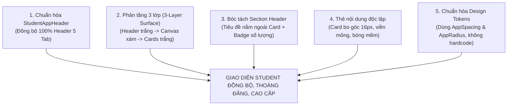

# KẾ HOẠCH NÂNG CẤP GIAO DIỆN ROLE STUDENT (STUDENT UI REFACTOR PLAN)

> **Dự án:** 40Study Mobile App (`mobile/`)  
> **Nhánh thực hiện:** `tung/refactor_UI_Student`  
> **Tài liệu căn cứ:**  
> - Báo cáo phân tích đối chiếu: `mobile/docs/insight_UI_student/UI_STYLE_COMPARISON_STUDENT_VS_PARENT.md`  
> - Tiêu chuẩn phong cách tham chiếu: Phân hệ Phụ huynh V2.0 (`mobile/lib/features/parent/*`, `mobile/docs/UI-Parent-plan/*`)  
> - Hệ thống Design Tokens: `mobile/lib/theme/*`  
> **Ngày lập kế hoạch:** 09/10/2026  
> **Nguyên tắc bất biến:** **TUYỆT ĐỐI KHÔNG THAY ĐỔI LOGIC XỬ LÝ & LOAD DATA** (Giữ nguyên 100% Bloc, Cubit, Event, State, Repository, API Service, luồng navigate, models). Chỉ tập trung tối ưu hóa thẩm mỹ, bố cục bề mặt (Layering), tính nhất quán của Header, sự thoáng đãng của các Card và quy chuẩn Design Tokens.

---

## MỤC LỤC
1. [MỤC TIÊU & PHẠM VI CAM KẾT (OBJECTIVES & BOUNDARIES)](#1-mục-tiêu--phạm-vi-cam-kết-objectives--boundaries)
2. [CÁC NGUYÊN TẮC CẢI TIẾN STYLE CỐT LÕI (CORE STYLE PILLARS)](#2-các-nguyên-tắc-cải-tiến-style-cốt-lõi-core-style-pillars)
3. [KẾ HOẠCH CHI TIẾT THEO TỪNG MÀN HÌNH (SCREEN-BY-SCREEN DETAILED PLAN)](#3-kế-hoạch-chi-tiết-theo-từng-màn-hình-screen-by-screen-detailed-plan)
   - [3.0. Shell Điều Hướng & Component Dùng Chung (`StudentShell` & `StudentAppHeader`)](#30-shell-điều-hướng--component-dùng-chung-studentshell--studentappheader)
   - [3.1. Tab Trang Chủ (`HomeScreen`)](#31-tab-trang-chủ-homescreen)
   - [3.2. Tab Học Tập (`LearningScreen` & Sub-screens)](#32-tab-học-tập-learningscreen--sub-screens)
   - [3.3. Tab Lịch Học (`ScheduleScreen` & `DailyGoalsScreen`)](#33-tab-lịch-học-schedulescreen--dailygoalsscreen)
   - [3.4. Tab Thành Tích (`AchievementScreen`)](#34-tab-thành-tích-achievementscreen)
   - [3.5. Tab Tài Khoản (`ProfileScreen`)](#35-tab-tài-khoản-profilescreen)
   - [3.6. Màn Hình Chi Tiết Khóa Học & Bài Học (`CourseDetailScreen`, `LessonDetailScreen`)](#36-màn-hình-chi-tiết-khóa-học--bài-học-coursedetailscreen-lessondetailscreen)
4. [QUY CHUẨN XỬ LÝ TRẠNG THÁI EMPTY DATA TOÀN DIỆN (COMPREHENSIVE EMPTY DATA SPECIFICATION)](#4-quy-chuẩn-xử-lý-trạng-thái-empty-data-toàn-diện-comprehensive-empty-data-specification)
5. [LỘ TRÌNH THỰC HIỆN THEO TỪNG GIAI ĐOẠN (IMPLEMENTATION PHASES)](#5-lộ-trình-thực-hiện-theo-từng-giai-đoạn-implementation-phases)
6. [CHECKLIST NGHIỆM THU AN TOÀN (VERIFICATION & SAFETY CHECKLIST)](#6-checklist-nghiệm-thu-an-toàn-verification--safety-checklist)

---

## 1. MỤC TIÊU & PHẠM VI CAM KẾT (OBJECTIVES & BOUNDARIES)

### 1.1. Mục tiêu
Đưa phong cách giao diện của phân hệ **Student** đạt cùng đẳng cấp thiết kế và độ hoàn thiện như phân hệ **Parent V2.0**:
* **Nhất quán tuyệt đối về Header:** Loại bỏ hiện tượng lệch chuẩn kích thước, giật layout khi chuyển tab giữa Trang chủ và các Tab chức năng.
* **Phân tầng thị giác cao cấp (High-Contrast 3-Layer Surface):** Header trắng $\rightarrow$ Nền Canvas xám dịu $\rightarrow$ Các Thẻ nội dung (Cards) màu trắng độc lập, viền mảnh và đổ bóng mềm.
* **Bóc tách Section Header ra khỏi Card:** Tiêu đề mục nằm bên ngoài card, tạo độ mở và nhịp thở thị giác thoáng đãng (*Visual Breathing Room*).
* **Chuẩn hóa Design Tokens:** Loại bỏ hoàn toàn các giá trị hardcoded (margin, padding, border radius, colors tùy tiện), đồng bộ hóa với hệ thống token `AppSpacing`, `AppRadius`, `AppShadows`.

### 1.2. Phạm vi cam kết nghiêm ngặt (Strict Boundaries)
```
┌────────────────────────────────────────────────────────────────────────┐
│                        CAM KẾT PHẠM VI AN TOÀN                         │
├────────────────────────────────────────────────────────────────────────┤
│  ✅ ĐƯỢC PHÉP THAY ĐỔI:                                                │
│  - Cấu trúc layout widget (Scaffold, Column, ListView, Container...).  │
│  - Thuộc tính màu sắc, decoration, border, borderRadius, shadows.      │
│  - Typography (font size, weight, line-height, letterSpacing).         │
│  - Khoảng cách (padding, margin, gap thông qua AppSpacing).             │
│  - Tách widget con để tái sử dụng, cải thiện code readability.        │
│  - Tinh chỉnh giao diện Loading Skeleton & Empty State.               │
├────────────────────────────────────────────────────────────────────────┤
│  ❌ TUYỆT ĐỐI KHÔNG ĐƯỢC THAY ĐỔI:                                    │
│  - Logic Bloc / Cubit: KHÔNG sửa luồng Event, State, BlocConsumer/     │
│    BlocBuilder. Giữ nguyên toàn bộ switch-case pattern hiện tại.      │
│  - API Calls & Data Flow: Giữ nguyên 100% Repository, Service, Models. │
│  - Navigation Arguments & Callbacks: Giữ nguyên tham số truyền nhận.   │
│  - Format dữ liệu nghiệp vụ: Không can thiệp vào các logic tính toán   │
│    điểm số, tiến độ hay thời gian của Backend.                         │
└────────────────────────────────────────────────────────────────────────┘
```

---

## 2. CÁC NGUYÊN TẮC CẢI TIẾN STYLE CỐT LÕI (CORE STYLE PILLARS)

Kế thừa trực tiếp từ bài học thành công của Parent UI V2.0, phân hệ Student sẽ tuân thủ 5 nguyên tắc style:



1. **Chuẩn hóa `StudentAppHeader`:** Xây dựng widget header chuẩn mực dùng chung cho các màn hình Tab chính. Có icon chức năng tròn pastel, danh mục chữ hoa nhỏ (`HỌC PHẦN & KHÓA HỌC`, `LỊCH HỌC CỦA BẠN`), tiêu đề 18-20sp w700, chuông thông báo có badge đỏ và avatar có tooltip.
2. **Phân tầng 3 lớp bề mặt (3-Layer Surface):**
   * **Lớp 1 (Header):** Nền trắng `#FFFFFF` hoặc trong suốt phẳng.
   * **Lớp 2 (Canvas):** Nền canvas xám dịu `surfaceBg` (`Color.alphaBlend(cs.primary.withValues(alpha: 0.045), cs.surfaceContainer)` hoặc `#F8FAFC`).
   * **Lớp 3 (Cards):** Các card nội dung nền trắng `#FFFFFF` nổi trên nền canvas xám dịu, viền mảnh `outlineVariant` (0.8px) và shadow nhẹ.
3. **Bóc tách Section Header ra khỏi Card:** Không nhét Section Title vào trong một chiếc card khổng lồ đóng kín. Đưa Section Title ra bên ngoài, có icon nhận diện và badge số lượng rõ ràng.
4. **Thẻ độc lập theo ca & theo môn:** Mỗi ca học trong ngày, mỗi bài tập, mỗi khóa học là một Card độc lập. Khối thời gian học có nền riêng biệt (Online: pastel xanh `Color(0xFFEFF6FF)`; Offline: slate pastel).
5. **Đồng bộ hóa Design Tokens:** Thay thế toàn bộ padding/margin thủ công bằng `AppSpacing` (`AppSpacing.screenPadding`, `AppSpacing.md`, `AppSpacing.vGap20`).

---

## 3. KẾ HOẠCH CHI TIẾT THEO TỪNG MÀN HÌNH (SCREEN-BY-SCREEN DETAILED PLAN)

---

### 3.0. Shell Điều Hướng & Component Dùng Chung (`StudentShell` & `StudentAppHeader`)

#### A. Hiện trạng & Nhược điểm cần khắc phục:
* `StudentShell` đang bọc `HomeScreen`, `LearningScreen`, `ScheduleScreen`, `AchievementScreen`, `ProfileScreen`.
* `HomeScreen` tự vẽ `AppBar` chuẩn kèm icon Menu Drawer. Trong khi `LearningScreen` và `ScheduleScreen` lại dùng `TabScreenHeader` riêng lẻ. Khi người dùng bấm chuyển tab ở thanh dưới, phần đỉnh màn hình bị nhảy giật chiều cao (từ 56dp của AppBar sang 80dp+ của TabScreenHeader).
* `AppDrawer` đã hoạt động tốt với dữ liệu `AuthBloc`, cần giữ nguyên.

#### B. Giải pháp cải tiến Style:
1. **Tạo Component mới `StudentAppHeader`** tại `lib/features/student/presentation/widgets/student_app_header.dart` (mô phỏng theo chuẩn `ParentAppHeader`):
   * Hỗ trợ các thuộc tính:
     * `icon`: IconData nhận diện phân hệ (vd: `Icons.school_rounded`, `Icons.calendar_month_rounded`, `Icons.emoji_events_rounded`).
     * `categoryLabel`: Nhãn chữ hoa nhỏ (vd: `'40STUDY LEARNING'`, `'LỊCH HỌC & THỜI KHÓA BIỂU'`).
     * `title`: Tiêu đề chính màn hình (vd: `'Khóa học của tôi'`, `'Lịch hôm nay'`).
     * `onDrawerTap`: Mở Drawer khi cần.
     * `onNotificationTap`: Chuyển đến màn hình thông báo.
     * `onAvatarTap`: Chuyển đến tab Tài khoản.
     * `trailing`: Widget tùy chọn (vd nút tìm kiếm).
   * Kích thước chuẩn: Chiều cao padding cố định `fromLTRB(AppSpacing.lg, AppSpacing.sm, AppSpacing.lg, AppSpacing.md)`.
2. **Đồng bộ `StudentShell`:**
   * Giữ nguyên `PageView`, `NavigationBar` 5 tabs và toàn bộ `BlocProvider`.
   * Thêm border mỏng trên đỉnh `NavigationBar` (`BorderSide(color: cs.outlineVariant)`), đổ bóng mềm `BoxShadow(color: cs.shadow.withValues(alpha: 0.04), blurRadius: 16, offset: Offset(0, -3))`.

---

### 3.1. Tab Trang Chủ (`HomeScreen`)

#### A. Hiện trạng:
* Sử dụng `AppBar` chuẩn 56dp.
* Phần body chia làm 2 khúc: Lời chào + `TodaySummary` + `ContinueLearningCard` nằm ở trên; bên dưới bọc toàn bộ các section trong một `Container` bo góc lớn `BorderRadius.vertical(top: Radius.circular(28))` màu xám.
* Cách thiết kế này khiến màn hình bị "đóng hộp", phân cách cứng nhắc và không tận dụng được toàn bộ chiều sâu của canvas.

#### B. Kế hoạch Refactor Style (Giữ 100% logic `HomeBloc` & `AchievementBloc`):
1. **Header & Lời chào:**
   * Thay thế `AppBar` hiện tại bằng `StudentAppHeader`:
     * Icon: `Icons.local_fire_department_rounded` hoặc `Icons.school_rounded` màu xanh `blue600` trên nền tròn pastel `Color(0xFFEFF6FF)`.
     * Category: `'HỌC VIÊN 40STUDY'`.
     * Title: Lời chào tự động theo giờ + tên thật (`${_greeting()}, ${_firstName(widget.userName)}`).
     * Actions: Nút chuông thông báo (có badge chấm đỏ khi có thông báo) và Avatar bo tròn có viền mỏng.
2. **Loại bỏ Container cong nguyên khối (De-boxing):**
   * Chuyển toàn bộ `ListView` hoặc `CustomScrollView` của màn hình chạy trên nền canvas dịu `surfaceBg` (`Color.alphaBlend(cs.primary.withValues(alpha: 0.045), cs.surfaceContainer)`).
   * Không bọc section vào một khối hộp cong lớn nữa; để các section hiển thị nối tiếp nhau với khoảng cách `AppSpacing.vGap24`.
3. **Nâng cấp Thẻ Tóm tắt hôm nay (`TodaySummary`):**
   * Đặt trên nền trắng `Colors.white`, bo góc `AppRadius.borderLg` (16px), viền mảnh `outlineVariant`.
   * Tách 2 cột thông tin rõ ràng: Ca học hôm nay (icon xanh dương) và Bài tập cần nộp (icon cam/đỏ cảnh báo nếu có bài tồn).
4. **Nâng cấp Thẻ Tiếp tục học (`ContinueLearningCard`):**
   * Thumbnail khóa học bo góc 12px, tỷ lệ 16:9 sắc nét.
   * Thanh tiến độ học tập: Gradient xanh primary, bo tròn hai đầu (capsule progress bar).
   * Nút "Học tiếp" dạng `FilledButton` bo tròn mềm mại, icon play nổi bật.
5. **Bóc tách các Section Header ra ngoài Card:**
   * **Mục Lịch học hôm nay:**
     * Section Header: Icon lịch + Chữ `'LỊCH HỌC HÔM NAY'` (w700, 14sp uppercase) + Badge số lượng (`state.scheduleItems.length`) + nút `'Xem tất cả'`.
     * Từng ca học bên dưới là một Card trắng độc lập, có khối thời gian riêng (Online = nền xanh pastel; Offline = nền xám), tag giáo viên và link vào học.
   * **Mục Mục tiêu hôm nay (`DailyGoals`):**
     * Section Header: Icon cờ mục tiêu + Chữ `'MỤC TIÊU HÔM NAY'` + Nút thêm/xem tất cả.
     * Các item mục tiêu hiển thị dạng checklist card độc lập có checkbox tròn hiện đại.
   * **Mục Bài tập cần nộp (`Assignments`):**
     * Section Header: Icon bài nộp + Chữ `'BÀI TẬP CẦN NỘP'` + Badge số lượng.
     * Thẻ bài tập hiển thị rõ hạn nộp (nếu quá hạn: badge đỏ; nếu còn hạn: badge cam/xanh).
   * **Mục Thành tích nổi bật:**
     * Card thành tích tóm tắt streak ngọn lửa và coin dạng card phẳng thanh thoát.

---

### 3.2. Tab Học Tập (`LearningScreen` & Sub-screens)

#### A. Hiện trạng:
* Đang dùng `TabScreenHeader` với text "Learning" tiếng Anh không đồng nhất với các tab tiếng Việt khác.
* Khóa học của tôi (`MyCourseCard`) nằm trong horizontal scroll view nhưng card hơi thấp, thanh tiến độ nhỏ.
* Nền trang phẳng lì, chưa có sự tách biệt rõ giữa canvas và card.

#### B. Kế hoạch Refactor Style (Giữ 100% logic `LearningBloc`):
1. **Header:**
   * Dùng `StudentAppHeader`:
     * Icon: `Icons.menu_book_rounded` (nền tròn pastel).
     * Category: `'HỌC PHẦN & KHÓA HỌC'`.
     * Title: `'Học tập của tôi'`.
     * Trailing: Icon tìm kiếm (`Icons.search_rounded`) để mở `SearchScreen`.
2. **Nền trang:**
   * Áp dụng `surfaceBg` đồng nhất với Trang chủ.
3. **Khối Khóa học của tôi (My Courses):**
   * Section Header nằm ngoài: `'KHÓA HỌC ĐANG HỌC'` + Badge số lượng khóa học active + Nút `'Xem tất cả'` dẫn tới `AllCoursesScreen`.
   * Refactor `MyCourseCard`:
     * Tăng chiều cao card lên ~240dp để hiển thị thoải mái.
     * Bổ sung tag thể loại/danh mục nhỏ trên góc ảnh thumbnail.
     * Thanh tiến độ (Progress Indicator) dày hơn (6dp), có nhãn `% hoàn thành` đặt ngay cạnh.
     * Hiển thị bài học tiếp theo cần học (`Tiếp tục: Bài 3 - Widget cơ bản`).
4. **Hàng Chip lọc danh mục (`FilterChipsRow`):**
   * Bỏ style chip xám cũ; chuyển sang chip bo tròn `Capsule` (cao 38dp, touch target thoáng).
   * Trạng thái Active: Nền xanh thương hiệu `cs.primary` hoặc `blue600`, chữ trắng đậm.
   * Trạng thái Inactive: Nền trắng, viền mảnh `outlineVariant`, chữ `slate700`.
5. **Gợi ý Khóa học (`RecommendationCard`):**
   * Thiết kế dạng thẻ danh thiếp khóa học nằm dọc hoặc ngang: Nổi bật giảng viên, đánh giá sao (Rating bar vàng), số lượng bài học và mức độ (Cơ bản/Nâng cao).
6. **Màn hình phụ liên quan:**
   * `AllCoursesScreen`: Danh sách khóa học dạng Grid 2 cột hoặc List dọc; Card trắng bo góc 16px, có bộ lọc tab (Đang học / Đã xong).
   * `ExploreCoursesScreen`: Header chuẩn, banner khóa học nổi bật dạng carousel bo góc lớn.

---

### 3.3. Tab Lịch Học (`ScheduleScreen` & `DailyGoalsScreen`)

#### A. Hiện trạng:
* `ScheduleScreen` đang bọc phần timeline ca học trong một `Container` cong lớn nửa dưới, tương tự `HomeScreen`.
* Lịch tháng `CalendarWidget` nền phẳng chưa tạo được điểm nhấn khối.
* Ngày rảnh `FreeDay` là một text đơn giản, chưa mang lại trải nghiệm thị giác tích cực.

#### B. Kế hoạch Refactor Style (Giữ 100% logic `ScheduleBloc`):
1. **Header:**
   * Dùng `StudentAppHeader`:
     * Icon: `Icons.calendar_month_rounded`.
     * Category: `'THỜI KHÓA BIỂU & NHIỆM VỤ'`.
     * Title: `'Lịch học'`.
     * Trailing: Icon chuyển nhanh đến `DailyGoalsScreen`.
2. **Quyển lịch (Calendar Block):**
   * Đặt quyển lịch bên trong một **Card trắng nổi bật** (`AppRadius.borderLg`, viền mỏng `outlineVariant`, shadow nhẹ).
   * Ngày hôm nay (`Today`): Vòng tròn viền xanh nổi bật.
   * Ngày được chọn (`SelectedDate`): Nền xanh tròn `cs.primary`, chữ trắng đậm.
   * Ngày có lịch học: Chấm tròn xanh pastel nhỏ bên dưới số ngày.
3. **Bóc tách khu vực Ca học trong ngày:**
   * Xóa bỏ Container cong lớn nửa dưới; đặt các ca học trực tiếp trên nền `surfaceBg`.
   * **Thanh tiêu đề ngày (`SelectedDateHeader`):**
     * Format tiếng Việt chuẩn mực: `Thứ [2-CN], [Ngày] Th[Tháng]` (vd: `Thứ Năm, 09 Th10`).
     * Badge số ca học: `2 ca học hôm nay`.
   * **Thẻ Ca học độc lập:**
     * Thay vì vạch timeline liên tục dính liền, chuyển mỗi ca học thành **1 Card trắng độc lập**:
       * Cột thời gian bên trái: Nền xanh pastel `Color(0xFFEFF6FF)` cho ca Online; nền xám cho ca Offline. Hiển thị giờ (`14:00`) + thời lượng (`60p`).
       * Cột nội dung: Tên môn học, tên giảng viên, mã phòng học hoặc nút `"Vào lớp"` nổi bật.
4. **Refactor Trạng thái ngày nghỉ (`FreeDay`):**
   * Card nền trắng hoặc xanh ngọc pastel, icon thư giãn (tách cà phê / quyển sách mở), tiêu đề *"Hôm nay bạn không có lịch học"*, mô tả *"Hãy dành thời gian tự ôn tập hoặc thư giãn nhé!"*.

---

### 3.4. Tab Thành Tích (`AchievementScreen`)

#### A. Hiện trạng:
* Đã có các component: `OverviewStatistics`, `RecentBadges`, `CertificateCarousel`, `ContributionGrid`, `LearningTrendChart`.
* Tuy nhiên các card còn khá phẳng, bố cục dồn dập, màu sắc chưa tối ưu theo semantic gamification.

#### B. Kế hoạch Refactor Style (Giữ 100% logic `AchievementBloc`):
1. **Header:**
   * Dùng `StudentAppHeader`:
     * Icon: `Icons.emoji_events_rounded` (màu vàng kim trên nền vàng nhạt `Color(0xFFFEF3C7)`).
     * Category: `'RÈN LUYỆN & DANH HIỆU'`.
     * Title: `'Bảng thành tích'`.
2. **Nâng cấp Khối 4 Chỉ số Tổng quan (`OverviewStatistics`):**
   * Grid 2x2 hoặc hàng ngang gồm 4 Card trắng bo góc 16px:
     * Streak ngày học: Icon ngọn lửa cam `brandOrange`, số ngày in đậm 24sp.
     * Số giờ học: Icon đồng hồ xanh dương, định dạng giờ học.
     * Bài tập hoàn thành: Icon checklist xanh lá, số bài nộp.
     * Điểm trung bình / Coin: Icon cúp vàng / xu vàng.
3. **Nâng cấp Huy hiệu gần đây (`RecentBadges`):**
   * Section Header ngoài card: `'HUY HIỆU ĐÃ ĐẠT'` + Nút xem tất cả.
   * Thẻ huy hiệu có hiệu ứng chiều sâu (*Depth Effect*): Icon huy hiệu vector nổi bật, khung viền vàng/đồng mảnh, nhãn tên huy hiệu rõ ràng.
4. **Nâng cấp Băng chuyền Chứng chỉ (`CertificateCarousel`):**
   * Khung chứng chỉ thiết kế như một bản preview thu nhỏ: Viền đôi trang trọng, con dấu chứng nhận, nút xem chi tiết hoặc tải về PDF.
5. **Biểu đồ đóng góp & Xu hướng (`ContributionGrid`, `LearningTrendChart`):**
   * Bọc trong Card trắng độc lập, tiêu đề biểu đồ rõ ràng, màu các ô đóng góp phân cấp độ xanh từ nhạt đến đậm mượt mà.

---

### 3.5. Tab Tài Khoản (`ProfileScreen`)

#### A. Hiện trạng:
* Sử dụng `ProfileCard` cho thông tin cá nhân.
* Danh sách cài đặt bọc trong container, style menu khá cơ bản.

#### B. Kế hoạch Refactor Style (Giữ 100% logic `ProfileCubit` & `AuthBloc`):
1. **Thẻ Profile Hero (`ProfileCard`):**
   * Đặt trên nền trắng độc lập hoặc gradient xanh nhẹ sang trọng.
   * Avatar kích thước lớn 72x72 có viền mỏng trắng bao quanh.
   * Huy hiệu vai trò: Chip nhỏ `'Học viên'` nền xanh pastel chữ xanh đậm.
   * Nút chỉnh sửa hồ sơ bo tròn nhẹ nhàng.
2. **Nhóm Cài đặt & Chức năng (Grouped Settings Cards):**
   * Gom các menu thành từng nhóm Card bo góc 16px riêng biệt (theo chuẩn iOS / Modern Android):
     * **Nhóm 1 - Học tập & Portfolio:** Portfolio cá nhân, Khóa học đã lưu (Bookmarks), Ghi chú của tôi.
     * **Nhóm 2 - Hệ thống & Tài khoản:** Thông tin bảo mật, Cài đặt thông báo, Trung tâm trợ giúp.
     * **Nhóm 3 - Đổi vai trò & Đăng xuất:** Nút chuyển đổi vai trò (nếu có role khác) và Nút Đăng xuất chữ đỏ cảnh báo.
   * Mỗi item menu có icon vuông bo góc nền pastel riêng biệt, text đậm vừa, mũi tên chevron xám thanh mảnh.

---

### 3.6. Màn Hình Chi Tiết Khóa Học & Bài Học (`CourseDetailScreen`, `LessonDetailScreen`)

#### A. Kế hoạch Refactor Style `CourseDetailScreen`:
1. **AppBar & Hero Video/Banner:**
   * Thu gọn mượt mà khi cuộn (SliverAppBar), ảnh bìa khóa học tỷ lệ 16:9 sắc nét.
2. **Thanh TabBar (Tổng quan, Lộ trình bài học, Giảng viên, Đánh giá):**
   * Căn giữa hoặc cuộn ngang với indicator bo tròn dạng pill hoặc underline xanh nổi bật.
3. **Danh sách bài học (Curriculum Section):**
   * Từng Section là một Card có thể mở rộng (ExpansionTile) sạch sẽ.
   * Mỗi bài học con hiển thị icon trạng thái:
     * Đã hoàn thành: Chấm xanh lá kèm dấu tick.
     * Đang học: Chấm xanh dương kèm icon play.
     * Chưa mở khóa: Chấm xám kèm ổ khóa nhỏ.
4. **Sticky Bottom Action Bar:**
   * Thanh đáy cố định hiển thị nút `"Tiếp tục bài học"` nổi bật, có hiển thị % hoàn thành tổng thể.

#### B. Kế hoạch Refactor Style `LessonDetailScreen`:
1. **Khung Video Player:** Nền đen tuyệt đối, tỷ lệ 16:9 chuẩn.
2. **Khu vực Nội dung & Tabs:**
   * Text bài giảng dễ đọc, line-height 1.5.
   * Nút Next/Previous bài học đặt đối xứng ở thanh đáy, to bản, dễ bấm.

---

## 4. QUY CHUẨN XỬ LÝ TRẠNG THÁI EMPTY DATA TOÀN DIỆN (COMPREHENSIVE EMPTY DATA SPECIFICATION)

Một trong những bài học thành công lớn nhất từ phân hệ Phụ huynh (Parent V2.0) là **tuyệt đối không để màn hình bị vỡ, trống trơn hay rơi vào trạng thái bế tắc khi Backend trả về danh sách rỗng (`[]`)**. Trong thực tế, một tài khoản học sinh mới đăng ký sẽ chưa có khóa học, chưa có lịch học và chưa có bài nộp.

Thay vì hiển thị các khối màu xám cụt lủn hay ẩn hoàn toàn giao diện, Student UI cần áp dụng triết lý **"Positive & Actionable Empty States" (Trạng thái rỗng tích cực & Kêu gọi hành động)** theo bảng quy chuẩn chi tiết dưới đây:

### 4.1. Ma trận xử lý Empty Data theo từng màn hình

| Màn hình | Vị trí / Component | Điều kiện Empty Data | Thiết kế & Nội dung hiển thị (Positive & Actionable) | Nút bấm hành động (CTA) |
| :--- | :--- | :--- | :--- | :--- |
| **Home** | **Khối "Tiếp tục học"** | `continueLearning == null`<br>*(Chưa học khóa nào hoặc chưa có enrollment active)* | **Thẻ Hero Khám Phá (Welcome Card):**<br>- Nền trắng, viền mảnh `outlineVariant`, bo góc 16px.<br>- Icon sách mở lớn nền xanh pastel (`Color(0xFFEFF6FF)`).<br>- Tiêu đề: **"Bắt đầu hành trình học tập!"** (16sp, bold).<br>- Phụ đề: *"Khám phá hàng trăm khóa học hấp dẫn và xây dựng lộ trình phát triển của riêng bạn."* | Nút `FilledButton`: **"Khám phá khóa học ngay"** $\rightarrow$ Chuyển sang Tab Học tập (`Tab 1`). |
| **Home** | **Section "Lịch học hôm nay"** | `scheduleItems.isEmpty`<br>*(Hôm nay không có ca học nào)* | **Thẻ All-Clear Lịch Trình (No Classes Today):**<br>- Card trắng độc lập, viền mảnh.<br>- Icon lịch check xanh ngọc (`Icons.event_available_rounded`) trong ô vuông bo góc pastel xanh.<br>- Tiêu đề: **"Hôm nay không có ca học nào"** (15sp, bold).<br>- Phụ đề: *"Bạn đã hoàn thành lịch học hoặc hôm nay là ngày nghỉ. Dành thời gian ôn bài hoặc thư giãn nhé!"* | Nút Text: **"Xem lịch tuần này →"** $\rightarrow$ Chuyển sang Tab Lịch học (`Tab 2`). |
| **Home** | **Section "Bài tập cần hoàn thành"** | `assignments.isEmpty`<br>*(Không có bài tập nào đang chờ nộp)* | **Thẻ All-Clear Bài Tập (All Done Hero Card):**<br>- Mô phỏng chuẩn mực *All-Clear Card* của Parent.<br>- Viền xanh ngọc nhạt `A7F3D0`, nền trắng.<br>- Icon khiên tích xanh lá (`Icons.task_alt_rounded` / `Icons.gpp_good_outlined`).<br>- Tiêu đề: **"Tuyệt vời! Không có bài tập tồn đọng"** (15sp, bold).<br>- Phụ đề: *"Bạn đã hoàn thành tất cả bài tập được giao. Hãy tiếp tục duy trì phong độ!"*<br>- Badge góc phải: **`Tất cả đã xong`** (Xanh lá). | Không cần nút bấm, tạo cảm giác hoàn thành nhẹ nhõm. |
| **Home** | **Section "Mục tiêu hôm nay"** | `hasGoals == false` hoặc `goals.isEmpty`<br>*(Chưa thiết lập mục tiêu)* | **Thẻ Đặt Mục Tiêu Đầu Ngày (`_EmptyGoalsBanner` Refactored):**<br>- Nền trắng viền xanh lá mờ, icon mầm cây/lá xanh (`Icons.eco_rounded`).<br>- Tiêu đề: **"Thiết lập mục tiêu ngày mới"**.<br>- Phụ đề: *"Tạo thói quen tốt với 15-30 phút học tập mỗi ngày."* | Nút Pill xanh lá: **"+ Đặt mục tiêu"** $\rightarrow$ Mở dialog tạo mục tiêu hoặc chuyển Tab Lịch. |
| **Home** | **Thanh Tóm tắt ngày (`TodaySummary`)** | Cả 2 chỉ số = 0 (`scheduleCount == 0 && assignmentCount == 0`) | Thay vì dòng text khô khan `0 buổi học \| 0 bài cần làm`, hiển thị Badge trạng thái nhẹ nhàng:<br>- Icon mặt cười / check xanh: **"Hôm nay thảnh thơi: 0 ca học • Đã sạch bài tập"**. | Tránh cảm giác tiêu cực/thiếu dữ liệu. |
| **Learning** | **Toàn bộ màn hình (Full-Page)** | `enrollments.isEmpty`<br>*(Học sinh mới tinh chưa ghi danh khóa nào)* | **Full-Page Empty State (`EmptyStateStyle.fullPage`):**<br>- Giữ nguyên `StudentAppHeader` ở trên để không mất bối cảnh.<br>- Minh họa trung tâm: Vòng tròn pastel lớn 80dp với icon mũ cử nhân/sách (`Icons.school_outlined`).<br>- Tiêu đề: **"Bạn chưa tham gia khóa học nào"** (18sp, bold).<br>- Phụ đề: *"Đăng ký khóa học đầu tiên để bắt đầu tích lũy kiến thức, bài tập và chứng chỉ."* | Nút `FilledButton` lớn: **"Khám phá danh mục khóa học"** $\rightarrow$ Mở `AllCoursesScreen`. |
| **Learning** | **Lọc theo Tab Filter (Inline)** | Danh sách khóa lọc rỗng<br>*(vd: Bấm tab 'Đã hoàn thành' nhưng chưa xong khóa nào)* | **Thẻ Inline Empty State (`EmptyStateStyle.compactCard`):**<br>- Khung card trắng gọn gàng giữa trang.<br>- Icon cúp phác thảo hoặc tài liệu rỗng.<br>- Tiêu đề thay đổi theo ngữ cảnh filter (`_emptyFilterMessage`):<br>  + Tab Đang học: *"Hiện bạn không có khóa học nào đang diễn ra."*<br>  + Tab Đã hoàn thành: *"Bạn chưa hoàn thành khóa học nào. Hãy kiên trì mỗi ngày!"* | Nút phụ: **"Xem tất cả khóa học"** (reset filter về All). |
| **Learning** | **Khối Gợi ý khóa học** | `recommendedCourses.isEmpty` | Ẩn nhẹ nhàng khối hoặc hiển thị thẻ nhỏ: *"Khám phá thêm các chủ đề bạn quan tâm trong Thư viện khóa học"*. | Link dẫn tới Explore. |
| **Schedule** | **Lịch ngày được chọn** | `selectedDateItems.isEmpty`<br>*(Ngày bấm chọn trên lịch không có ca học)* | **Thẻ Ngày Nghỉ Tích Cực (`FreeDay` Refactored):**<br>- Card trắng độc lập bo góc 16px, viền mỏng.<br>- Icon tách cà phê / quyển sách thư giãn (`Icons.coffee_rounded` / `Icons.self_improvement_rounded`).<br>- Tiêu đề: **"Không có ca học vào ngày này"** (15sp, bold).<br>- Phụ đề: *"Lịch trình trống. Tận dụng thời gian để ôn lại bài cũ hoặc nạp lại năng lượng nhé!"* | Nút viền nhẹ: **"Đặt mục tiêu tự học"**. |
| **Schedule** | **Thống kê tháng (`MonthSummary`)** | `eventDates.isEmpty`<br>*(Tháng này chưa có lịch xếp lớp)* | Badge xám dịu: **"0 ca học trong tháng này"**, lịch hiển thị bình thường không có dấu chấm. | Giữ bố cục trang ổn định. |
| **Achievement** | **Huy hiệu gần đây** | `earnedBadges.isEmpty`<br>*(Chưa đạt huy hiệu nào)* | **Thẻ Mở Khóa Huy Hiệu (Badge Teaser Card):**<br>- Khung viền nét đứt (dashed border) màu vàng nhạt/xám.<br>- Icon huy hiệu khóa mờ (`Icons.lock_outline_rounded`).<br>- Tiêu đề: **"Huy hiệu đầu tiên đang chờ bạn"**.<br>- Phụ đề: *"Hoàn thành bài học đầu tiên hoặc duy trì chuỗi học 3 ngày liên tiếp để thắp sáng huy hiệu."* | Nút Text: **"Xem danh sách nhiệm vụ →"**. |
| **Achievement** | **Băng chuyền Chứng chỉ** | `certificates.isEmpty`<br>*(Chưa có chứng chỉ)* | **Thẻ Mục Tiêu Chứng Chỉ:**<br>- Khung chứng chỉ mockup viền đôi mờ mờ.<br>- Icon bằng cấp (`Icons.workspace_premium_outlined`).<br>- Tiêu đề: **"Chứng chỉ khóa học"**.<br>- Phụ đề: *"Hoàn thành 100% nội dung một khóa học để nhận chứng chỉ chính thức được chứng nhận."* | Không crash, không trống khoảng trắng vô nghĩa. |
| **Achievement** | **Chuỗi ngày học (Streak)** | `stats.streakDays == 0`<br>*(Chưa học liên tục)* | **Thẻ Khởi Động Chuỗi Học (Start Streak Banner):**<br>- Icon ngọn lửa xám viền cam.<br>- Tiêu đề: **"Bắt đầu chuỗi học hôm nay"**.<br>- Phụ đề: *"Học tối thiểu 1 bài học ngay hôm nay để thắp sáng ngọn lửa ngày đầu tiên!"* | Nút `FilledButton.tonal`: **"Học ngay"** $\rightarrow$ Tab 1. |
| **Sub-screens** | **Thông báo (`NotificationScreen`)** | `notifications.isEmpty` | Icon chuông yên tĩnh trong vòng tròn xám 64dp, Tiêu đề **"Chưa có thông báo nào"**, Mô tả *"Bạn sẽ nhận được thông báo khi có lịch học, bài tập mới hoặc nhận xét từ giảng viên."*. | Nút **Quay lại Trang chủ**. |
| **Sub-screens** | **Đã lưu (`BookmarkScreen`)** | `bookmarks.isEmpty` | Icon bookmark rỗng, Tiêu đề **"Chưa có bài học nào được lưu"**, Mô tả *"Nhấn biểu tượng đánh dấu khi học bài để lưu lại các bài giảng quan trọng."*. | Nút **Khám phá bài học**. |

---

### 4.2. Các quy tắc thiết kế Empty State cho Student UI (UX Principles)

1. **Nguyên tắc "Never a Dead End" (Không bao giờ bế tắc):** Mọi Empty State đều phải có một con đường tiếp diễn (call-to-action button, link chuyển tab, hoặc thông điệp hướng dẫn), giúp học sinh luôn biết mình cần làm gì tiếp theo.
2. **Nguyên tắc "Tone of Voice Khích Lệ" (Encouraging Tone):** Tránh các từ ngữ báo lỗi tiêu cực như *"Không tìm thấy dữ liệu"*, *"Lỗi không có khóa học"*. Thay bằng lời khích lệ hành động: *"Bắt đầu học ngay!"*, *"Tuyệt vời, tất cả bài tập đã hoàn thành!"*, *"Hôm nay nghỉ ngơi nhé!"*.
3. **Nguyên tắc "Visual Delight" (Hình ảnh tinh tế):** Tất cả các empty state phải có icon tròn pastel hoặc vector minh họa chỉn chu, kích thước cân đối, bo góc `AppRadius.borderLg` (16px) và viền mảnh đồng bộ với toàn hệ thống thẻ.

---

## 5. LỘ TRÌNH THỰC HIỆN THEO TỪNG GIAI ĐOẠN (IMPLEMENTATION PHASES)

Để đảm bảo quá trình cải tiến diễn ra an toàn, kiểm soát được lỗi và không ảnh hưởng đến logic của app, công việc được chia thành **6 giai đoạn tuần tự**:

```
[Phase 1: Foundation & Shared Components]
  ├── Tạo StudentAppHeader chuẩn hóa
  └── Chuẩn hóa surfaceBg & Design Tokens
         │
         ▼
[Phase 2: Refactor Tab Trang Chủ (Home)]
  ├── Bóc tách container cong khổng lồ
  ├── Header mới & Lời chào động
  └── Cards độc lập cho Hôm nay, Bài tập, Lịch
         │
         ▼
[Phase 3: Refactor Tab Học Tập (Learning)]
  ├── Header chuẩn & Canvas surfaceBg
  ├── Thẻ MyCourseCard & Filter chips mới
  └── Cải tiến Recommendation & AllCourses
         │
         ▼
[Phase 4: Refactor Tab Lịch Học (Schedule)]
  ├── Header chuẩn & Card Quyển lịch nổi
  ├── Bóc tách timeline ca học thành Cards độc lập
  └── Cải tiến ngày nghỉ FreeDay tích cực
         │
         ▼
[Phase 5: Refactor Tab Thành Tích & Tài Khoản]
  ├── Nâng cấp Achievement (Streak, Badges, Stats)
  └── Grouped Settings Cards cho Profile
         │
         ▼
[Phase 6: Verification, Dark Mode & Regression Test]
  ├── Kiểm tra Light / Dark theme toàn diện
  ├── Kiểm thử hiển thị trên màn hình nhỏ & lớn
  └── Xác nhận 100% logic nghiệp vụ không bị ảnh hưởng
```

### Chi tiết các Task theo Giai đoạn:

| Giai đoạn | Nội dung công việc chi tiết | Files tác động | Kết quả bàn giao (Deliverables) |
| :--- | :--- | :--- | :--- |
| **Phase 1** | - Tạo `StudentAppHeader` với đầy đủ props icon, category, title, notifications, avatar.<br>- Bổ sung helper / utility `surfaceBg` chuẩn.<br>- Cập nhật `StudentShell` hỗ trợ chuyển tab mượt. | `lib/features/student/presentation/widgets/student_app_header.dart`<br>`lib/features/student/presentation/student_shell.dart` | Header dùng chung hoạt động độc lập, không lỗi compile. |
| **Phase 2** | - Refactor `HomeScreen`: Thay AppBar bằng `StudentAppHeader`.<br>- Phá bỏ `Container` bo góc 28px lớn; chuyển sang cuộn canvas `surfaceBg`.<br>- Refactor `TodaySummary`, `ContinueLearningCard`.<br>- Tách các Section Header ra ngoài Card. | `lib/features/student/presentation/home/home_screen.dart`<br>`lib/features/student/presentation/home/widgets/*` | Trang chủ Student đạt chuẩn 3-layer, thoáng đãng như Parent Home. |
| **Phase 3** | - Thay `TabScreenHeader` bằng `StudentAppHeader`.<br>- Chuyển nền sang `surfaceBg`.<br>- Refactor `MyCourseCard` (nâng chiều cao, thêm badge %, bài tiếp theo).<br>- Tinh chỉnh `FilterChipsRow` & Empty state. | `lib/features/student/presentation/learning/learning_screen.dart`<br>`lib/features/student/presentation/learning/widgets/*` | Tab Học tập đồng bộ Header, thẻ khóa học trực quan dễ học tiếp. |
| **Phase 4** | - Thay header bằng `StudentAppHeader`.<br>- Bọc lịch tháng vào Card trắng nổi bật.<br>- Xóa container cong, bóc tách ca học thành các Card độc lập có khối thời gian riêng.<br>- Cải tiến `FreeDay`. | `lib/features/student/presentation/schedule/schedule_screen.dart`<br>`lib/features/student/presentation/schedule/widgets/*` | Tab Lịch học dễ nhìn, phân biệt rõ ca Online/Offline. |
| **Phase 5** | - Nâng cấp `AchievementScreen`: 4 thẻ stats độc lập, streak rực rỡ, carousel chứng chỉ.<br>- Refactor `ProfileScreen`: Grouped cards kiểu iOS, avatar to viền mỏng. | `lib/features/student/presentation/achievement/*`<br>`lib/features/student/presentation/profile/*` | Tab Thành tích giàu cảm hứng; Profile gọn gàng, chuyên nghiệp. |
| **Phase 6** | - Test giao diện trên Light Theme và Dark Theme.<br>- Test flutter analyze & test suite.<br>- Kiểm tra lại toàn bộ navigation, pull-to-refresh và click action. | Toàn bộ các files đã refactor. | Mã nguồn sạch, không lỗi lint, giao diện đồng bộ hoàn hảo. |

---

## 6. CHECKLIST NGHIỆM THU AN TOÀN (VERIFICATION & SAFETY CHECKLIST)

Mỗi màn hình sau khi hoàn thành refactor style bắt buộc phải vượt qua checklist 9 điểm:

* [ ] **1. Header Consistency:** Header có đúng chiều cao, icon đại diện, category hoa nhỏ, tiêu đề 18-20sp, avatar và chuông thông báo không bị nhảy vị trí khi đổi tab không?
* [ ] **2. Surface Layering:** Nền trang có đúng `surfaceBg` xám dịu không? Các card nội dung có mang màu trắng tinh `#FFFFFF` với viền `outlineVariant` mảnh và bo góc $\ge 12\text{dp}$ không?
* [ ] **3. Section Header Out-of-card:** Tiêu đề các mục lớn có nằm bên ngoài card kèm icon và badge số lượng không?
* [ ] **4. Touch Target Safety:** Tất cả các nút bấm, icon button, filter chip có đạt diện tích chạm an toàn $\ge 44 \times 44\text{dp}$ không?
* [ ] **5. Empty Data Completeness:** Toàn bộ các trường hợp danh sách rỗng (`[]`) hoặc `null` (chưa có khóa học, chưa có lịch học hôm nay, không có bài tập tồn, chưa có huy hiệu) có hiển thị đúng chuẩn Empty State tích cực, không vỡ layout và có nút bấm hành động (CTA) không?
* [ ] **6. No Logic Regression:** Toàn bộ `BlocConsumer`, `BlocBuilder`, event dispatching, refresh indicator có hoạt động nguyên vẹn như trước khi refactor không?
* [ ] **7. No Hardcoded Strings / Colors:** Các text có dùng đúng từ điển l10n hoặc quy chuẩn tiếng Việt không? Màu sắc có dùng đúng `Theme.of(context).colorScheme` hoặc token không?
* [ ] **8. Dark Mode Readiness:** Khi chuyển sang Dark Theme, các nền trắng có tự động thích ứng với `surfaceContainer` của Dark Theme không? Text có tương phản tốt không?
* [ ] **9. Static Analysis & Build:** Chạy lệnh `flutter analyze` không phát sinh lỗi hoặc cảnh báo mới.

---

*Kế hoạch này là tài liệu kim chỉ nam để triển khai từng commit trên nhánh `tung/refactor_UI_Student`.*
