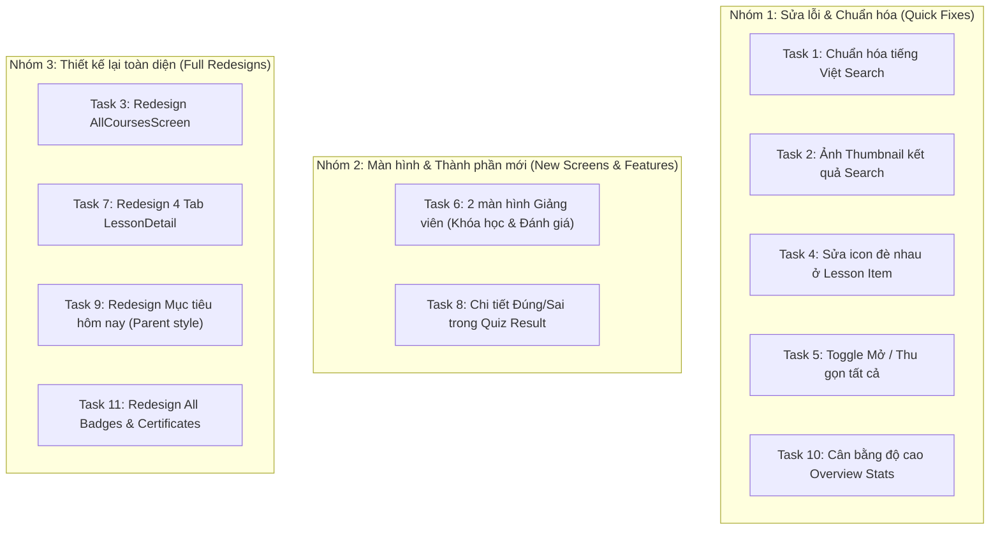

# KẾ HOẠCH TOÀN DIỆN: CẢI TIẾN UI/UX 11 TASK CHO ROLE STUDENT

> **Tài liệu tham chiếu:** `mobile/docs/insight_UI_student/STUDENT_UI_11_TASKS_REFINEMENT_PLAN.md`  
> **Dự án:** ForteX Mobile App (`lib/features/student`)  
> **Nhánh làm việc:** `tung/refactor_UI_Student`  
> **Tone & Style:** Academic Blue (`#3D5FC4`), Tinh tế, Hiện đại, Chuẩn mực học thuật  
> **Trạng thái:** Kế hoạch phân tích chi tiết — **CHƯA SỬA CODE** ở giai đoạn này.

---

## MỤC LỤC
1. [TỔNG QUAN & NGUYÊN TẮC THIẾT KẾ](#1-tổng-quan--nguyên-tắc-thiết-kế)
2. [CHI TIẾT PHÂN TÍCH & GIẢI PHÁP CHO 11 TASK](#2-chi-tiết-phân-tích--giải-pháp-cho-11-task)
   - [Task 1: Chuẩn hóa tiếng Việt trong SearchScreen](#task-1-chuẩn-hóa-tiếng-việt-trong-searchscreen)
   - [Task 2: Hiển thị thumbnail khóa học trong kết quả tìm kiếm](#task-2-hiển-thị-thumbnail-khóa-học-trong-kết-quả-tìm-kiếm)
   - [Task 3: Thiết kế lại giao diện AllCoursesScreen ("Khóa học của tôi")](#task-3-thiết-kế-lại-giao-diện-allcoursesscreen-khóa-học-của-tôi)
   - [Task 4: Sửa lỗi icon mở rộng bị hiển thị đôi/vỡ layout ở thẻ bài học](#task-4-sửa-lỗi-icon-mở-rộng-bị-hiển-thị-đôivỡ-layout-ở-thẻ-bài-học)
   - [Task 5: Toggle hai chiều "Mở tất cả" / "Thu gọn tất cả" (Tab Nội dung)](#task-5-toggle-hai-chiều-mở-tất-cả--thu-gọn-tất-cả-tab-nội-dung)
   - [Task 6: Thiết kế 2 màn hình mới từ Hồ sơ giảng viên](#task-6-thiết-kế-2-màn-hình-mới-từ-hồ-sơ-giảng-viên)
   - [Task 7: Thiết kế lại 4 tab trong LessonDetailScreen (Nội dung, Tài liệu, Bài tập, Ghi chú)](#task-7-thiết-kế-lại-4-tab-trong-lessondetailscreen)
   - [Task 8: Bổ sung chi tiết câu đúng/sai trong QuizResultScreen](#task-8-bổ-sung-chi-tiết-câu-đúngsai-trong-quizresultscreen)
   - [Task 9: Thiết kế lại thẻ "Mục tiêu hôm nay" (Tab Lịch học - Tham khảo Parent)](#task-9-thiết-kế-lại-thẻ-mục-tiêu-hôm-nay-tab-lịch-học)
   - [Task 10: Cân bằng độ cao 4 cột thống kê Overview (Tab Thành tích)](#task-10-cân-bằng-độ-cao-4-cột-thống-kê-overview-tab-thành-tích)
   - [Task 11: Thiết kế lại AllAchievementsScreen & AllCertificatesScreen rực rỡ, trang trọng](#task-11-thiết-kế-lại-allachievementsscreen--allcertificatesscreen)
3. [LỘ TRÌNH TRIỂN KHAI THEO TỪNG GIAI ĐOẠN (ROADMAP)](#3-lộ-trình-triển-khai-theo-từng-giai-đoạn-roadmap)
4. [KẾ HOẠCH KIỂM THỬ & BẢO ĐẢM HỆ THỐNG](#4-kế-hoạch-kiểm-thử--bảo-đảm-hệ-thống)

---

## 1. TỔNG QUAN & NGUYÊN TẮC THIẾT KẾ

### 1.1. Bối cảnh
Sau khi hoàn thành việc chuẩn hóa padding các nút bấm và đồng nhất sắc xanh học thuật `#3D5FC4` trên toàn bộ module Student, việc đánh giá trực quan qua emulator đã phát hiện ra 11 điểm cần cải tiến UI/UX từ những lỗi vụn vặt (tiếng Việt không dấu, icon đè lên nhau, lệch độ cao) đến những màn hình cần nâng cấp thẩm mỹ để mang lại trải nghiệm chuyên nghiệp, đằm tính và tôn vinh thành tích của học viên.

### 1.2. Ba nguyên tắc cốt lõi
1. **Academic Blue Identity (`#3D5FC4`):** Duy trì sự đồng nhất của màu chủ đạo học thuật, kết hợp sắc xanh nhạt (`#EFF6FF`), Slate (`#0F172A`, `#475569`, `#94A3B8`) và hệ màu điểm nhấn chuẩn mực (`#059669` cho thành công/đúng, `#DC2626` cho lỗi/sai, `#D97706` cho tiến trình).
2. **Clean Information Hierarchy (Phân tầng thông tin rõ ràng):** Tối ưu whitespace, padding, tỉ lệ typography; loại bỏ cảm giác thô cứng, nặng nề của các thẻ card cũ bằng cấu trúc viền tinh tế (`0.8px` alpha `0.5-0.6`), bo góc mềm mại (`AppRadius.lg = 16dp`) và hiệu ứng đổ bóng mỏng nhẹ (`alpha: 0.03 - 0.05`).
3. **Logic Safety & Regression Protection:** Tất cả các thay đổi giao diện phải gắn kết chặt chẽ với BLoC, Model, DTO hiện hữu; không làm phá vỡ các luồng xử lý dữ liệu và duy trì pass 100% test suite.

---

## 2. CHI TIẾT PHÂN TÍCH & GIẢI PHÁP CHO 11 TASK



---

### Task 1: Chuẩn hóa tiếng Việt trong SearchScreen

#### 1. Hiện trạng & Nguyên nhân
- Trong `SearchScreen` và các widget con, một số chuỗi hiển thị giao diện vẫn đang hardcode dạng tiếng Việt không dấu:
  - `search_screen.dart:69`: `hintText: 'Tim kiem khoa hoc, bai hoc...'`
  - `search_screen.dart:131`: `'${state.filteredResults.length} ket qua'`
  - `recent_searches.dart:36`: `'Tim kiem khoa hoc, bai hoc'`
  - `recent_searches.dart:54`: `'Tim kiem gan day'`
  - `recent_searches.dart:60`: `'Xoa tat ca'`
  - `filter_tabs.dart:64-68`: `'Tat ca'`, `'Khoa hoc'`, `'Bai hoc'`
  - `empty_result.dart:36, 41`: `'Khong tim thay ket qua'`, `'Khong co ket qua cho "$query"\nThu tu khoa khac nhe!'`
  - `search_result_item.dart:126-127`: `'Khoa hoc'`, `'Bai hoc'`

#### 2. Phương án giải quyết
- Chuẩn hóa toàn bộ các chuỗi text sang tiếng Việt chuẩn có dấu:
  - Hint: `"Tìm kiếm khóa học, bài học..."`
  - Thống kê: `"${state.filteredResults.length} kết quả"`
  - Tiêu đề mục: `"Tìm kiếm gần đây"`, nút `"Xóa tất cả"`
  - Bộ lọc tabs: `"Tất cả"`, `"Khóa học"`, `"Bài học"`, `"Trắc nghiệm"`
  - Trạng thái rỗng: `"Không tìm thấy kết quả"`, `"Không có kết quả cho \"$query\"\nThử từ khóa khác nhé!"`
  - Tag loại kết quả: `"Khóa học"`, `"Bài học"`, `"Trắc nghiệm"`
- Các file can thiệp:
  - `lib/features/student/presentation/search/search_screen.dart`
  - `lib/features/student/presentation/search/widgets/filter_tabs.dart`
  - `lib/features/student/presentation/search/widgets/recent_searches.dart`
  - `lib/features/student/presentation/search/widgets/empty_result.dart`
  - `lib/features/student/presentation/search/widgets/search_result_item.dart`

---

### Task 2: Hiển thị thumbnail khóa học trong kết quả tìm kiếm

#### 1. Hiện trạng & Nguyên nhân
- Khi tìm kiếm (ví dụ từ khóa "flutter"), kết quả trả về danh sách các khóa học nhưng chỉ hiển thị icon vuông màu xanh `Icons.school_rounded` bên trái (như chụp ở emulator ảnh 1), không có ảnh bìa thực tế của khóa học.
- **Nguyên nhân code:**
  - `SearchResult` model trong `search_state.dart` chỉ có các trường `id`, `title`, `subtitle`, `type`. Thiếu trường `imageUrl`.
  - Trong `SearchBloc` (`_onQueryChanged`), khi map từ `CourseModel` sang `SearchResult`, model `CourseModel` vốn đã có `thumbnailUrl` nhưng `SearchResult` không nhận trường này.
  - Trong `SearchResultItem`, container bên trái luôn vẽ `Icon(_getTypeIcon(result.type))` thay vì hiển thị hình ảnh nếu có.
  - Ngoài ra, callback `onTap` trong `SearchResultItem` đang để `// TODO: Navigate to result`.

#### 2. Phương án giải quyết
- **Nâng cấp Model `SearchResult`:**
  - Thêm trường optional `final String? imageUrl;` vào class `SearchResult`.
- **Cập nhật `SearchBloc`:**
  - Khi map từ `CourseModel`, truyền `imageUrl: course.thumbnailUrl`.
- **Nâng cấp `SearchResultItem`:**
  - Kiểm tra nếu `result.imageUrl != null && result.imageUrl!.isNotEmpty`:
    - Sử dụng `CachedNetworkImage` với kích thước 48x48dp, bo góc `AppRadius.md (12dp)`.
    - Placeholder & ErrorWidget: Fallback mềm mại về container có `_getTypeIcon(result.type)`.
  - Nếu không có ảnh hoặc loại bài học/quiz không có thumbnail: Hiển thị container icon gradient/tint như hiện tại.
  - Bổ sung xử lý `onTap`: Khi ấn vào kết quả khóa học, điều hướng trực tiếp sang `CourseDetailScreen`.
- Các file can thiệp:
  - `lib/features/student/bloc/search/search_state.dart`
  - `lib/features/student/bloc/search/search_bloc.dart`
  - `lib/features/student/presentation/search/widgets/search_result_item.dart`

---

### Task 3: Thiết kế lại giao diện AllCoursesScreen ("Khóa học của tôi")

#### 1. Hiện trạng & Nhận xét
- `all_courses_screen.dart` hiện tại sử dụng `AsyncListScaffold<EnrollmentModel>` rất đơn điệu (như hiển thị ở emulator ảnh 2):
  - AppBar chỉ có tiêu đề "Khóa học của tôi" và nút back.
  - Danh sách thẳng đứng các `CourseCard` phẳng, không có bộ lọc (Tất cả / Đang học / Đã hoàn thành).
  - Không có thanh tìm kiếm nhanh khóa học đã đăng ký.
  - Không có thống kê tổng quan (ví dụ: đang học bao nhiêu khóa, đã hoàn thành bao nhiêu khóa).
  - Thiết kế tổng thể thô và chưa tạo cảm hứng học tập.

#### 2. Đề xuất ý tưởng thiết kế lại giao diện (Chỉ đổi Presentation UI)

```
+-------------------------------------------------------------+
| [<] Khóa học của tôi                                  (Search)|
+-------------------------------------------------------------+
|  +-------------------------------------------------------+  |
|  | [Icon Sách] TIẾN TRÌNH HỌC TẬP                        |  |
|  | 5 Khóa học đã đăng ký   •   3 Đang học   •   2 Hoàn thành |  |
|  | [========================>................] 68% chung |  |
|  +-------------------------------------------------------+  |
|                                                             |
|  [🔍 Tìm kiếm trong khóa học của bạn...]                    |
|                                                             |
|  ( Tất cả 5 )  ( Đang học 3 )  ( Đã hoàn thành 2 )          |
|                                                             |
|  Sắp xếp: [Mới học gần đây v]                               |
|                                                             |
|  +-------------------------------------------------------+  |
|  | [Ảnh Thumbnail 16:9]                    [Badge: 75%]  |
|  | Chuyên mục: LẬP TRÌNH FLUTTER                         |
|  | Lập trình Flutter từ Cơ bản đến Nâng cao             |
|  | Giảng viên: Nguyễn Văn A • 42/56 bài học              |
|  | [=====================>        ] 75%                  |
|  | [ Tiếp tục học (Bài 43) ]              [Icon Bookmark]|  |
|  +-------------------------------------------------------+  |
+-------------------------------------------------------------+
```

- **Chi tiết các thành phần:**
  1. **Header Overview Card (Thẻ tiến trình tổng hợp):**
     - Nền gradient nhẹ (`LinearGradient` từ `#3D5FC4` sang `#2E4899`), chữ trắng sang trọng.
     - Hiển thị 3 chỉ số nhanh: Tổng số khóa học, Số khóa đang học, Số khóa đã hoàn thành.
     - Thanh progress tổng quát tỉ lệ hoàn thành chung của học viên.
  2. **Thanh tìm kiếm & lọc nhanh (In-screen Filter & Search):**
     - SearchBar mini bo tròn full pill tìm kiếm theo tên khóa học hoặc tên giảng viên.
     - Bộ 3 filter chips: `Tất cả (${total})`, `Đang học (${inProgress})`, `Đã hoàn thành (${completed})`.
     - Dropdown/Button sắp xếp: "Mới học gần đây", "Tiến độ cao nhất", "Tên A-Z".
  3. **Thẻ khóa học nâng cấp (`ModernEnrolledCourseCard`):**
     - Card dạng nổi viền mảnh (`0.8px`), bo góc `16dp`, shadow siêu nhẹ.
     - Thumbnail tỉ lệ vàng với badge tiến độ nổi góc trên (VD: `75%` nền xanh `#3D5FC4`).
     - Thông tin chi tiết: Danh mục khóa học, Tên khóa học (2 dòng), Giảng viên kèm avatar mini, số bài đã học / tổng số bài.
     - Nút Action CTA nổi bật:
       - Nếu đang học: Nút `FilledButton` màu xanh `#3D5FC4` với icon Play: `"Tiếp tục học"`.
       - Nếu đã hoàn thành: Nút `OutlinedButton` xanh lá `#059669` với icon cúp: `"Xem chứng chỉ"`.
  4. **Trạng thái rỗng thân thiện (Empty State):**
     - Khi filter không có kết quả: Hiển thị minh họa học tập nhẹ nhàng, kèm gợi ý và nút `"Khám phá khóa học mới"`.
- Các file can thiệp:
  - `lib/features/student/presentation/learning/all_courses_screen.dart`
  - Widget phụ trợ: `lib/features/student/presentation/learning/widgets/all_courses_summary_card.dart`, `all_courses_filter_bar.dart`

---

### Task 4: Sửa lỗi icon mở rộng bị hiển thị đôi/vỡ layout ở thẻ bài học

#### 1. Hiện trạng & Nguyên nhân
- Trong `CourseDetailScreen` -> Tab "Nội dung khóa học":
  - Ở mỗi dòng bài học (Lesson Item) có các bài học con nhỏ (`hasContents == true`), vùng bên phải của thẻ xuất hiện đồng thời **CẢ HAI ICON**:
    1. Icon mở rộng/thu gọn `expand_more_rounded` / `expand_less_rounded`
    2. Icon mũi tên chuyển tiếp `chevron_right_rounded`
  - Điều này làm cột bên phải bị chật chội, chữ thời lượng bài học (`15 phút`) bị đẩy ép và giao diện trông bị lỗi vỡ layout (đúng như vùng khoanh đỏ trong ảnh 4 của người dùng).
- **Nguyên nhân code cụ thể:**
  - File `lib/features/student/presentation/learning/widgets/section/section_widgets.dart`, dòng 267–300 trong class `_SectionLessonItemState`:
    ```dart
    if (hasContents)
      Icon(
        _isExpanded ? Icons.expand_less_rounded : Icons.expand_more_rounded,
        color: cs.slate400,
        size: 20,
      )
    else if (isCompleted)
      const Text('Hoàn thành', ...)
    else if (isInProgress)
      Container(...)
    AppSpacing.hGap4,
    Icon(Icons.chevron_right_rounded, size: 18, color: cs.slate400), // <--- LUÔN ĐƯỢC VẼ BẤT KỂ hasContents!
    ```
  - Khi `hasContents == true`, tap vào hàng này chỉ để toggle mở/đóng các bài học con bên dưới chứ KHÔNG navigate ngay, do đó icon `chevron_right_rounded` là hoàn toàn thừa thãi và gây lỗi hiển thị đôi.

#### 2. Phương án giải quyết
- Tách bạch điều kiện hiển thị icon hành động bên phải:
  - **Trường hợp 1 (`hasContents == true`):**
    - Chỉ hiển thị duy nhất icon xoay mở rộng: `Icon(_isExpanded ? Icons.keyboard_arrow_up_rounded : Icons.keyboard_arrow_down_rounded)`.
    - TUYỆT ĐỐI KHÔNG vẽ thêm `Icons.chevron_right_rounded`.
  - **Trường hợp 2 (`hasContents == false` - bài học đơn lẻ):**
    - Hiển thị badge trạng thái (Hoàn thành / Tiến độ % / Chưa học).
    - Phía sau hiển thị `Icon(Icons.chevron_right_rounded, size: 18, color: cs.slate400)` để thể hiện hành vi tap sẽ mở màn hình bài học.
  - Căn chỉnh lại `CrossAxisAlignment.center` và padding để khoảng cách thời lượng `15 phút` cách đều mép phải.
- File can thiệp:
  - `lib/features/student/presentation/learning/widgets/section/section_widgets.dart`

---

### Task 5: Toggle hai chiều "Mở tất cả" / "Thu gọn tất cả" (Tab Nội dung)

#### 1. Hiện trạng & Nguyên nhân
- Trong `CourseContentTab` (`lib/features/student/presentation/learning/course_detail/widgets/course_content_tab.dart`, dòng 38–49):
  - Nút bấm góc trên bên phải đang hardcode text `'Mở tất cả'`.
  - Khi nhấn vào nút, code chỉ duyệt qua các section chưa mở và add vào `expandedSections`.
  - Khi tất cả đã mở, nút vẫn giữ nguyên nhãn `'Mở tất cả'` và nhấn vào không có tác dụng thu gọn lại.

#### 2. Phương án giải quyết
- Xác định trạng thái toàn bộ các section đã được mở hay chưa:
  ```dart
  final allExpanded = state.sections.isNotEmpty &&
      state.sections.every((s) => state.expandedSections.contains(s.id));
  ```
- Cập nhật giao diện nút bấm:
  - Nếu `allExpanded == true`: Nhãn là `"Thu gọn tất cả"`, kèm icon `Icons.unfold_less_rounded`.
  - Nếu `allExpanded == false`: Nhãn là `"Mở tất cả"`, kèm icon `Icons.unfold_more_rounded`.
- Logic sự kiện khi click:
  - Nếu `allExpanded == true`: Thu gọn tất cả bằng cách lặp qua các section đang mở và dispatch `CourseDetailSectionToggled(section.id)` (hoặc dispatch event mới `CourseDetailCollapseAllSections()`).
  - Nếu `allExpanded == false`: Dispatch mở tất cả các section chưa mở.
- File can thiệp:
  - `lib/features/student/presentation/learning/course_detail/widgets/course_content_tab.dart`
  - (Tùy chọn BLoC event mở rộng nếu cần batch update: `course_detail_event.dart`, `course_detail_bloc.dart`).

---

### Task 6: Thiết kế 2 màn hình mới từ Hồ sơ giảng viên

#### 1. Hiện trạng & Yêu cầu
- Trong `InstructorDetailScreen` (`lib/features/student/presentation/learning/instructor_detail_screen.dart`):
  - Mục "Khóa học của giảng viên" có nút "Xem tất cả" (dòng 370: `onPressed: () {}`).
  - Mục "Đánh giá từ học viên" có nút "Xem tất cả" (dòng 445: `onPressed: () {}`).
  - Cả 2 nút này đều đang để trống callback vì chưa có màn hình đích được thiết kế.

#### 2. Thiết kế chi tiết Màn hình 1: `InstructorCoursesScreen` ("Tất cả khóa học của giảng viên")

```
+-------------------------------------------------------------+
| [<] Khóa học của giảng viên                           (🔍)   |
+-------------------------------------------------------------+
|  +-------------------------------------------------------+  |
|  | [Avatar] ThS. Nguyễn Văn A                            |  |
|  | Giảng viên Cao cấp • 12 Khóa học • 18.5k Học viên     |  |
|  +-------------------------------------------------------+  |
|                                                             |
|  ( Tất cả 12 )  ( Thiết kế UI/UX 8 )  ( Lập trình 4 )       |
|                                                             |
|  [Card Khóa Học 1]                                          |
|  +-------------------------------------------------------+  |
|  | [Thumbnail]  UI/UX Design Fundamentals                |  |
|  |              ⭐ 4.9 (1.2k) • 12 bài • 6h 40m          |  |
|  |              [Badge: Đã đăng ký - Tiến độ 65%]        |  |
|  |              [ Tiếp tục học ]                         |  |
|  +-------------------------------------------------------+  |
|  [Card Khóa Học 2] ...                                      |
+-------------------------------------------------------------+
```

- **Cấu trúc màn hình:**
  1. **Top Bar:** Back button, tiêu đề `"Khóa học của giảng viên"`, icon tìm kiếm.
  2. **Instructor Summary Bar:** Avatar tròn thu nhỏ của giảng viên, họ tên, danh hiệu, tổng số khóa học và tổng số học viên tin tưởng.
  3. **Filter Category Chips:** Cho phép lọc theo chuyên môn của các khóa học giảng viên phụ trách (VD: Tất cả, UI/UX Design, Mobile App, Web).
  4. **Danh sách khóa học chi tiết (`InstructorCourseListTile`):**
     - Thumbnail chuẩn tỉ lệ 16:9 với badge trạng thái (Đã đăng ký / Mới / Hot).
     - Tiêu đề khóa học, đánh giá sao trung bình (`⭐ 4.9 (1.2k)`), số lượng bài học và tổng thời lượng.
     - Giá khóa học (hoặc Miễn phí) nếu chưa đăng ký; hoặc thanh tiến độ học nếu đã đăng ký.
     - Tap vào khóa học sẽ điều hướng sang `CourseDetailScreen`.
  5. **Empty State:** Hiển thị nếu giảng viên chưa có khóa học nào thuộc danh mục đã chọn.

#### 3. Thiết kế chi tiết Màn hình 2: `InstructorReviewsScreen` ("Tất cả đánh giá từ học viên")

```
+-------------------------------------------------------------+
| [<] Đánh giá từ học viên                                    |
+-------------------------------------------------------------+
|  +-------------------------------------------------------+  |
|  |  4.8 ★★★★★       | 5★ [==============>  ] 85%         |  |
|  |  Dựa trên 1,248  | 4★ [===>             ] 10%         |  |
|  |  đánh giá        | 3★ [=>               ]  3%         |  |
|  |                  | 2★ [>                ]  1%         |  |
|  |                  | 1★ [>                ]  1%         |  |
|  +-------------------------------------------------------+  |
|                                                             |
|  Bộ lọc: ( Tất cả )  ( 5 Sao )  ( 4 Sao )  ( Có nhận xét )   |
|                                                             |
|  +-------------------------------------------------------+  |
|  | [Avatar] Trần Thị B  ★★★★★  • 2 ngày trước             |  |
|  | Khóa học: UI/UX Design Fundamentals                      |  |
|  | "Thầy dạy cực kỳ có tâm, bài giảng trực quan dễ hiểu.   |  |
|  | Sau khóa học mình đã tự thiết kế được app đầu tay!"     |  |
|  | 👍 Hữu ích (24)                                          |  |
|  +-------------------------------------------------------+  |
+-------------------------------------------------------------+
```

- **Cấu trúc màn hình:**
  1. **Top Bar:** Tiêu đề `"Đánh giá từ học viên"`, nút quay lại.
  2. **Rating Breakdown Card (Bảng phân tích đánh giá):**
     - Cột trái: Điểm số trung bình to rõ (`4.8 / 5.0`), 5 ngôi sao vàng, tổng số lượt đánh giá (`1,248 đánh giá`).
     - Cột phải: 5 thanh progress thể hiện tỉ lệ phần trăm số sao từ 5★ đến 1★ với màu sắc nhận diện trực quan.
  3. **Filter Bar:** Thanh cuộn ngang các chip lọc: `Tất cả`, `5 Sao (1,050)`, `4 Sao (120)`, `3 Sao`, `Có nhận xét text`.
  4. **Danh sách đánh giá chi tiết (`StudentReviewCard`):**
     - Header: Avatar học viên, Họ tên, Đánh giá số sao (Star rating bar), Thời gian đánh giá (VD: "3 ngày trước", "2 tuần trước").
     - Chip liên kết khóa học: Tên khóa học mà học viên đã học và để lại đánh giá.
     - Nội dung nhận xét: Đoạn văn đánh giá thực tế của học viên, phông chữ dễ đọc, giãn dòng `1.4`.
     - Footer: Nút tương tác `"👍 Hữu ích (N)"` để tạo cảm giác cộng đồng học tập sống động.
  5. **Empty State:** Hiển thị thân thiện khi không có đánh giá nào thỏa mãn bộ lọc đã chọn.
- Các file mới cần tạo:
  - `lib/features/student/presentation/learning/instructor_courses_screen.dart`
  - `lib/features/student/presentation/learning/instructor_reviews_screen.dart`
  - Widgets hỗ trợ: `instructor_course_list_tile.dart`, `rating_breakdown_card.dart`, `student_review_card.dart`

---

### Task 7: Thiết kế lại 4 tab trong LessonDetailScreen

#### 1. Hiện trạng & Vấn đề
- `LessonDetailScreen` có 4 tab: **Nội dung**, **Tài liệu**, **Bài tập**, **Ghi chú**.
- Giao diện hiện tại rất thô:
  - Tab *Nội dung*: Chỉ có một card thông tin buổi học xơ sài và danh sách hàng bài con xám nhạt, thiếu điểm nhấn phân cấp.
  - Tab *Tài liệu*: Chỉ có một ô xám "Tải tất cả" và các card slide PDF thô sơ.
  - Tab *Bài tập*: Header card đơn điệu, các ô câu hỏi quiz phẳng, chưa có thông tin độ khó và thời lượng.
  - Tab *Ghi chú*: Chỉ có một ô `TextField` to tướng choán toàn bộ màn hình như trang giấy trắng, không có tính năng gắn mốc thời gian video hay quản lý các ghi chú đã lưu.

#### 2. Kế hoạch thiết kế lại 4 tab

##### Tab 1: "Nội dung" (Lesson Curriculum & Overview)
- **Header "Tiến trình bài học":** Thẻ bo cong `16dp` viền xanh nhạt, hiển thị số buổi học, thanh tiến độ học video kèm badge "Đang học" hoặc "Đã hoàn thành".
- **Timeline Lộ trình bài học:**
  - Danh sách các phần bài học con (sub-lessons) được trình bày dạng **Timeline liên tục** với các node tròn:
    - Bài đã học xong: Node xanh lá có dấu check trắng.
    - Bài đang học: Node xanh học thuật `#3D5FC4` có hiệu ứng sóng âm/pulse động.
    - Bài chưa học: Node xám có số thứ tự.
    - Bài bị khóa: Node ổ khóa bảo vệ.
  - Mỗi mục bài con hiển thị thời lượng, định dạng bài (Video / Lý thuyết / Thực hành), nút học ngay.
- **Section "Mục tiêu bài học" (Key Takeaways):**
  - Khối highlight nền `#EFF6FF` với icon bóng đèn, liệt kê 3–4 kiến thức trọng tâm học viên sẽ nắm vững sau bài học này.

##### Tab 2: "Tài liệu" (Lesson Resources & Attachments)
- **Top Card "Tải xuống trọn bộ tài liệu":**
  - Thiết kế card bo góc `16dp` sang trọng với icon thư mục ZIP nổi bật, tổng hợp tổng dung lượng và số lượng tệp (VD: `4 tệp • 14.8 MB`), nút CTA `"Tải về máy"` với hiệu ứng tiến trình tải.
- **Phân loại tài liệu theo danh mục (Category Badges):**
  - Slide bài giảng (PDF)
  - Mã nguồn thực hành (Source Code ZIP/GitHub)
  - Bảng tra cứu / Cheat sheet (Hình ảnh/Tài liệu)
- **Thẻ tệp tin cao cấp (`DocumentFileCard`):**
  - Icon định dạng tệp chuyên biệt có màu nhận diện chuẩn: PDF (Đỏ cam), ZIP (Vàng đồng), Code (Xanh ngọc), Word/Docs (Xanh dương).
  - Tên tệp rõ ràng, số trang/dung lượng, ngày tải lên.
  - Nút hành động: Xem trực tuyến (Preview) hoặc Tải về (Download) kèm trạng thái `"Đã tải"` tinh tế.

##### Tab 3: "Bài tập" (Quizzes & Exercises)
- **Gamified Overview Header:**
  - Card tổng quan tiến độ làm bài tập: Vòng tròn phần trăm hoàn thành, số lượng bài đã nộp (VD: `3/4 bài tập đã làm`), điểm cao nhất đạt được (`Điểm cao nhất: 95%`).
- **Thẻ bài tập nâng cấp (`ModernExerciseCard`):**
  - Badge phân loại độ khó: `Dễ` (Xanh lá), `Trung bình` (Vàng cam), `Nâng cao` (Đỏ tím).
  - Thông số chi tiết: Số lượng câu hỏi (VD: `10 câu`), Thời gian làm bài (VD: `15 phút`), Số lượt làm bài còn lại.
  - Trạng thái rõ ràng:
    - Chưa làm: Nút `"Bắt đầu làm bài"` màu xanh `#3D5FC4`.
    - Đã làm đạt: Badge điểm số xanh lá kèm nút `"Làm lại"` hoặc `"Xem lại kết quả"`.
    - Đang làm dở: Badge màu cam kèm nút `"Tiếp tục làm"`.

##### Tab 4: "Ghi chú" (Smart Timestamped Notes)
- **Kiến trúc giao diện chia 2 phần (Hybrid Notes View):**
  1. **Khung soạn thảo ghi chú nhanh (Quick Note Composer):**
     - Nút `"Gắn mốc thời gian hiện tại"` (`Chip 04:25`): Tự động lấy giây phát hiện tại của video player vào nội dung ghi chú.
     - Ô nhập nội dung ngắn gọn, bo góc mềm mại, nút `"Lưu ghi chú"` có animation.
  2. **Danh sách ghi chú đã lưu theo dòng thời gian (Timestamped Notes Timeline):**
     - Mỗi ghi chú hiển thị dạng thẻ nhỏ gọn:
       - Chip thời gian có thể bấm vào (VD: `[⏱ 02:15]`) -> Khi học viên bấm vào chip, video player lập tức tua đến đúng giây `02:15`!
       - Nội dung ghi chú của học viên.
       - Tùy chọn chỉnh sửa hoặc xóa ghi chú.
     - Empty state: Minh họa sổ tay học tập kèm lời nhắn: *"Chưa có ghi chú nào. Hãy ghi lại những kiến thức quan trọng khi đang xem video!"*.
- Các file can thiệp:
  - `lib/features/student/presentation/learning/lesson_detail/widgets/lesson_content_section.dart`
  - `lib/features/student/presentation/learning/lesson_detail/widgets/lesson_documents_section.dart`
  - `lib/features/student/presentation/learning/lesson_detail/widgets/lesson_exercise_section.dart`
  - `lib/features/student/presentation/learning/lesson_detail/widgets/lesson_notes_section.dart`

---

### Task 8: Bổ sung chi tiết câu đúng/sai trong QuizResultScreen

#### 1. Hiện trạng & Định hướng trải nghiệm
- Hiện tại, sau khi hoàn thành bài thi trắc nghiệm, `QuizResultScreen` (`lib/features/student/presentation/learning/quiz_result_screen.dart`) chỉ hiển thị:
  - Vòng tròn % điểm (`ScoreCircle`)
  - Headline thông báo (Đạt / Không đạt)
  - 3 thẻ thống kê tóm tắt: Số câu đúng, Số câu sai, Tổng số câu
  - 2 nút bấm đáy: "Quay về bài học", "Làm lại bài kiểm tra"
- **Vấn đề:** Học sinh không thể biết mình đã làm đúng những câu nào, sai ở câu nào, tại sao sai và đáp án chính xác là gì.
- **Ý tưởng thiết kế cốt lõi (Interactive Stat-driven Filter):**
  - Không xả toàn bộ danh sách câu hỏi lên màn hình ngay từ đầu nhằm tránh quá tải thị giác (cognitive overload).
  - Tận dụng chính 3 thẻ tóm tắt (Câu đúng, Câu sai, Tổng câu) thành **Bộ lọc tương tác trực tiếp (`InteractiveStatCard`)**:
    - **Chạm vào thẻ "Câu đúng":** Chỉ hiển thị danh sách các câu học sinh đã trả lời đúng.
    - **Chạm vào thẻ "Câu sai":** Chỉ hiển thị danh sách các câu làm sai (đáp ứng đúng tâm lý học sinh luôn muốn xem lại ngay lỗi sai để rút kinh nghiệm).
    - **Chạm vào thẻ "Tổng câu":** Hiển thị toàn bộ danh sách câu hỏi kèm trạng thái đúng/sai.

#### 2. Phân tích kỹ thuật & Luồng dữ liệu
- Khi nộp bài trong `QuizBloc` (`lib/features/student/bloc/quiz/quiz_bloc.dart`):
  - State `QuizReady` vốn đang nắm giữ đầy đủ `questions: List<QuizQuestionModel>` và `answers: Map<int, int>` (map chỉ số câu hỏi -> chỉ số đáp án học sinh chọn).
  - Trong `QuizQuestionModel`: Mỗi câu hỏi đã có danh sách `answers: List<QuizAnswerModel>` (mỗi answer có trường `isCorrect: bool`) và `explanation: String?`.
  - Khi nộp bài trong `_onSubmitted`, `QuizBloc` phát ra state `QuizCompleted`.
- **Giải pháp kỹ thuật:**
  - Bổ sung vào state `QuizCompleted`:
    ```dart
    final List<QuizQuestionModel> questions;
    final Map<int, int> userAnswers;
    ```
  - Truyền danh sách `questions` và `userAnswers` này sang `QuizResultScreen`.
  - Trong `QuizResultScreen`, quản lý trạng thái bộ lọc đang chọn:
    ```dart
    enum QuizReviewFilter { total, correct, wrong }
    ```

#### 3. Thiết kế giao diện chi tiết & Xử lý nhược điểm UX

```
+-------------------------------------------------------------+
|                     [ Score Circle: 80% ]                   |
|                        Xuất sắc! 🎉                         |
|                                                             |
|          Chạm vào từng thẻ bên dưới để xem chi tiết:         |
|  +---------------+   +---------------+   +---------------+  |
|  | [✓] CÂU ĐÚNG  |   | [X] CÂU SAI   |   | [≣] TỔNG CÂU  |  |
|  |      8        |   |      2        |   |      10       |  |
|  +---------------+   +---------------+   +---------------+  |
|                             ▼ (Pointer trỏ thẻ đang chọn)   |
|  ---------------------------------------------------------  |
|  ĐANG XEM: 2 CÂU TRẢ LỜI SAI (Bấm "Tổng câu" để xem tất cả) |
|                                                             |
|  +-------------------------------------------------------+  |
|  | Câu 2: Widget nào dùng để tạo layout một chiều?       |  |
|  | [Icon X Đỏ] BẠN ĐÃ TRẢ LỜI SAI                        |  |
|  | (x) A. Stack           [Bạn đã chọn - Sai]            |  |
|  | (•) B. Flex            [Đáp án đúng]                  |  |
|  | ( ) C. GridView                                       |  |
|  | 💡 Giải thích: Flex là widget nền tảng của Row &       |  |
|  |    Column để sắp xếp con theo 1 chiều ngang/dọc.      |  |
|  +-------------------------------------------------------+  |
|  [Câu sai tiếp theo...]                                     |
+-------------------------------------------------------------+
```

- **Xử lý các vấn đề UX cốt lõi:**
  1. **Tăng cường khả năng nhận biết tương tác (Affordance):**
     - Thêm dòng chỉ dẫn thanh lịch phía trên: *"Chạm vào từng thẻ để xem chi tiết bài làm 👇"*.
     - Mỗi thẻ thống kê tích hợp hiệu ứng gợn sóng (`InkWell`), icon mắt/kính lúp nhỏ (`Icons.visibility_outlined`) ở góc trên thẻ để báo hiệu thẻ bấm được.
  2. **Trạng thái Active rõ rệt & Con trỏ liên kết (Visual Anchor):**
     - Thẻ đang được chọn (Active) sẽ có viền màu dày `2px` (Xanh lá `#059669` cho Đúng, Đỏ `#DC2626` cho Sai, Xanh `#3D5FC4` cho Tổng câu), nền chuyển sang màu pastel tương ứng.
     - Dưới đáy thẻ đang chọn xuất hiện một **mũi tên tam giác nhỏ (caret pointer)** trỏ xuống danh sách câu hỏi bên dưới để tạo sự kết nối thị giác rõ ràng.
  3. **Trạng thái mặc định thông minh (Smart Default State):**
     - Mặc định khi vừa vào màn hình: Hệ thống tự động chọn thẻ **"Tổng câu"** (hoặc nếu có câu sai thì người dùng có thể chạm 1 chạm sang "Câu sai" để xem ngay).
  4. **Xử lý trường hợp số lượng = 0 (Zero-state):**
     - Nếu học sinh làm đúng 100% (`wrong == 0`) và bấm vào thẻ "Câu sai": Hiển thị Empty state vui nhộn với cúp vàng: *"Xuất sắc! Bạn không làm sai câu nào cả! 🎉"*.
     - Nếu làm sai toàn bộ (`correct == 0`) và bấm vào thẻ "Câu đúng": Hiển thị thông điệp động viên: *"Đừng nản lòng nhé! Hãy ôn lại bài học và thử lại nào 💪"*.
  5. **Thẻ câu hỏi chi tiết (`QuestionReviewCard`):**
     - Tiêu đề câu: Số thứ tự câu (Câu 1, Câu 2...) và nội dung câu hỏi rõ ràng.
     - Badge kết quả nổi bật ở góc (Chính xác / Chưa chính xác).
     - Danh sách các đáp án: Highlight xanh lá đáp án đúng, highlight đỏ đáp án chọn sai, làm mờ các đáp án còn lại.
     - Hộp giải thích (`ExplanationCallout`): Hiển thị giải thích chi tiết có icon bóng đèn nếu backend cung cấp `explanation`.
- File can thiệp:
  - `lib/features/student/bloc/quiz/quiz_state.dart`
  - `lib/features/student/bloc/quiz/quiz_bloc.dart`
  - `lib/features/student/presentation/learning/widgets/quiz/quiz_view.dart`
  - `lib/features/student/presentation/learning/quiz_result_screen.dart`
  - Widget mới: `lib/features/student/presentation/learning/widgets/quiz/interactive_stat_card.dart`, `question_review_card.dart`, `quiz_review_empty_state.dart`

---

### Task 9: Thiết kế lại thẻ "Mục tiêu hôm nay" (Tab Lịch học)

#### 1. Hiện trạng & Phân tích so sánh với Role Parent
- Hiện tại trong Tab Lịch học của Student (`daily_goals_section.dart` & `goal_tile.dart`):
  - Card là một khối hộp chữ nhật đơn giản với dòng tiêu đề "Mục tiêu hôm nay" và thanh `LinearProgressIndicator` mảnh `6dp`.
  - Các mục tiêu là danh sách `GoalTile` thô, viền đơn điệu, ô checkbox vuông bình thường.
  - Ô nhập thêm mục tiêu dạng khung thô cứng.
- **Tham khảo từ Role Parent (`ParentScheduleCard`):**
  - Role Parent sử dụng cấu trúc phân tầng thông tin cực kỳ chặt chẽ (Header có Avatar con/chủ đề -> Thời gian to rõ -> Khối nội dung bài học bo góc màu xám nhạt cao cấp -> Footer thông tin giáo viên & hành động).
  - Màu sắc viền `Border.all(color: cs.outlineVariant.withValues(alpha: 0.5))`, đổ bóng mềm mại `BoxShadow(color: cs.shadow.withValues(alpha: 0.05), blurRadius: 10, offset: Offset(0, 3))`.

#### 2. Đề xuất thiết kế lại Thẻ "Mục tiêu hôm nay"

```
+-------------------------------------------------------------+
|  🎯 MỤC TIÊU HÔM NAY                [ Đã xong 2/3 mục tiêu ] |
|  "Cố gắng lên, chỉ còn 1 mục tiêu nữa để hoàn thành ngày!"  |
|  [==================================>.......] 67%            |
+-------------------------------------------------------------+
|  [Khối Mục Tiêu 1 - Đã xong]                                |
|  [v] Hoàn thành bài 3: StatefulWidget           [⏱ 45 phút] |
|      Chuyên mục: Lập trình Flutter • Đã hoàn thành 09:30    |
+-------------------------------------------------------------+
|  [Khối Mục Tiêu 2 - Đang làm]                               |
|  [ ] Làm bài trắc nghiệm chương 2               [Ưu tiên cao]|
|      Chuyên mục: Ôn tập kiến thức • Hạn chót: 18:00         |
+-------------------------------------------------------------+
|  [ + Thêm mục tiêu mới cho hôm nay ]                        |
+-------------------------------------------------------------+
```

- **Cấu trúc 4 tầng chuẩn mực:**
  1. **Tầng 1: Header & Motivational Banner:**
     - Icon mục tiêu nổi bật (Target 🎯 trong hình tròn màu pastel xanh).
     - Tiêu đề "Mục tiêu hôm nay" đậm nét, góc phải là pill badge trạng thái: `Đã xong 2/3` (nền xanh `#EFF6FF`, chữ xanh `#3D5FC4`).
     - Câu thông điệp truyền cảm hứng học tập thay đổi linh hoạt theo % tiến độ (VD: 0% -> "Bắt đầu ngày học đầy hứng khởi nào!", 100% -> "Tuyệt vời! Bạn đã hoàn thành toàn bộ mục tiêu hôm nay 🎉").
     - Thanh tiến độ bo cong `8dp` với hiệu ứng gradient gradient xanh học thuật mượt mà.
  2. **Tầng 2: Khối danh sách mục tiêu (`ModernGoalCard`):**
     - Mỗi mục tiêu được đặt trong một khối bo góc `12dp` tách biệt, nền trắng (hoặc `surfaceContainerLowest`).
     - Checkbox tùy biến dạng nút tròn mềm mại: Khi tích chọn có hiệu ứng animation tích xanh nảy nhẹ và gạch ngang chữ tinh tế.
     - Tag phân loại mục tiêu nhỏ xinh (VD: "Khóa học", "Bài tập", "Ôn tập").
     - Thao tác vuốt mượt mà để xóa (`Dismissible` với icon thùng rác và nền đỏ bo góc).
  3. **Tầng 3: Modal / Inline Add Goal tiện dụng:**
     - Nút `"+ Thêm mục tiêu mới"` dạng viền đứt nét hoặc nút mềm mở ra khung nhập thông minh với gợi ý nhanh (VD: "Học 1 bài mới", "Làm 1 bài kiểm tra", "Ôn bài 30 phút").
  4. **Tầng 4: Empty State đầy cảm hứng:**
     - Khi chưa có mục tiêu: Hình vẽ minh họa quyển sổ cùng nút kêu gọi tạo mục tiêu đầu tiên cho ngày.
- Các file can thiệp:
  - `lib/features/student/presentation/schedule/widgets/daily_goals_section.dart`
  - `lib/features/student/presentation/schedule/widgets/goal_tile.dart`
  - `lib/features/student/presentation/schedule/widgets/empty_goals.dart`

---

### Task 10: Cân bằng độ cao 4 cột thống kê Overview (Tab Thành tích)

#### 1. Hiện trạng & Nguyên nhân
- Trong `AchievementScreen` -> Khối "Overview" (`overview_statistics.dart`):
  - Khối chứa 4 cột thống kê:
    1. Study Hours
    2. Completed Lessons
    3. Badges
    4. Streak
  - Xem emulator ảnh 5 (do người dùng chụp): Cột số 2 `"Completed Lessons"` chữ bị ngắt thành 2 dòng (`Completed\nLessons`), trong khi 3 cột còn lại chữ chỉ chiếm 1 dòng.
  - Do `Text(label)` không được cố định chiều cao (không có container hoặc `SizedBox`), dòng chữ 2 dòng đã đẩy biểu đồ đường thu nhỏ (`MiniSparkline`) và toàn bộ phần đáy của cột 2 thụt sâu xuống dưới so với 3 cột còn lại!
  - Kết quả là 4 sparkline chart nằm lệch hàng nhau, tạo cảm giác lộn xộn, khấp khểnh và thiếu chuyên nghiệp.

#### 2. Phương án giải quyết
- **Xác định cấu trúc phân tầng chiều cao của `AchievementStatItem`:**
  - Icon tròn: cố định `32x32dp`.
  - Khoảng cách `AppSpacing.vGap8`.
  - Giá trị số (`TweenAnimationBuilder` text): cố định font `titleLarge`.
  - **Nhãn mô tả (`Text(label)`):** Bọc trong `SizedBox` có chiều cao cố định đúng bằng 2 dòng văn bản:
    ```dart
    SizedBox(
      height: 32,
      child: Center(
        child: Text(
          label,
          style: tt.labelSmall?.copyWith(color: cs.onSurfaceVariant),
          textAlign: TextAlign.center,
          maxLines: 2,
          overflow: TextOverflow.ellipsis,
        ),
      ),
    ),
    ```
  - Khoảng cách `AppSpacing.vGap4`.
  - Biểu đồ `MiniSparkline(color: color)`: cố định kích thước `40x16dp`.
- **Kết quả:** Vì cả 4 cột đều dành đúng `32dp` cho phần nhãn chữ, toàn bộ 4 biểu đồ `MiniSparkline` sẽ nằm trên **CÙNG MỘT ĐƯỜNG THẲNG NGANG TUYỆT ĐỐI**, giải quyết triệt để lỗi chênh lệch độ cao được khoanh đỏ trong ảnh 5.
- File can thiệp:
  - `lib/features/student/presentation/achievement/widgets/overview_statistics.dart`

---

### Task 11: Thiết kế lại AllAchievementsScreen & AllCertificatesScreen rực rỡ, trang trọng

#### 1. Hiện trạng & Định hướng
- Học tập là một hành trình nỗ lực, và hai màn hình:
  - `AllAchievementsScreen` (Xem tất cả huy hiệu)
  - `AllCertificatesScreen` (Xem tất cả chứng chỉ)
  chính là nơi **tôn vinh thành quả và năng lực của học viên**.
- Hiện tại:
  - `AllAchievementsScreen` chỉ hiển thị các icon lục giác phẳng trong một grid 4 cột khá chật chội và đơn giản, thiếu hào quang của sự thành tựu.
  - `AllCertificatesScreen` là các thẻ danh sách thông thường, chưa toát lên vẻ trang trọng của một tấm bằng tốt nghiệp / chứng nhận học thuật thực thụ.
- **Yêu cầu:** Thiết kế lại cả 2 màn hình cho thật **rực rỡ, cầu kì, trang trọng và mang đậm tính tôn vinh**.

#### 2. Thiết kế lại `AllAchievementsScreen` — Phòng Truyền Thống Huy Hiệu (Trophy Showcase)

```
+-------------------------------------------------------------+
| [<] Bộ Sưu Tập Huy Hiệu                                (🔍) |
+-------------------------------------------------------------+
|  +-------------------------------------------------------+  |
|  |  🏆 PHÒNG TRUYỀN THỐNG THÀNH TÍCH                     |  |
|  |  Học viên Ưu tú • Hạng Vàng                           |  |
|  |  Đã mở khóa: 18/24 Huy hiệu    •    Cấp độ 12         |  |
|  |  [=========================>........] 75% hoàn thành  |  |
|  +-------------------------------------------------------+  |
|                                                             |
|  ( Tất cả 24 )  ( 🌟 Đã đạt 18 )  ( ⏳ Đang mở 4 )  ( 🔒 2 )|
|                                                             |
|  PHÂN CẤP HUY HIỆU:                                         |
|  [🥇 Kim Cương / Vàng]     [🥈 Bạc]     [🥉 Đồng]           |
|                                                             |
|  +---------------------+       +---------------------+      |
|  |    /-------\        |       |    /-------\        |      |
|  |   |  ⭐ ⭐  |       |       |   |   🔥   |       |      |
|  |    \-------/        |       |    \-------/        |      |
|  | [GLOW HOÀNG KIM]    |       | [GLOW HỌC THUẬT]    |      |
|  | Chiến Thần Học Tập  |       | Chuỗi 30 Ngày       |      |
|  | Đã đạt 12/10/2026   |       | Đã đạt 05/10/2026   |      |
|  | Cấp bậc: VÀNG       |       | Cấp bậc: BẠC        |      |
|  +---------------------+       +---------------------+      |
+-------------------------------------------------------------+
```

- **Điểm nhấn thiết kế mới:**
  1. **Showcase Hero Header (Bảng vàng danh dự):**
     - Banner lớn mang phong cách Hall of Fame với nền gradient xanh hoàng gia đậm (`#1E293B` sang `#1E3A8A` hoặc `#3D5FC4`), họa tiết hoa văn ngôi sao chìm.
     - Cúp vàng 3D/Vector lấp lánh, danh hiệu hiện tại của học viên (VD: *"Chiến binh tri thức"*), tổng điểm kinh nghiệm thành tích.
  2. **Hệ thống phân cấp bậc huy hiệu (Badge Tiers):**
     - Đồng (Bronze): Viền màu đồng ánh kim.
     - Bạc (Silver): Viền bạch kim bóng bẩy.
     - Vàng (Gold): Viền ánh vàng kèm hiệu ứng tỏa sáng (`BoxShadow` vàng hổ phách).
     - Kim Cương (Diamond): Viền gradient lấp lánh xanh ngọc - tím.
  3. **Thẻ huy hiệu rực rỡ (`ShowcaseBadgeCard`):**
     - Kích thước thẻ rộng rãi hơn (Grid 3 cột thay vì 4 cột chật chội).
     - Huy hiệu dạng nổi với viền gradient đa tầng, bóng đổ hào quang (glow effect) đối với các huy hiệu đã đạt (`earned`).
     - Huy hiệu đang thực hiện (`inProgress`): Thanh tiến trình vòng cung hoặc linear rực rỡ kèm số % rõ nét.
     - Huy hiệu bị khóa (`locked`): Hiệu ứng mờ nghệ thuật kèm biểu tượng ổ khóa bạc tinh xảo và điều kiện mở khóa.
  4. **Modal Chi tiết Huy hiệu tương tác cao (`BadgeTrophyDialog`):**
     - Khi bấm vào huy hiệu, hiển thị modal bung nở với hiệu ứng chúc mừng (confetti / tia sáng tỏa ra), ngày đạt được, ý nghĩa thành tích và nút chia sẻ khoe thành tích với bạn bè/mạng xã hội.

#### 3. Thiết kế lại `AllCertificatesScreen` — Sảnh Chứng Chỉ Danh Giá (Honor Certificate Hall)

```
+-------------------------------------------------------------+
| [<] Chứng chỉ của tôi                                       |
+-------------------------------------------------------------+
|  +-------------------------------------------------------+  |
|  |  🎓 HỒ SƠ NĂNG LỰC HỌC THUẬT                          |  |
|  |  4 Chứng chỉ đã cấp   •   2 Chứng chỉ đang theo học   |  |
|  |  Xác thực mã định danh điện tử trên hệ thống ForteX    |  |
|  +-------------------------------------------------------+  |
|                                                             |
|  ( Tất cả 6 )  ( Đã cấp bằng 4 )  ( Đang học 2 )            |
|                                                             |
|  +-------------------------------------------------------+  |
|  | +---------------------------------------------------+ |  |
|  | | [LOGO]          CHỨNG CHỈ TỐT NGHIỆP      [GOLD]  | |  |
|  | |                                           [SEAL]  | |  |
|  | | Chứng nhận học viên: TRẦN VĂN AN                  | |  |
|  | | Đã hoàn thành xuất sắc khóa học:                  | |  |
|  | | CHUYÊN GIA THIẾT KẾ UI/UX CHUYÊN NGHIỆP          | |  |
|  | | Ngày cấp: 10/10/2026 • Mã số: FTX-2026-9981      | |  |
|  | | Giảng viên ký duyệt: ThS. Nguyễn Văn A           | |  |
|  | +---------------------------------------------------+ |  |
|  | [ Chi tiết chứng chỉ ]          [ Tải PDF ]  [Chia sẻ]|  |
|  +-------------------------------------------------------+  |
+-------------------------------------------------------------+
```

- **Điểm nhấn thiết kế mới:**
  1. **Thẻ chứng chỉ mô phỏng Bằng Khen Thật (`RealisticDiplomaCard`):**
     - Tỉ lệ khung hình ngang chuẩn bằng khen học thuật (aspect ratio `1.58 : 1`).
     - Nền thẻ màu giấy mỹ thuật ngà nhẹ (`#FCFDFD`), bao quanh bởi **khung viền hoa văn kép học thuật màu xanh `#3D5FC4` và viền vàng kim**.
     - **Dấu mộc điện tử Gold Seal:** Con dấu tròn viền răng cưa nổi bật bằng màu vàng ánh kim (`#D97706` / Gold gradient) có chữ "ForteX Certified".
     - Typography trang trọng: Tên khóa học in hoa đậm nét, tên học viên nổi bật, mã chứng chỉ định danh duy nhất (Certificate ID) kèm QR code xác thực nhỏ gọn.
     - Chữ ký điện tử của giảng viên và Viện đào tạo.
  2. **Thanh công cụ vinh danh tích hợp trên từng thẻ:**
     - Nút `"Xem toàn màn hình"`: Mở chế độ xem bằng xoay ngang chất lượng cao.
     - Nút `"Tải bản PDF gốc"`: Xuất chứng chỉ vector in ấn chất lượng cao.
     - Nút `"Chia sẻ"`: Tạo ảnh story hoặc chia sẻ lên LinkedIn / Facebook.
  3. **Thẻ chứng chỉ đang học (`InProgressCertificateCard`):**
     - Thiết kế phác thảo bằng mờ mờ với dải ruy-băng tiến độ: "Còn 3 bài học nữa để mở khóa tấm bằng này!".
- Các file can thiệp:
  - `lib/features/student/presentation/achievement/all_achievements_screen.dart`
  - `lib/features/student/presentation/achievement/all_certificates_screen.dart`
  - Widgets hỗ trợ: `lib/features/student/presentation/achievement/widgets/showcase_badge_card.dart`, `realistic_diploma_card.dart`, `trophy_header_banner.dart`

---

## 3. LỘ TRÌNH TRIỂN KHAI THEO TỪNG GIAI ĐOẠN (ROADMAP)

Kế hoạch thực hiện được chia thành 4 giai đoạn logic, tách biệt rõ ràng và có thể kiểm thử độc lập ở mỗi bước:

### Giai đoạn 1: Sửa lỗi hiển thị & Chuẩn hóa văn bản (Tasks 1, 2, 4, 5, 10)
- **Mục tiêu:** Giải quyết dứt điểm các lỗi giao diện vụn vặt và hiển thị sai trên emulator.
- **Nội dung:**
  - Task 1: Chuẩn hóa 100% tiếng Việt có dấu trong `SearchScreen`.
  - Task 2: Cập nhật model, bloc và widget để kết quả tìm kiếm hiển thị thumbnail khóa học.
  - Task 4: Bỏ icon chevron thừa khi bài học có bài con trong `section_widgets.dart`.
  - Task 5: Triển khai toggle "Mở tất cả" / "Thu gọn tất cả" hai chiều trong `course_content_tab.dart`.
  - Task 10: Thêm `SizedBox(height: 32)` cho label trong `overview_statistics.dart` để căn thẳng hàng tuyệt đối 4 biểu đồ.
- **Tiêu chuẩn nghiệm thu:** Test suite pass 100%, không còn lỗi đè icon, sparkline cân bằng hoàn hảo.

### Giai đoạn 2: Bổ sung tính năng & Màn hình mới (Tasks 6, 8)
- **Mục tiêu:** Bổ sung các màn hình và phần thông tin chi tiết còn khuyết.
- **Nội dung:**
  - Task 6: Xây dựng 2 màn hình mới `InstructorCoursesScreen` và `InstructorReviewsScreen`, đấu nối vào nút "Xem tất cả" trong `InstructorDetailScreen`.
  - Task 8: Cập nhật `QuizCompleted` mang theo `questions` và `userAnswers`, xây dựng cơ chế lọc tương tác từ 3 thẻ thống kê (Interactive Stat Cards) hiển thị danh sách câu đúng/sai kèm giải thích chi tiết trong `QuizResultScreen`.
- **Tiêu chuẩn nghiệm thu:** Click "Xem tất cả" ở profile giảng viên mở đúng màn hình mới; làm xong quiz có thể chạm vào từng thẻ Câu đúng / Câu sai / Tổng câu để lọc danh sách câu hỏi tương ứng với đầy đủ giải thích và trạng thái đúng/sai.

### Giai đoạn 3: Nâng cấp trải nghiệm học tập (Tasks 3, 7, 9)
- **Mục tiêu:** Hiện đại hóa các màn hình học tập chính.
- **Nội dung:**
  - Task 3: Redesign `AllCoursesScreen` với Header tổng quan, Search/Filter chips và Card khóa học hiện đại.
  - Task 7: Redesign 4 tab trong `LessonDetailScreen` (Timeline bài học, Thẻ tài liệu chuyên nghiệp, Bài tập gamified, Ghi chú gắn timestamp video).
  - Task 9: Redesign thẻ "Mục tiêu hôm nay" trong tab Lịch học theo phong cách 4 tầng của Role Parent.
- **Tiêu chuẩn nghiệm thu:** Luồng học tập trực quan, mượt mà, đầy đủ công cụ ghi chú và theo dõi tiến độ.

### Giai đoạn 4: Tôn vinh thành tích học tập (Task 11)
- **Mục tiêu:** Nâng tầm trải nghiệm thành tích với sự trang trọng và rực rỡ.
- **Nội dung:**
  - Thiết kế lại `AllAchievementsScreen` thành Phòng truyền thống thành tích (Showcase Trophy Room) với phân cấp huy hiệu và hiệu ứng hào quang lộng lẫy.
  - Thiết kế lại `AllCertificatesScreen` thành Sảnh chứng chỉ danh giá với bằng khen mô phỏng thực tế viền kép, Gold Seal và nút chia sẻ.
- **Tiêu chuẩn nghiệm thu:** Giao diện truyền cảm hứng cao, học viên cảm nhận được sự tôn vinh khi đạt thành tích.

---

## 4. KẾ HOẠCH KIỂM THỬ & BẢO ĐẢM HỆ THỐNG

1. **Kiểm thử tự động (Automated Testing):**
   - Chạy toàn bộ test suite `flutter test test/features/student/` sau mỗi giai đoạn.
   - Viết bổ sung widget test cho:
     - `SearchResultItem` khi có thumbnail vs khi fallback icon.
     - `CourseContentTab` kiểm tra nhãn "Mở tất cả" chuyển thành "Thu gọn tất cả".
     - `QuizResultScreen` kiểm tra render danh sách câu hỏi đúng/sai.
     - `InstructorCoursesScreen` và `InstructorReviewsScreen`.
2. **Kiểm tra biên dịch & Static Analysis:**
   - Đảm bảo `flutter analyze` không có bất kỳ warning hoặc error mới nào liên quan đến code sửa đổi.
3. **Kiểm thử trực quan (Manual / Emulator Verification):**
   - So sánh trực tiếp trên emulator từng màn hình so với các ảnh chụp gốc của người dùng.
   - Kiểm tra hỗ trợ hiển thị ở cả Light Mode và Dark Mode.

---

> **Ghi chú quyết định:** Tài liệu này hoàn thành phần phân tích và lập kế hoạch chi tiết cho cả 11 task theo đúng yêu cầu của người dùng. Sau khi người dùng xem xét và phê duyệt kế hoạch, quá trình triển khai code sẽ bắt đầu theo từng giai đoạn quy định ở Mục 3.
