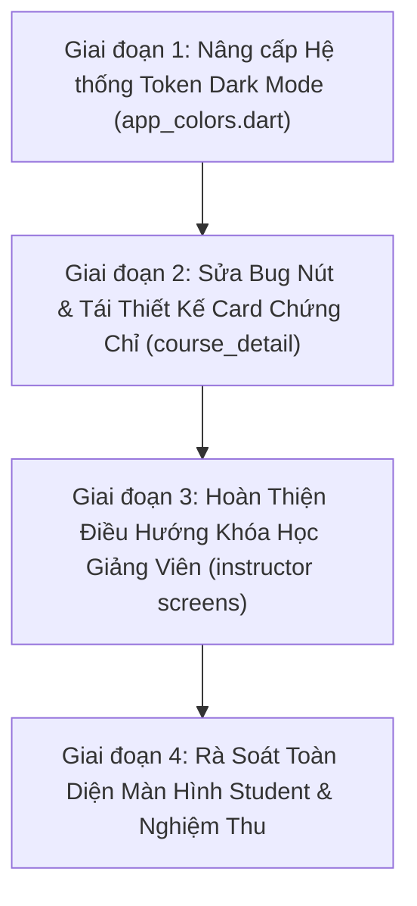

# KẾ HOẠCH KHẮC PHỤC LỖI UI ROLE STUDENT: ĐIỀU HƯỚNG KHÓA HỌC GIẢNG VIÊN, TÁI THIẾT KẾ CARD CHỨNG CHỈ & XỬ LÝ TOÀN DIỆN DARK MODE

> **Mã tài liệu:** `STUDENT_UI_COURSE_CERT_DARKMODE_FIX_PLAN.md`  
> **Thư mục:** `mobile/docs/insight_UI_student/`  
> **Phạm vi:** Phân hệ Học sinh (Role Student) trên ứng dụng Flutter Mobile  
> **Trạng thái:** Bản phân tích & Kế hoạch chi tiết (Analysis & Execution Plan - Không code ở bước này)  
> **Thời điểm lập:** 24/10/2026  

---

## 1. TỔNG QUAN YÊU CẦU & BỐI CẢNH

Qua khảo sát thực tế trên toàn bộ codebase của phân hệ Student (`mobile/lib/features/student/`), hiện có 3 vấn đề then chốt ảnh hưởng trực tiếp đến trải nghiệm học tập và tính thẩm mỹ:

1. **Lỗi điều hướng khóa học của giảng viên:** Khi học sinh truy cập vào danh sách khóa học của giảng viên (`InstructorCoursesScreen`) hoặc xem các khóa học tại hồ sơ giảng viên (`InstructorDetailScreen`), click vào thẻ khóa học không chuyển tới màn hình xem thông tin chi tiết khóa học (`CourseDetailScreen`).
2. **Card chứng chỉ thô & Bug không bấm lại được sau khi back:**
   - Tại màn hình chi tiết khóa học (`CourseDetailScreen`), khi khóa học đạt 100% và có chứng chỉ, khối card hoàn thành khóa học kèm nút màu xanh lá được thiết kế thô ráp, cứng nhắc, chật chội và vỡ thẩm mỹ khi dùng trong Dark Mode.
   - Bug logic: Học sinh bấm "Xem chứng chỉ" để mở màn hình chứng chỉ (`CertificateDetailScreen`), sau đó bấm nút Back quay lại chi tiết khóa học thì nút "Xem chứng chỉ" bị đơ, bấm lại không còn phản hồi.
3. **Mất chữ / Không đổi màu chữ khi chuyển sang Dark Mode:**
   - Toàn bộ các tiêu đề chính, lời chào, tên khóa học và thanh header ở hầu hết các màn hình (Home, Khóa học của tôi, Thẻ tiến độ, Khám phá khóa học...) bị biến thành chữ đen trên nền tối khiến chữ bị "biến mất" hoàn toàn hoặc độ tương phản cực kỳ thấp, không thể đọc được.

---

## 2. PHÂN TÍCH NGUYÊN NHÂN GỐC RỄ (ROOT CAUSE ANALYSIS)

### 2.1. Yêu cầu 1: Lỗi không điều hướng khi click khóa học giảng viên

#### A. Tại màn hình Khóa học của giảng viên (`InstructorCoursesScreen`)
- **Vị trí tệp:** `mobile/lib/features/student/presentation/learning/instructor_courses_screen.dart` (dòng 475 - 486).
- **Hiện trạng code:**
  ```dart
  // instructor_courses_screen.dart dòng 475-485
  child: InkWell(
    borderRadius: BorderRadius.circular(AppRadius.lg),
    onTap: () {
      ScaffoldMessenger.of(context).showSnackBar(
        SnackBar(
          content: Text('Khóa học: ${course.title}'),
          behavior: SnackBarBehavior.floating,
          duration: const Duration(seconds: 1),
        ),
      );
    },
    child: Padding(...),
  )
  ```
- **Nguyên nhân:** Sự kiện `onTap` của thẻ khóa học mới chỉ được viết dạng **stub/mock tạm thời** (hiển thị `SnackBar`), chưa gọi lệnh điều hướng sang `CourseDetailScreen`.

#### B. Tại thẻ khóa học ngang ở màn hình Chi tiết giảng viên (`InstructorDetailScreen`)
- **Vị trí tệp:**
  - `mobile/lib/features/student/presentation/learning/widgets/instructor_course_card.dart`
  - `mobile/lib/features/student/presentation/learning/instructor_detail_screen.dart` (dòng 410 - 438)
- **Hiện trạng code:**
  - Widget `InstructorCourseCard` hoàn toàn không có tham số `onTap`, không được bọc bởi `InkWell` hay `GestureDetector`.
  - Thẻ chỉ là một `Container` tĩnh hiển thị thông tin, học sinh chạm vào không có bất kỳ phản hồi xúc giác (ripple) hay hành động nào.

---

### 2.2. Yêu cầu 2: Bug nút xem chứng chỉ & Thiết kế card chứng chỉ thô

#### A. Bug "Bấm vào xem chứng chỉ xong back về thì không bấm được nữa"
- **Vị trí tệp:**
  - `mobile/lib/features/student/presentation/learning/course_detail/course_detail_screen.dart` (dòng 128 - 148, dòng 235)
  - `mobile/lib/features/student/bloc/course_detail/course_detail_bloc.dart` (dòng 161 - 191)
- **Chuỗi sự kiện gây lỗi:**
  1. Khi người dùng bấm nút "Xem chứng chỉ" trên `CourseProgressCard`:
     ```dart
     onViewCertificate: () => _requestCertificate(context, state.enrollment.id),
     ```
     Lệnh này bắn event `CourseDetailCertificateRequested(enrollmentId)` vào `CourseDetailBloc`.
  2. `CourseDetailBloc` xử lý và emit state mới:
     ```dart
     emit(currentState.copyWith(certificate: cert));
     ```
  3. Trên `CourseDetailScreen`, việc chuyển trang phụ thuộc hoàn toàn vào `BlocConsumer.listener`:
     ```dart
     listenWhen: (prev, curr) {
       if (prev is! CourseDetailSuccess || curr is! CourseDetailSuccess) return false;
       return prev.isBookmarked != curr.isBookmarked ||
           (prev.certificate == null && curr.certificate != null); // <-- ĐIỂM GÃY TẠI ĐÂY
     },
     listener: (context, state) {
       final cert = state.certificate;
       if (cert != null) {
         Navigator.push(context, MaterialPageRoute(builder: (_) => CertificateDetailScreen(certificate: cert)));
       }
     }
     ```
  4. **Cơ chế gây đơ (Bug Reproduction):**
     - **Lần bấm 1:** `prev.certificate` là `null`, `curr.certificate` có giá trị `cert`. Điều kiện `(prev.certificate == null && curr.certificate != null)` là **`true`** $\rightarrow$ `listener` chạy và mở `CertificateDetailScreen`.
     - **Người dùng bấm Back:** Màn hình quay trở về `CourseDetailScreen`. Lúc này, trong bộ nhớ của `CourseDetailBloc`, `state.certificate` **vẫn đang mang giá trị `cert`** (không hề bị reset về `null`).
     - **Lần bấm 2:** Người dùng bấm lại nút "Xem chứng chỉ". Hàm `_requestCertificate` gửi tiếp event `CourseDetailCertificateRequested`. Bloc emit lại state có `certificate: cert`.
     - Lúc này, cả `prev.certificate` và `curr.certificate` đều là `cert` (đều khác `null`).
     - Biểu thức `(prev.certificate == null && curr.certificate != null)` trả về **`false`**!
     - `listenWhen` chặn cập nhật, `listener` **không được kích hoạt**, và không có lệnh điều hướng nào được gọi. Nút bấm hoàn toàn vô tác dụng!

#### B. Khuyết điểm thiết kế hiện tại của Card chứng chỉ
- **Vị trí tệp:** `mobile/lib/features/student/presentation/learning/course_detail/widgets/course_progress_card.dart` (dòng 99 - 174).
- **Vấn đề thẩm mỹ & trải nghiệm:**
  - **Màu sắc thô cứng (Hardcoded Colors):** Sử dụng các mã màu cố định `0xFFECFDF5` (nền xanh mint bợt), `0xFFA7F3D0` (viền mint), `0xFF059669` (nút xanh lá đậm). Khi sang Dark Mode, màu nền xanh mint này sáng chói lọi, tương phản gay gắt với nền đen của ứng dụng.
  - **Bố cục chật chội (Cramped Row):** Ép tất cả trong 1 hàng ngang duy nhất: `[Icon tròn 40px] + [Cột 2 dòng Text] + [Nút FilledButton to bản]`. Trên màn hình hẹp, phần tiêu đề dài "Chúc mừng! Khóa học đã hoàn thành" bị co rúm, xuống dòng xấu xí, trông như một thông báo cảnh báo (alert banner) tạm thời thay vì một tấm thẻ chứng nhận thành tích trang trọng.
  - **Thiếu cảm xúc vinh danh (Lack of Prestige):** Hoàn thành 100% khóa học là cột mốc lớn nhất của học sinh, nhưng chiếc card hiện tại không mang lại cảm giác tự hào hay cao cấp (thiếu chi tiết huy hiệu ánh kim, thiếu sự tinh gọn của Material 3).

---

### 2.3. Yêu cầu 3: Lỗi mất chữ / Không đổi màu chữ khi chuyển Dark Mode

#### A. Nguyên nhân cốt lõi số 1: Lỗi kiến trúc Token trong `app_colors.dart` (`TogetherColorsX`)
- **Vị trí tệp:** `mobile/lib/theme/app_colors.dart` (dòng 55 - 89).
- **Đoạn code khiếm khuyết:**
  ```dart
  // app_colors.dart
  extension TogetherColorsX on ColorScheme {
    Color get slate50 => const Color(0xFFF8FAFC);
    Color get slate100 => const Color(0xFFF1F5F9);
    ...
    Color get slate500 => const Color(0xFF64748B);
    Color get slate700 => const Color(0xFF334155);
    Color get slate800 => const Color(0xFF1E293B);
    Color get slate900 => const Color(0xFF0F172A); // <-- MÀU ĐEN CỐ ĐỊNH CHO MỌI CHẾ ĐỘ!
  }
  ```
- **Hệ quả dây chuyền:**
  - Các lập trình viên khi code UI đã gọi `cs.slate900` cho tiêu đề và `cs.slate500` cho phụ đề vì nghĩ rằng extension trên `ColorScheme` sẽ tự thích ứng sáng/tối.
  - Thực tế, `slate900` luôn trả về `#0F172A` (màu đen sẫm gần như tuyệt đối).
  - Khi bật Dark Mode, nền ứng dụng chuyển sang màu tối `#12151B`. Chữ đen `#0F172A` đặt trên nền đen `#12151B` khiến **100% chữ bị chìm mất hoàn toàn vào màn hình**!

#### B. Các điểm cụ thể bị "mất chữ" trên UI Student:
1. **Thanh Header dùng chung (`StudentAppHeader`):**
   - Tệp: `widgets/student_app_header.dart` (dòng 202, 214).
   - Tiêu đề màn hình dùng `color: cs.slate900` $\rightarrow$ Mất tiêu đề ở toàn bộ các tab: *Khóa học của tôi, Lịch học, Thành tích, Yêu thích...*
   - Chuông thông báo dùng `color: cs.slate700` $\rightarrow$ Tối đen, khó nhìn.
2. **Top Bar Trang chủ (`StudentHomeTopBar`):**
   - Tệp: `widgets/student_home_top_bar.dart` (dòng 54, 87).
   - Nút menu Drawer dùng `cs.slate800`, chuông dùng `cs.slate700` $\rightarrow$ Tối đen trên nền Dark Mode.
3. **Tab Trang chủ (`HomeScreen` & Widgets con):**
   - Lời chào đầu trang: `'${_greeting()}, $firstName'` dùng `color: cs.slate900` (dòng 183).
   - Các thẻ `ContinueLearningCard`, `HomeDailyGoalsCard`, `AssignmentList`, `ScheduleTimeline`, `WeeklyAchievementCard`, `ExploreCoursesCard`, `AchievementPlaceholder`: Toàn bộ tiêu đề thẻ dùng `cs.slate900`, mô tả dùng `cs.slate500`.
4. **Tab Học tập (`LearningScreen` & `CourseCard`):**
   - Tệp: `widgets/course_card.dart` (dòng 90, 120, 137).
   - Tiêu đề khóa học dùng `cs.slate900`, tên giảng viên và số bài học dùng `cs.slate500`.
5. **Màn hình Khám phá khóa học (`ExploreCoursesScreen`):**
   - Khung tìm kiếm (dòng 314): Nền hardcoded `Colors.white`, chữ gõ vào `color: Color(0xFF1E293B)`.
   - Thẻ khóa học (dòng 813): Nền `Colors.white`, tiêu đề `cs.slate900`, tên giảng viên `cs.slate500`.
6. **Màn hình Khóa học của giảng viên (`InstructorCoursesScreen`):**
   - Nền thẻ hardcoded `color: Colors.white` (dòng 458).
   - Tiêu đề dùng `cs.slate900` (dòng 584), giá tiền `Color(0xFF0F172A)` (dòng 572), số sao rating `Color(0xFF0F172A)` (dòng 607).

---

## 3. GIẢI PHÁP CHI TIẾT & BẢN THIẾT KẾ ĐỀ XUẤT

### 3.1. Giải pháp Yêu cầu 1: Hoàn thiện Điều hướng Khóa học Giảng viên

#### A. Cập nhật `InstructorCoursesScreen`
- Tại phương thức `_buildCourseCard` (dòng 475), thay thế đoạn code hiển thị `SnackBar` bằng logic điều hướng chuẩn của dự án:
  ```dart
  onTap: () {
    Navigator.of(context).push(
      MaterialPageRoute<void>(
        builder: (_) => BlocProvider(
          create: (_) => diContainer<CourseDetailBloc>()
            ..add(CourseDetailStarted(course.id, isEnrollment: course.isEnrolled)),
          child: const CourseDetailScreen(),
        ),
      ),
    );
  }
  ```

#### B. Cập nhật `InstructorCourseCard` & `InstructorDetailScreen`
- Bổ sung tham số `final VoidCallback? onTap;` hoặc `final String? courseId;` vào `InstructorCourseCard`.
- Bọc toàn bộ thẻ bằng `Material` trong suốt và `InkWell` với `borderRadius: BorderRadius.circular(AppRadius.lg)` để mang lại hiệu ứng gợn sóng khi chạm.
- Tại `InstructorDetailScreen`, truyền callback điều hướng mở `CourseDetailScreen` khi học sinh click vào từng khóa học trong danh sách lướt ngang.

---

### 3.2. Giải pháp Yêu cầu 2: Sửa Bug Nút & Tái Thiết Kế Card Chứng Chỉ

#### A. Khắc phục Bug không bấm lại được nút "Xem chứng chỉ"
- Sửa đổi trực tiếp tại `CourseDetailScreen`:
  1. Trong hàm callback `onViewCertificate`:
     ```dart
     onViewCertificate: () {
       final currentCert = state.certificate;
       if (currentCert != null) {
         // Nếu chứng chỉ đã có sẵn trong state, mở màn hình chứng chỉ ngay lập tức
         Navigator.of(context).push(
           MaterialPageRoute<void>(
             builder: (_) => CertificateDetailScreen(certificate: currentCert),
           ),
         );
       } else {
         // Nếu chưa có, kích hoạt request để lấy chứng chỉ từ backend
         _requestCertificate(context, state.enrollment.id);
       }
     }
     ```
  2. Tại `BlocConsumer.listener`: Giữ nguyên nhiệm vụ lắng nghe khi chứng chỉ được cấp mới từ backend để tự động navigate lần đầu khi kết quả trả về.
  $\rightarrow$ **Kết quả:** Học sinh bấm xem chứng chỉ lần đầu $\rightarrow$ mở màn hình; bấm Back về $\rightarrow$ bấm lại nút lần 2, lần 3... vẫn lập tức mở màn hình chứng chỉ mượt mà, không bao giờ bị đơ.

#### B. Bản vẽ thiết kế mới Card Chứng Chỉ (Milestone Celebration Card)

##### Triết lý thiết kế:
- **Tôn vinh & Sang trọng:** Sử dụng biểu tượng huy hiệu kết hợp tông màu xanh ngọc bảo / hoàng kim tinh tế, phân định rõ ràng giữa phần thông tin thành tích và nút hành động.
- **Thích ứng 100% Theme Tokens:** Tuyệt đối không hardcode màu sắc. Tự động chuyển đổi giữa Light Mode và Dark Mode.
- **Bố cục 2 tầng cân đối (Balanced Stack Layout):** Tránh hiện tượng co ép chữ trong một hàng ngang chật chội.

##### Bố cục giao diện (Wireframe Concept):
```text
┌─────────────────────────────────────────────────────────────┐
│  [★] HOÀN THÀNH XUẤT SẮC                         100% TIẾN ĐỘ│
│                                                             │
│  Chứng chỉ tốt nghiệp khóa học                              │
│  Chúc mừng bạn đã hoàn thành trọn vẹn toàn bộ bài học.      │
│  Chứng chỉ chính thức đã sẵn sàng để xem và lưu trữ.        │
│                                                             │
│  ┌───────────────────────────────────────────────────────┐  │
│  │   [Icon Chứng Chỉ]   Xem & Tải Chứng Chỉ        →     │  │  (Nút Pill hiện đại)
│  └───────────────────────────────────────────────────────┘  │
└─────────────────────────────────────────────────────────────┘
```

##### Thông số kỹ thuật Design Tokens cho Card mới:
- **Container nền:**
  - Light Mode: `cs.surfaceContainerLowest` với viền `Border.all(color: cs.secondary.withValues(alpha: 0.25), width: 1.0)`. Đổ bóng mờ nhẹ `BoxShadow(color: cs.secondary.withValues(alpha: 0.06), blurRadius: 16, offset: Offset(0, 4))`.
  - Dark Mode: `cs.surfaceContainerHigh` với viền `cs.secondary.withValues(alpha: 0.35)`.
- **Huy hiệu (Badge Icon):**
  - Khung squircle bo góc 12px với màu nền `cs.secondaryContainer.withValues(alpha: 0.6)`.
  - Icon: `Icons.workspace_premium_rounded` hoặc `Icons.verified_rounded` màu `cs.secondary` rạng rỡ.
- **Typography:**
  - Tag trạng thái: `tt.labelSmall` in hoa, màu `cs.secondary`, đậm nét (`FontWeight.w800`).
  - Tiêu đề thành tích: `tt.titleMedium` (`16px`, `FontWeight.w700`), màu `cs.onSurface`.
  - Phụ đề chúc mừng: `tt.bodySmall` (`12px`), màu `cs.onSurfaceVariant`, chiều cao dòng thông thoáng (`height: 1.4`).
- **Nút hành động "Xem chứng chỉ":**
  - Dạng nút: `FilledButton.icon` kiểu Pill bo tròn tuyệt đối (`AppRadius.full`).
  - Màu nền nút: Tông xanh chính `cs.primary` hoặc xanh ngọc `cs.secondary` với độ tương phản chuẩn WCAG AAA.
  - Icon đi kèm: `Icons.card_membership_rounded` hoặc `Icons.arrow_forward_rounded` kích thước `18px`.
  - Padding nút: `symmetric(horizontal: 20, vertical: 12)`, trải dài toàn chiều ngang hoặc căn phải tinh tế, mang lại điểm chạm xúc giác rõ rệt.

---

### 3.3. Giải pháp Yêu cầu 3: Khắc phục Toàn diện Lỗi Mất Chữ trong Dark Mode

Giải pháp được thực hiện theo nguyên lý **"Sửa một lần ở tầng Token, bảo đảm an toàn ở tầng Component"**:

#### Bước 1: Nâng cấp linh hoạt hệ thống Slate Tokens tại `mobile/lib/theme/app_colors.dart`
Cập nhật extension `TogetherColorsX on ColorScheme` để toàn bộ dải màu trung tính Slate tự động phản chiếu (invert) khi chuyển sang Dark Mode:

```dart
extension TogetherColorsX on ColorScheme {
  bool get _isDark => brightness == Brightness.dark;

  /// Slate 900 - Text chính / Tiêu đề quan trọng
  Color get slate900 => _isDark ? const Color(0xFFF8FAFC) : const Color(0xFF0F172A);

  /// Slate 800 - Text tiêu đề vừa / Icon hành động
  Color get slate800 => _isDark ? const Color(0xFFF1F5F9) : const Color(0xFF1E293B);

  /// Slate 700 - Subtitle / Icon phụ
  Color get slate700 => _isDark ? const Color(0xFFE2E8F0) : const Color(0xFF334155);

  /// Slate 600 - Nội dung phụ trợ
  Color get slate600 => _isDark ? const Color(0xFFCBD5E1) : const Color(0xFF475569);

  /// Slate 500 - Caption / Muted text
  Color get slate500 => _isDark ? const Color(0xFF94A3B8) : const Color(0xFF64748B);

  /// Slate 400 - Icon disabled / Border thứ cấp
  Color get slate400 => _isDark ? const Color(0xFF64748B) : const Color(0xFF94A3B8);

  /// Slate 200 - Đường kẻ viền phân cách
  Color get slate200 => _isDark ? const Color(0xFF334155) : const Color(0xFFE2E8F0);

  /// Slate 100 - Nền thẻ phụ
  Color get slate100 => _isDark ? const Color(0xFF1E293B) : const Color(0xFFF1F5F9);

  /// Slate 50 - Nền sáng
  Color get slate50 => _isDark ? const Color(0xFF0F172A) : const Color(0xFFF8FAFC);
}
```
*Lợi ích đột phá:* Ngay khi sửa bước này, hơn 90% các vị trí đang bị mất chữ (do dùng `cs.slate900`, `cs.slate800`, `cs.slate700`, `cs.slate500`) trên toàn bộ ứng dụng sẽ **ngay lập tức hiển thị sắc nét với độ tương phản hoàn hảo** trên nền tối mà không làm vỡ giao diện Light Mode hiện có!

#### Bước 2: Chuẩn hóa Container nền và dọn sạch các mã màu Hardcoded
1. **Loại bỏ `Colors.white` trên Card nền:**
   - Thay thế `color: Colors.white` tại `InstructorCoursesScreen`, `ExploreCoursesScreen`, `InstructorReviewsScreen` bằng:
     ```dart
     color: cs.surfaceContainerLowest, // Tự động là trắng trong Light Mode, và xám sẫm 0xFF181B22 trong Dark Mode
     ```
2. **Loại bỏ các mã màu chữ hardcoded:**
   - Thay thế các đoạn code dùng `color: Color(0xFF0F172A)` hoặc `color: Color(0xFF1E293B)` bằng token ngữ nghĩa `color: cs.onSurface`.
   - Thay thế các đoạn code phụ đề mờ bằng `color: cs.onSurfaceVariant`.
3. **Chuẩn hóa thanh tìm kiếm (`SearchBar`):**
   - Nền thanh tìm kiếm: chuyển sang `cs.surfaceContainerLowest` hoặc `cs.surfaceContainerLow`.
   - Text gõ vào: sử dụng `style: TextStyle(color: cs.onSurface)`.
   - Hint text: sử dụng `hintStyle: TextStyle(color: cs.onSurfaceVariant)`.

---

## 4. BẢN ĐỒ CÁC TỆP TIN CẦN TÁC ĐỘNG (FILE MATRIX)

| STT | Tệp tin | Vấn đề xử lý | Nội dung can thiệp |
| :--- | :--- | :--- | :--- |
| **1** | `mobile/lib/theme/app_colors.dart` | Yêu cầu 3 | Cập nhật `TogetherColorsX` để dải màu `slate*` tự động đảo màu theo `brightness == Brightness.dark`. |
| **2** | `mobile/lib/features/student/presentation/learning/instructor_courses_screen.dart` | Yêu cầu 1 & 3 | Thêm điều hướng tới `CourseDetailScreen`; thay `Colors.white` và `Color(0xFF0F172A)` bằng tokens ngữ nghĩa. |
| **3** | `mobile/lib/features/student/presentation/learning/widgets/instructor_course_card.dart` | Yêu cầu 1 & 3 | Bổ sung `onTap` và `InkWell` cho thẻ; kiểm tra màu text thích ứng dark mode. |
| **4** | `mobile/lib/features/student/presentation/learning/instructor_detail_screen.dart` | Yêu cầu 1 | Gắn callback mở `CourseDetailScreen` khi click vào thẻ khóa học của giảng viên. |
| **5** | `mobile/lib/features/student/presentation/learning/course_detail/course_detail_screen.dart` | Yêu cầu 2 | Sửa logic click nút xem chứng chỉ: nếu đã có chứng chỉ trong state thì navigate ngay lập tức, không để bị đơ nút khi back về. |
| **6** | `mobile/lib/features/student/presentation/learning/course_detail/widgets/course_progress_card.dart` | Yêu cầu 2 & 3 | Tái thiết kế card chúc mừng & chứng chỉ sang trọng, tinh tế; dùng tokens thay thế toàn bộ màu hardcoded `#ECFDF5`. |
| **7** | `mobile/lib/features/student/presentation/learning/explore_courses_screen.dart` | Yêu cầu 3 | Thay `Colors.white` trên khung tìm kiếm và thẻ khóa học bằng `cs.surfaceContainerLowest`; dùng `cs.onSurface`. |
| **8** | `mobile/lib/features/student/presentation/widgets/student_app_header.dart` | Yêu cầu 3 | Rà soát tiêu đề trang lớn đảm bảo hiển thị rõ ràng trên nền dark mode (được thừa hưởng từ sửa đổi `app_colors.dart`). |
| **9** | `mobile/lib/features/student/presentation/widgets/student_home_top_bar.dart` | Yêu cầu 3 | Rà soát icon menu và icon chuông đảm bảo sáng rõ trên dark mode (được thừa hưởng từ sửa đổi `app_colors.dart`). |

---

## 5. LỘ TRÌNH THỰC HIỆN TUẦN TỰ (4 GIAI ĐOẠN)



### Giai đoạn 1: Nâng cấp Hệ thống Token Dark Mode cốt lõi (`app_colors.dart`)
1. Cập nhật `TogetherColorsX` trong `mobile/lib/theme/app_colors.dart`.
2. Kiểm tra tính toàn vẹn của ứng dụng để đảm bảo không phát sinh regression trên giao diện Light Mode.

### Giai đoạn 2: Sửa Bug Nút & Tái Thiết Kế Card Chứng Chỉ (`CourseDetail`)
1. Sửa logic callback `onViewCertificate` trong `course_detail_screen.dart` để hỗ trợ mở ngay chứng chỉ khi state đã có dữ liệu.
2. Tái cấu trúc lại widget hiển thị khi `isCompleted == true` trong `course_progress_card.dart` theo bản thiết kế sang trọng, thanh lịch, chuẩn Material 3 Tokens.

### Giai đoạn 3: Hoàn thiện Điều hướng Khóa học Giảng viên
1. Bổ sung `onTap` vào `InstructorCourseCard` và kết nối điều hướng tại `InstructorDetailScreen`.
2. Thay thế SnackBar bằng điều hướng `CourseDetailScreen` trong `InstructorCoursesScreen`.
3. Thay thế các container `Colors.white` và text hardcoded trong `InstructorCoursesScreen` sang theme tokens.

### Giai đoạn 4: Rà soát Toàn diện & Nghiệm thu
1. Kiểm tra màn hình Khám phá khóa học (`ExploreCoursesScreen`) về khung tìm kiếm và danh sách khóa học.
2. Kiểm tra chu trình chuyển đổi Light Mode $\leftrightarrow$ Dark Mode trên toàn bộ 5 tab chính của vai trò Student.
3. Chạy `flutter analyze` để đảm bảo 0 lỗi cảnh báo, 0 lỗi cú pháp.

---

## 6. TIÊU CHÍ NGHIỆM THU (ACCEPTANCE CRITERIA)

- [ ] **Tiêu chí 1 (Khóa học giảng viên):** Bấm vào bất kỳ khóa học nào trong trang "Khóa học của giảng viên" (`InstructorCoursesScreen`) hoặc trong danh sách ngang của "Chi tiết giảng viên" (`InstructorDetailScreen`) đều chuyển trang mượt mà sang `CourseDetailScreen` đúng với thông tin khóa học đó.
- [ ] **Tiêu chí 2 (Không còn bug nút chứng chỉ):** Tại khóa học đã hoàn thành 100%, bấm "Xem chứng chỉ" mở ra `CertificateDetailScreen`. Sau đó bấm nút Back quay lại, bấm tiếp "Xem chứng chỉ" lần 2, lần 3... vẫn mở bình thường, không bao giờ bị đơ nút.
- [ ] **Tiêu chí 3 (Card chứng chỉ tinh tế):** Card chúc mừng hoàn thành khóa học có diện mạo trang trọng, thanh lịch, không bị vỡ giao diện trên màn hình hẹp, tôn vinh thành tích học sinh, sử dụng 100% Design Tokens.
- [ ] **Tiêu chí 4 (Dark Mode hoàn hảo):** Khi chuyển sang Dark Mode, 100% chữ tiêu đề (Header, Lời chào, Tên khóa học, Nhãn ca học, Thanh tìm kiếm) đều hiển thị rõ ràng, sắc nét, tương phản đạt chuẩn WCAG, không có hiện tượng chữ đen chìm trên nền tối hay chữ trắng chìm trên thẻ trắng.
- [ ] **Tiêu chí 5 (Chất lượng mã nguồn):** Không sửa đổi business logic của Backend, mã nguồn Flutter tuân thủ kiến trúc BLoC hiện tại, không gây breaking changes cho các vai trò khác.
