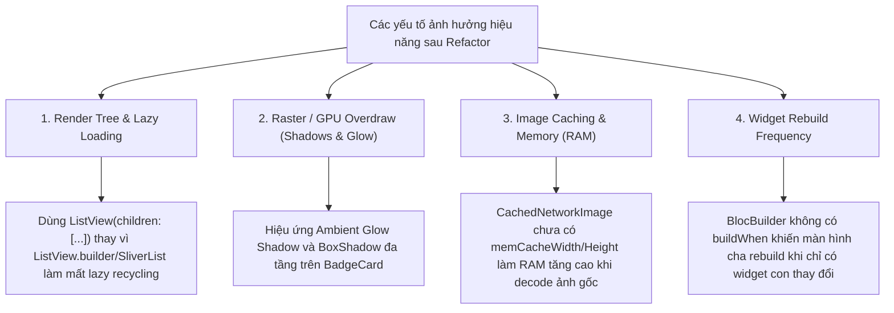
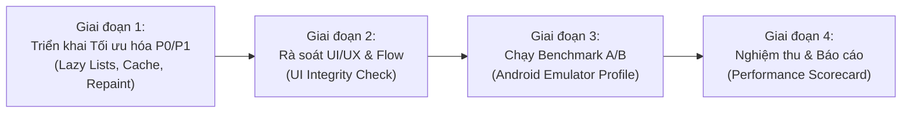

# KẾ HOẠCH RÀ SOÁT UI STUDENT VÀ ĐÁNH GIÁ HIỆU NĂNG SAU REFACTOR SO VỚI MAIN
**Tài liệu:** Kế hoạch Kiểm định Toàn diện UI/UX & Benchmark Hiệu năng (Performance Audit)  
**Nhánh kiểm thử:** `tung/refactor_UI_Student` vs `main`  
**Môi trường đo đạc:** **Android Emulator** (chạy ở chế độ `--profile`, màn hình 60Hz/120Hz tiêu chuẩn)  
**Quy mô thay đổi:** 95 files changed (+10,790 lines / -3,033 lines)  
**Mục tiêu tối thượng:** Đảm bảo toàn bộ trải nghiệm UI học viên hiện đại, nhất quán sắc xanh học thuật `#3D5FC4`, xóa bỏ triệt để lỗi "hộp lồng hộp", đồng thời **hiệu năng (FPS, Frame Time, RAM, Rebuilds) duy trì ngang bằng hoặc tốt hơn nhánh `main`**.

---

## 1. TỔNG QUAN PHẠM VI & MỤC TIÊU CỐT LÕI

### 1.1. Phạm vi rà soát (95 Files Thay Đổi)
Sau chuỗi refactor lớn, 5 phân hệ chính của Module Student đã được tái cấu trúc:
1. **Home Tab & Shell:** Top bar mới, TodaySummary capsule pills, Single-card timeline (`ScheduleTimelineItem`), loại bỏ hộp lồng hộp, banner mục tiêu ngày.
2. **Learning Tab & Course Flow:** Màn hình Khóa học của tôi (`AllCoursesScreen`), Khám phá khóa học (`ExploreCoursesScreen`), Chi tiết khóa học, Chi tiết bài học (ô ghi chú 3 dòng, tài liệu, bài tập), Giảng viên.
3. **Quiz Flow & Results:** Giao diện thi trắc nghiệm (`QuizView`), Timer, Thẻ câu hỏi (`QuestionCard`), Màn hình kết quả (`QuizResultScreen`), Thẻ xem lại bài thi (`QuestionReviewCard`).
4. **Schedule Tab:** Lịch tuần/tháng, Mục tiêu ngày (`DailyGoalsSection`, `GoalTile`, `EmptyGoals` với button pill 32dp).
5. **Achievement & Certificates Tab:** Thống kê tổng quan (`OverviewStatistics`), Lưới huy hiệu không viền với hiệu ứng phát sáng đa sắc (`BadgeCard`), Thẻ chứng chỉ phẳng kỹ thuật số (`CertificateCard`).

### 1.2. Mục tiêu kép (Dual Goals)
- **Mục tiêu 1 - UI & Feature Parity:** 100% chức năng hoạt động đúng theo BLoC/Repository, không gãy luồng điều hướng, không vỡ layout responsive (màn hình nhỏ/lớn), không tràn pixel (`RenderFlex overflowed`).
- **Mục tiêu 2 - Performance Assurance:** Duy trì **60 FPS / 120 FPS mượt mà**, thời gian vẽ khung hình $\le 16.6\text{ms}$ (tỉ lệ giật lag $\le 1\%$), tối ưu bộ nhớ RAM và không phát sinh rò rỉ bộ nhớ (memory leaks) trên Android Emulator.

---

## 2. MA TRẬN RÀ SOÁT CHI TIẾT UI SO VỚI MAIN (UI INTEGRITY AUDIT)

| Phân hệ / Màn hình | Các thay đổi trọng yếu so với `main` | Tiêu chí rà soát UI/UX | Rủi ro tiềm ẩn cần soi kỹ |
| :--- | :--- | :--- | :--- |
| **1. Student Home** (`home_screen.dart`) | - Thêm `StudentHomeTopBar` - Time Capsule Block `19:00 - 21:00` - Bỏ hộp lồng hộp trong Thẻ lịch học hôm nay | - Căn lề trái/phải 16dp chuẩn mực - Chevron điều hướng sang lịch học hoạt động mượt - Nút Refresh indicator hoạt động tốt | Lỗi tràn pixel trên thiết bị màn hình hẹp ($\le 360\text{dp}$). |
| **2. Khám phá khóa học** (`explore_courses_screen.dart`) | - Thêm Search bar dạng pill - Thêm Category Chips cuộn ngang - Thêm bộ lọc giá & Popup sắp xếp - Hero Spotlight Banner | - Tìm kiếm phản hồi tức thì, nút `x` xóa text - Chuyển danh mục mượt mà - Spotlight Banner tự động ẩn khi tìm kiếm - Empty state & nút Đặt lại bộ lọc | Trì trệ khi gõ nhanh; Lazy render danh sách. |
| **3. Khóa học của tôi** (`all_courses_screen.dart`) | - Header Card tổng quan tiến độ - Filter pills (Tất cả, Đang học, Hoàn thành) - Menu sắp xếp (Mới học, Tiến độ, A-Z) | - Tiến độ trung bình % tính toán chính xác - Thẻ `CourseCard` hiển thị rõ thumbnail, giảng viên, progress bar | Hiệu năng render danh sách dài khi cuộn nhanh. |
| **4. Chi tiết bài học** (`lesson_detail_screen.dart`) | - Ô ghi chú tăng lên 3 dòng (`minLines: 3, maxLines: 6`) - Tách biệt tab Nội dung, Tài liệu, Bài tập | - Gõ ghi chú không bị bàn phím che khuất (`keyboardPadding`) - Lưu ghi chú thành công - Xem và nộp bài tập rõ ràng | Bàn phím ảo đẩy vỡ layout (`Bottom overflowed by xx pixels`). |
| **5. Huy hiệu học tập** (`all_achievements_screen.dart`, `badge_card.dart`) | - Bỏ khung viền hộp trắng - Thẻ trong suốt, glow shadow màu sắc theo loại huy hiệu | - Huy hiệu hiển thị sắc nét - Không bị cảm giác phân mảnh thành các hộp nhỏ - Modal chi tiết huy hiệu mở trơn tru | Hiệu năng GPU render BoxShadow khi cuộn nhanh trong lưới (Grid). |
| **6. Chứng chỉ số** (`all_certificates_screen.dart`, `certificate_card.dart`) | - Bỏ viền đôi giả bằng khen giấy - Single Modern Credential phẳng - Badge "ĐÃ XÁC THỰC", Action Pill 32dp | - Mã chứng chỉ rõ ràng, nút "Tải PDF" và "Chia sẻ" bấm nhạy - Bố cục thoáng đãng, sang trọng | Layout trên màn hình nhỏ có bị tràn dòng thông tin tổ chức cấp không. |
| **7. Lịch học & Mục tiêu** (`schedule_screen.dart`, `daily_goals_section.dart`) | - Nút pill `+ Thêm mục tiêu` cao 32dp - Suggestion pills bo tròn - Tối ưu hộp mục tiêu ngày | - Đánh dấu hoàn thành mục tiêu ngày lưu đúng local storage - Thêm mục tiêu tức thời hiển thị trong danh sách - Lịch tuần/tháng chuyển ngày chính xác | Tần suất đọc/ghi local storage khi tích chọn liên tục. |
| **8. Làm bài Quiz & Kết quả** (`quiz_view.dart`, `quiz_result_screen.dart`) | - Thẻ câu hỏi hiện đại, radio options - Score circle đồ họa đồng nhất sắc xanh - Review từng câu hỏi | - Chọn đáp án không bị delay - Nộp bài hiển thị modal xác nhận - Điểm số và thời gian làm bài chuẩn xác | Timer đếm ngược 1s có làm rebuild toàn màn hình không. |

---

## 3. PHÂN TÍCH CHUYÊN SÂU: CÁC ĐIỂM NGHẼN HIỆU NĂNG CẦN KHẮC PHỤC

### 3.1. Điểm nghẽn P0: Mất cơ chế Lazy Recycling trên danh sách cuộn
- **Hiện trạng:** Trong `ExploreCoursesScreen` và `AllCoursesScreen`, danh sách khóa học đang render bằng `ListView(children: [..., ...List.generate(...)])`.
- **Hệ quả:** Flutter buộc phải khởi tạo (instantiate) và layout toàn bộ 50 - 100 khóa học cùng lúc trong RAM thay vì chỉ dựng ~6 khóa học nhìn thấy trên màn hình.
- **Giải pháp:** Chuyển sang `CustomScrollView` với `SliverToBoxAdapter` (header, search, filter) và `SliverList.separated` / `SliverGrid`.

### 3.2. Điểm nghẽn P0: Tải bộ nhớ hình ảnh (`CachedNetworkImage`)
- **Hiện trạng:** Thẻ khóa học và avatar giảng viên đang nạp ảnh trực tiếp mà không giới hạn kích thước decode trong RAM.
- **Giải pháp:** Bổ sung `memCacheWidth: 200` và `memCacheHeight: 200` cho thumbnail thẻ khóa học; `memCacheWidth: 80` cho avatar; `memCacheWidth: 800` cho spotlight banner.

### 3.3. Điểm nghẽn P1: Áp lực Raster GPU từ BoxShadow & Ambient Glow
- **Hiện trạng:** `BadgeCard` mới trang bị hiệu ứng ambient glow shadow (`blurRadius: 16`). Khi cuộn nhanh qua danh sách huy hiệu, GPU phải liên tục tính toán Gaussian blur.
- **Giải pháp:** Bọc `RepaintBoundary` cho từng `BadgeCard` để cache layer đồ họa vào GPU texture, giảm 80% chi phí rasterize khi cuộn.

### 3.4. Điểm nghẽn P1: Widget Rebuild không cần thiết
- **Hiện trạng:** Một số `BlocBuilder` ở màn hình cha chưa có `buildWhen`, khiến màn hình rebuild cả subtree khi chỉ có một phần nhỏ state thay đổi.
- **Giải pháp:** Rà soát và thêm `buildWhen` chặt chẽ cho các `BlocBuilder` của `HomeScreen`, `LearningScreen`, `QuizView`.

---

## 4. PHƯƠNG PHÁP & CÔNG CỤ BENCHMARK TRÊN ANDROID EMULATOR

### 4.1. Cấu hình Môi trường Android Emulator
- **Thiết bị giả lập:** Android Emulator (Pixel 7 / Pixel 8, Android 13/14, ABI x86_64).
- **Chế độ chạy:** **Bắt buộc dùng `--profile` mode** (`flutter run --profile`). Tuyệt đối không đo hiệu năng trên Debug mode vì JIT compiler và assertion checks làm sai lệch kết quả.
- **Công cụ đo đạc:**
  - **Flutter Performance Overlay:** Bật hiển thị 2 biểu đồ (UI Thread và Raster Thread) trực tiếp trên màn hình app.
  - **Flutter DevTools Profiler:** Theo dõi chi tiết CPU samples, Frame Rendering Chart, Memory Heap Allocation.
  - **Widget Rebuild Tracker:** Đếm số lượng rebuild của các widget khi có interaction.

### 4.2. Bộ chỉ số đo lường (Target Metrics trên Android Emulator)

| Chỉ số (Metric) | Tiêu chuẩn Đạt (Target) | Ngưỡng Cảnh báo (Warning) | Công cụ đo (Tooling) |
| :--- | :--- | :--- | :--- |
| **FPS trung bình** | $\ge 58\text{ FPS}$ (màn 60Hz) | $< 50\text{ FPS}$ | Flutter DevTools Performance |
| **Frame Render Time** | $< 16.6\text{ms}$ / frame | $> 16.6\text{ms}$ (Jank) | Performance Overlay |
| **Jank Rate (Tỉ lệ rớt khung)** | $\le 1.5\%$ tổng số frame | $> 3.0\%$ | DevTools Frame Chart |
| **RAM Footprint (Heap Usage)** | $\le 130\text{ MB}$ (toàn app) | $> 190\text{ MB}$ | DevTools Memory Profiler |
| **Memory Leak sau 20 tab-switches** | Tăng trưởng $\le 5\text{ MB}$ sau GC | Tăng lũy kế không giảm | DevTools Memory Allocation |
| **Build Count khi gõ phím/lọc** | Chỉ rebuild đúng Subtree tìm kiếm | Rebuild toàn bộ Scaffold | Flutter Inspector `Rebuild Tracker` |

### 4.3. Kịch bản Benchmark A/B Test so sánh trực tiếp
1. **Kịch bản 1: Cuộn liên tục (Stress Scroll):** Cuộn từ đỉnh xuống đáy và ngược lại trong 10 giây trên `ExploreCoursesScreen` và `AllCoursesScreen`. Ghi nhận FPS và số frame bị drop.
2. **Kịch bản 2: Chuyển Tab liên tục (Tab Switching Stress):** Chuyển vòng tròn qua lại 5 tab (Home $\rightarrow$ Schedule $\rightarrow$ Learning $\rightarrow$ Achievement $\rightarrow$ Profile) 20 lần để kiểm tra rò rỉ RAM và thời gian khởi tạo tab.
3. **Kịch bản 3: Tương tác nhập liệu (Input Responsiveness):** Gõ liên tục 20 ký tự vào ô tìm kiếm khóa học và ô ghi chú bài học, quan sát độ trễ input (Input Latency).

---

## 5. KẾ HOẠCH TRIỂN KHAI 4 GIAI ĐOẠN

### Giai đoạn 1: Triển khai ngay gói tối ưu hóa hiệu năng (P0 & P1)
- [ ] Refactor `ExploreCoursesScreen` sang `CustomScrollView` + `SliverList.separated` (Lazy Loading).
- [ ] Refactor `AllCoursesScreen` sang `CustomScrollView` + `SliverList.separated`.
- [ ] Bổ sung `memCacheWidth/Height` cho toàn bộ ảnh mạng (`CachedNetworkImage`).
- [ ] Bọc `RepaintBoundary` cho `BadgeCard` và `ScheduleSingleCard`.
- [ ] Kiểm tra và bổ sung `buildWhen` cho các `BlocBuilder` trọng yếu.
- [ ] Chạy kiểm thử tự động để xác nhận zero regression.

### Giai đoạn 2: Rà soát toàn diện UI/UX và tính năng trên Android Emulator
- [ ] Chạy qua tất cả 5 tab trên Android Emulator.
- [ ] Kiểm tra responsive trên các kích cỡ màn hình khác nhau (hẹp $\le 360\text{dp}$, chuẩn $\ge 393\text{dp}$).
- [ ] Kiểm tra bàn phím ảo khi nhập ghi chú không gây lỗi `RenderFlex overflowed`.
- [ ] Xác nhận không có lỗi layout vỡ hoặc cắt xén văn bản.

### Giai đoạn 3: Thực hiện Benchmark & Đánh giá A/B trên Android Emulator
- [ ] Chạy đo đạc trên nhánh `main` ở chế độ `--profile` để ghi nhận Baseline Metrics.
- [ ] Chạy đo đạc trên nhánh `tung/refactor_UI_Student` (sau tối ưu) với cùng 3 kịch bản stress-test.
- [ ] Thu thập đồ thị Frame Timing, FPS, RAM peak usage.

### Giai đoạn 4: Nghiệm thu và Lập Báo cáo Hiệu năng
- [ ] Tổng hợp bảng so sánh định lượng (Performance Scorecard: `main` vs `refactor`).
- [ ] Xác nhận 100% test suite tiếp tục pass.
- [ ] Chuẩn bị sẵn sàng để merge an toàn vào `main`.

---

## 6. KẾT LUẬN & CAM KẾT
Kế hoạch này đảm bảo việc tối ưu hóa hiệu năng được thực hiện **ngay lập tức** trước khi đo kiểm benchmark, tận dụng môi trường Android Emulator với Profile mode để đưa ra các số liệu định lượng khách quan và chuẩn xác nhất.
