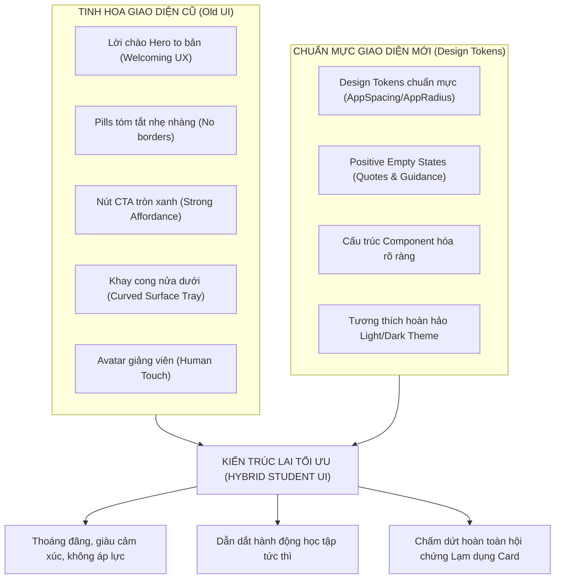
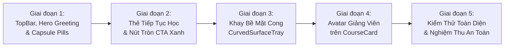

# KẾ HOẠCH TINH CHỈNH GIAO DIỆN HỌC SINH (STUDENT UI REFINEMENT PLAN)
## Kiến Trúc Lai Tối Ưu: Kết Hợp Tinh Hoa Old UI & Chuẩn Mực Design Tokens

> **Dự án:** 40Study Mobile App (`mobile/`)  
> **Nhánh thực hiện:** `tung/refactor_UI_Student`  
> **Tài liệu căn cứ:**  
> - Báo cáo đánh giá & phân tích lạm dụng Card: `mobile/docs/insight_UI_student/UI_EVALUATION_OLD_VS_NEW_AND_CARD_OVERUSE.md`  
> - Báo cáo so sánh phong cách Student vs Parent: `mobile/docs/insight_UI_student/UI_STYLE_COMPARISON_STUDENT_VS_PARENT.md`  
> - Kế hoạch refactor đợt 1: `mobile/docs/insight_UI_student/REFACTOR_STUDENT_UI_PLAN.md`  
> - Hệ thống Design Tokens: `mobile/lib/theme/*`  
> **Ngày lập kế hoạch:** 12/10/2026  
> **Nguyên tắc bất biến:** **TUYỆT ĐỐI KHÔNG THAY ĐỔI LOGIC XỬ LÝ & LOAD DATA** (Giữ nguyên 100% Bloc, Cubit, Event, State, Repository, API Service, luồng navigate, models). Chỉ tập trung tái cấu trúc bề mặt thị giác, giải quyết dứt điểm hiện tượng "Lạm dụng Card", khôi phục cảm xúc chào đón nồng hậu và các điểm chạm hành động (CTA) trực quan.

---

## MỤC LỤC
1. [BỐI CẢNH & MỤC TIÊU TINH CHỈNH](#1-bối-cảnh--mục-tiêu-tinh-chỉnh)
2. [TRIẾT LÝ THIẾT KẾ: KIẾN TRÚC LAI TỐI ƯU (HYBRID SURFACE ARCHITECTURE)](#2-triết-lý-thiết-kế-kiến-trúc-lai-tối-ưu-hybrid-surface-architecture)
3. [BẢN ĐỒ BỐ CỤC TRANG CHỦ MỚI (ASCII WIREFRAME)](#3-bản-đồ-bố-cục-trang-chủ-mới-ascii-wireframe)
4. [KẾ HOẠCH CHI TIẾT THEO TỪNG COMPONENT & MÀN HÌNH](#4-kế-hoạch-chi-tiết-theo-từng-component--màn-hình)
   - [4.1. Top Navigation Bar: Thanh thoát & Định vị thương hiệu](#41-top-navigation-bar-thanh-thoát--định-vị-thương-hiệu)
   - [4.2. Khối Hero Greeting & Capsule Pills (Xóa bỏ Card tóm tắt hình hộp)](#42-khối-hero-greeting--capsule-pills-xóa-bỏ-card-tóm-tắt-hình-hộp)
   - [4.3. Thẻ "Tiếp tục học" (Khôi phục Nút tròn CTA xanh & Avatar giảng viên)](#43-thẻ-tiếp-tục-học-khôi-phục-nút-tròn-cta-xanh--avatar-giảng-viên)
   - [4.4. Khay Bề Mặt Cong Nửa Dưới (Curved Surface Tray - Chấm dứt Card Fatigue)](#44-khay-bề-mặt-cong-nửa-dưới-curved-surface-tray---chấm-dứt-card-fatigue)
   - [4.5. Thẻ Khóa Học Tab Học Tập (`CourseCard`: Thêm Avatar giảng viên)](#45-thẻ-khóa-học-tab-học-tập-coursecard-thêm-avatar-giảng-viên)
   - [4.6. Đồng bộ hóa các Tab còn lại (Schedule, Achievement, Profile)](#46-đồng-bộ-hóa-các-tab-còn-lại-schedule-achievement-profile)
5. [LỘ TRÌNH THỰC HIỆN THEO 5 GIAI ĐOẠN (IMPLEMENTATION PHASES)](#5-lộ-trình-thực-hiện-theo-5-giai-đoạn-implementation-phases)
6. [CHECKLIST NGHIỆM THU AN TOÀN (VERIFICATION CHECKLIST)](#6-checklist-nghiệm-thu-an-toàn-verification-checklist)

---

## 1. BỐI CẢNH & MỤC TIÊU TINH CHỈNH

### 1.1. Bối cảnh
Ở đợt refactor trước, chúng ta đã chuẩn hóa thành công hệ thống Design Tokens và chuyển các màn hình sang phân tầng 3 lớp của Parent UI. Tuy nhiên, việc áp dụng máy móc mô hình của Phụ huynh đã dẫn tới một số hạn chế trực quan:
* **Hội chứng lạm dụng Card (Everything-is-a-box syndrome):** Màn hình Trang chủ bị phân mảnh thành một chuỗi các khối hộp trôi nổi (Card tóm tắt, Card tiếp tục học, Card ca học, Card bài tập, Card mục tiêu...), làm phẳng thứ bậc thị giác và gây mỏi mắt (*Card Fatigue*).
* **Mất đi năng lượng chào đón:** Lời chào cá nhân hóa `"Chào buổi tối, C"` to bản (28sp) bị co nhỏ và nhét vào thanh AppBar 56dp, khiến app trở nên khô khan.
* **Mất điểm chạm hành động (Affordance & CTA):** Nút tròn mũi tên xanh `->` trên thẻ Tiếp tục học bị gỡ bỏ, làm giảm động lực click của học sinh.
* **Mất yếu tố kết nối người dạy - người học:** Avatar giảng viên trên thẻ khóa học bị lược bỏ.

### 1.2. Mục tiêu tinh chỉnh
Tạo ra một **Kiến trúc Lai (Hybrid Surface Architecture)** hoàn hảo:
1. **Khôi phục trọn vẹn cảm xúc và tính tiện dụng của Giao diện gốc (Old UI):** Lời chào Hero ấm áp, Capsule Pills thanh mảnh không viền, Nút CTA tròn mũi tên xanh rực rỡ, Avatar giảng viên thân thiện, và Khay chứa cong nửa dưới (Curved Tray) tạo độ thở.
2. **Kế thừa 100% tính chuẩn mực của Giao diện mới (New UI Tokens):** Sử dụng token `AppSpacing`, `AppRadius`, `ColorScheme`, typography scale chuẩn, và hệ thống Positive Empty State thông minh khi không có lịch học/bài tập.
3. **Tuyệt đối an toàn:** 0% thay đổi logic Bloc/Cubit/State, không đổi API hay models.

---

## 2. TRIẾT LÝ THIẾT KẾ: KIẾN TRÚC LAI TỐI ƯU (HYBRID SURFACE ARCHITECTURE)



### 4 Trụ Cột Tinh Chỉnh Cốt Lõi:
1. **Phân vùng 2 nhịp bề mặt (Dual-Surface Rhythm):**
   - **Nửa trên (Nền trắng tinh khôi `#FFFFFF`):** Dành riêng cho Lời chào cá nhân hóa, 2 Capsule Pills thanh mảnh và Thẻ "Tiếp tục học" - **Hero Card duy nhất**. Không có bất kỳ card phụ nào cạnh tranh sự chú ý.
   - **Nửa dưới (Khay xám cong `CurvedSurfaceTray`):** Bo cong đỉnh `Radius.circular(28)`, màu nền `surfaceContainerLow` / xám dịu. Đóng vai trò "Bàn làm việc" gom toàn bộ nhiệm vụ cụ thể (Lịch học, Bài tập, Mục tiêu).
2. **Xóa bỏ triệt để Card thừa (Zero Redundant Containers):**
   - Tiêu diệt Card "Tóm tắt hôm nay" đóng hộp viền xám. Thay bằng 2 Capsule Pill thanh mảnh nằm tự nhiên dưới lời chào.
3. **Kích hoạt Điểm chạm hành động trực quan (High-Affordance CTA):**
   - Thẻ Tiếp tục học bắt buộc phải có Nút tròn xanh (`#2563EB`) mũi tên `->` ở bên phải để ngón tay cái người dùng được hút vào hành động bấm vào học.
4. **Tái hiện Kết nối Con người (Human-Centered Education):**
   - Thẻ khóa học và bài học hiển thị `CircleAvatar` nhỏ xinh với chữ cái đầu của giảng viên, mang lại sự ấm áp của lớp học thực tế.

---

## 3. BẢN ĐỒ BỐ CỤC TRANG CHỦ MỚI (ASCII WIREFRAME)

```
┌────────────────────────────────────────────────────────┐
│ [≡]                 40Study                   (🔔•) (L)│  <- TOP NAV BAR: Nền trắng, logo giữa,
├────────────────────────────────────────────────────────┤     icon trần thanh thoát
│                                                        │
│  Chào buổi tối, C!                                     │  <- HERO GREETING: 26-28sp, w700, slate900
│  [📅 1 ca học hôm nay]   [✓ 2 bài cần làm]             │  <- DYNAMIC CAPSULE PILLS: Không viền cứng,
│                                                        │     nền pastel siêu nhẹ
│  ┌──────────────────────────────────────────────────┐  │
│  │ [TIẾP TỤC HỌC]                                   │  │  <- HERO CARD DUY NHẤT TRÊN NỀN TRẮNG:
│  │ ┌───────┐  Flutter Mobile Development      ╭───╮ │  │     Cân đối giữa nội dung & nút tròn CTA
│  │ │  [▶]  │  Bài 1 • Thầy Nam                │ → │ │  │     (Nút tròn xanh #2563EB)
│  │ └───────┘  ═══════════════════════════════ ╰───╯ │  │
│  │            Tiến độ hoàn thành: 0%                │  │
│  └──────────────────────────────────────────────────┘  │
│                                                        │
├──╭──────────────────────────────────────────────────╮──┤  <- BẮT ĐẦU KHAY BỀ MẶT CONG (Radius 28)
│  │ │ Lịch học hôm nay                    Xem tất cả >│ │  <- Section Header có vạch màu đứng
│  │ ┌──────────────────────────────────────────────┐ │ │
│  │ │ 19:00 - Lớp ReactJS K12              [Video] │ │ │  <- Card ca học trắng tinh nổi trên nền
│  │ │ Giảng viên: Thầy Hoàng • Phòng 302           │ │ │     khay xám (Tương phản tự nhiên)
│  │ └──────────────────────────────────────────────┘ │ │
│  │                                                  │ │
│  │ │ Bài tập cần hoàn thành              Xem tất cả >│ │
│  │ ┌──────────────────────────────────────────────┐ │ │
│  │ │ [?] Màn hình danh sách khóa học     Còn 1 ngày│ │  <- Card bài tập trắng tinh nổi trên khay
│  │ └──────────────────────────────────────────────┘ │ │
│  │                                                  │ │
│  │ │ Mục tiêu học tập                    Xem tất cả >│ │
│  │ ┌──────────────────────────────────────────────┐ │ │
│  │ │ Hoàn thành 1 bài học • Đã xong 0/1           │ │ │
│  │ └──────────────────────────────────────────────┘ │ │
│  ╰──────────────────────────────────────────────────╯  │
└────────────────────────────────────────────────────────┘
```

---

## 4. KẾ HOẠCH CHI TIẾT THEO TỪNG COMPONENT & MÀN HÌNH

---

### 4.1. Top Navigation Bar: Thanh thoát & Định vị thương hiệu

#### Thực trạng hiện tại:
* Đang dùng `StudentAppHeader` với icon menu bọc trong nút tròn xanh pastel 44x44 (nhìn giống nút Back), logo "40Study" bị đẩy lên thành chữ caption nhỏ xíu màu xám, dòng tiêu đề chính bị ép hiển thị lời chào "Chào buổi tối, C!" trong không gian 18sp chật chội.

#### Giải pháp tinh chỉnh:
* **Tách biệt rõ ràng:**
  - Trang chủ (`HomeScreen`): Sử dụng `HomeTopBar` riêng biệt hoặc cấu hình chế độ `isHome` cho Header:
    + **Leading:** Nút Menu Hamburger 3 gạch (`Icons.menu_rounded`) **để trần, không viền, không nền màu** (icon size 26, màu `cs.slate800`), touch target chuẩn 44x44 qua `IconButton`.
    + **Center (hoặc Left-Center):** Chữ thương hiệu `"40Study"` in đậm nét (`fontSize: 20`, `fontWeight: FontWeight.w800`, màu `cs.primary` hoặc `cs.slate900`), đóng vai trò mỏ neo thương hiệu.
    + **Trailing:** Cụm Chuông thông báo (kèm badge đỏ chấm tròn tinh tế) và Avatar tài khoản tròn nhỏ (`CachedAvatar`, `radius: 17`), khi bấm vào sẽ chuyển sang Tab Tài khoản.
  - Các Tab chức năng (`LearningScreen`, `ScheduleScreen`, `AchievementScreen`, `ProfileScreen`):
    + Tiếp tục sử dụng `StudentAppHeader` với Category Label và Tiêu đề màn hình rõ ràng (`Học tập của tôi`, `Lịch học`, `Thành tích`), đảm bảo tính nhất quán giữa các trang con.

---

### 4.2. Khối Hero Greeting & Capsule Pills (Xóa bỏ Card tóm tắt hình hộp)

#### Thực trạng hiện tại:
* Lời chào bị nhốt trên Header.
* Bên dưới xuất hiện `TodaySummary` là một chiếc Card chữ nhật to đùng, có viền xám, đổ bóng, chia đôi bởi vạch kẻ sọc cứng nhắc $\rightarrow$ Tạo thêm 1 chiếc hộp không cần thiết ngay đầu trang.

#### Giải pháp tinh chỉnh:
1. **Khôi phục Hero Greeting:**
   * Đặt ngay đầu nội dung cuộn của `HomeScreen` (hoặc ngay dưới Header).
   * Typography: `headlineMedium` / `headlineLarge` (fontSize: 26-28sp, `FontWeight.w700`, màu `cs.slate900`).
   * Nội dung: `"Chào buổi tối, [Tên]!"` (tự động đổi Chào buổi sáng / chiều / tối theo giờ hệ thống).
2. **Thay thế `TodaySummary` bằng `HeroSummaryPills`:**
   * Bỏ hoàn toàn thẻ Container bọc ngoài.
   * Xếp ngang 2 Capsule Pill thanh mảnh (`Wrap` hoặc `Row` với `gap: 8`):
     - **Pill Ca học:** Nền `Color(0xFFEFF6FF)`, icon `Icons.calendar_month_rounded` màu `cs.blue600`, text `"$scheduleCount ca học hôm nay"` (13sp, `FontWeight.w600`, màu `cs.blue700`).
     - **Pill Bài tập:** Nền `Color(0xFFFEF3C7)`, icon `Icons.assignment_outlined` màu `Color(0xFFD97706)`, text `"$assignmentCount bài cần làm"` (13sp, `FontWeight.w600`, màu `Color(0xFFB45309)`).
   * Mỗi Pill bo góc `AppRadius.full` (pill shape), padding `h: 12, v: 6`, **hoàn toàn không có viền cứng, không shadow**.
   * Đọc lướt qua liền mạch với lời chào như một câu nói tự nhiên, không tạo cảm giác áp lực công việc.

---

### 4.3. Thẻ "Tiếp tục học" (Khôi phục Nút tròn CTA xanh & Avatar giảng viên)

#### Thực trạng hiện tại:
* Thẻ `ContinueLearningCard` hiện tại chỉ có thumbnail, text tiêu đề và thanh progress. Góc phải trên chỉ có chữ `0%` đơn điệu. Thiếu hoàn toàn nút hành động (Affordance).

#### Giải pháp tinh chỉnh:
1. **Khôi phục Nút tròn mũi tên xanh (`Affordance Button`):**
   * Đặt ở cạnh phải của khối thông tin khóa học: Một nút tròn đường kính 40px, nền xanh dương rực rỡ (`cs.blue600` / `#2563EB`), icon mũi tên trắng `Icons.arrow_forward_rounded` (size 22, màu `Colors.white`), đổ bóng nhẹ `AppShadows.button`.
   * Tạo cảm giác như một chiếc "nút bấm Play" mời gọi người dùng tiếp tục hành trình học tập.
2. **Bổ sung Avatar & Tên giảng viên:**
   * Dưới tiêu đề khóa học: Hiển thị dòng thông tin gồm `Bài {X} • ` kèm `CircleAvatar` mini (radius 9px) nền xám xanh nhạt chứa chữ cái đầu của Giảng viên (hoặc icon thầy giáo), kế bên là tên giảng viên.
3. **Thanh tiến độ tinh tế:**
   * Thanh tiến độ chuyển xuống phía đáy thẻ, chiều cao mảnh 5px, bo tròn, kèm text phụ `"Tiến độ: {X}%"` rõ ràng.
4. **Vị trí độc tôn:**
   * Đây là **Card duy nhất** xuất hiện ở nửa trên màn hình (vùng nền trắng), giúp nó trở thành tâm điểm thị giác tuyệt đối (*Single Primary Focus*).

---

### 4.4. Khay Bề Mặt Cong Nửa Dưới (Curved Surface Tray - Chấm dứt Card Fatigue)

#### Thực trạng hiện tại:
* Toàn bộ các mục Lịch học, Bài tập, Mục tiêu, Thành tích bị biến thành các Card rời rạc thả lơ lửng trên nền xám. Người dùng nhìn đâu cũng thấy hộp chữ nhật viền xám.

#### Giải pháp tinh chỉnh:
1. **Tạo component `CurvedSurfaceTray`:**
   * Là một `Container` bao bọc toàn bộ các Section tác vụ ở nửa dưới màn hình.
   * **Bề mặt (Surface):**
     - Màu nền: `surfaceContainerLow` hoặc xám phấn dịu (`Color(0xFFF8FAFC)` ở Light mode, `cs.surfaceContainer` ở Dark mode).
     - Bo cong đỉnh: `BorderRadius.vertical(top: Radius.circular(28))`.
     - Viền trên: `Border(top: BorderSide(color: cs.outlineVariant.withValues(alpha: 0.5), width: 1))`.
     - Đổ bóng hắt lên: `BoxShadow(color: cs.shadow.withValues(alpha: 0.04), blurRadius: 16, offset: Offset(0, -4))`.
     - Padding bên trong: `horizontal: 16, top: 24, bottom: 32`.
2. **Cơ chế Tương phản Tự nhiên (Natural Contrast):**
   * Vì nền của Khay đã có màu xám nhẹ, các Card con bên trong (Card ca học, Card bài tập, Card mục tiêu):
     - Sử dụng nền **trắng tinh khiết (`#FFFFFF`)**.
     - Bo góc chuẩn `AppRadius.lg` (16px).
     - Viền mảnh mờ hoặc không cần viền cứng.
     - **Kết quả:** Các Card tự động nổi bật lên một cách êm ái, thanh lịch. Màn hình lấy lại dòng chảy thị giác liền mạch, chấm dứt hoàn toàn hội chứng "Lạm dụng Card".
3. **Section Headers có vạch nhận diện đứng (Accent Bar):**
   * Mỗi Section Header bên trong Khay có vạch đứng màu đại diện:
     - Lịch học: Vạch xanh dương `| Lịch học hôm nay`
     - Bài tập: Vạch cam `| Bài tập cần hoàn thành`
     - Mục tiêu: Vạch xanh ngọc / tím `| Mục tiêu hôm nay`
   * Nút hành động bên phải: `"Xem tất cả"` kèm icon chevron nhỏ gọn.

---

### 4.5. Thẻ Khóa Học Tab Học Tập (`CourseCard`: Thêm Avatar giảng viên)

#### Thực trạng hiện tại:
* File `mobile/lib/features/student/presentation/learning/widgets/course_card.dart` chỉ hiển thị tên giảng viên dạng text xám đơn điệu (`Text(course!.instructorName!)`), không có avatar.

#### Giải pháp tinh chỉnh:
1. **Bổ sung `InstructorBadge` vào `CourseCard`:**
   * Thêm một hàng nhỏ gồm `CircleAvatar` (radius: 10px, nền `cs.primaryContainer`, chữ cái đầu của giảng viên màu `cs.onPrimaryContainer`, fontSize: 10, bold) + Tên giảng viên (`style: tt.bodySmall`, màu `cs.slate700`, `w500`).
   * Tạo cảm giác gần gũi, người học biết rõ ai đang đồng hành cùng mình.
2. **Chuẩn hóa Touch Ripple & Elevation:**
   * Nền trắng tinh khôi, viền mảnh 0.8px, bo góc 16px, hiệu ứng chạm mượt mà.

---

### 4.6. Đồng bộ hóa các Tab còn lại (Schedule, Achievement, Profile)

1. **Tab Lịch học (`ScheduleScreen`):**
   * Đảm bảo Calendar Widget và Danh sách ca học sử dụng cùng hệ thống màu nền và khoảng cách với Trang chủ.
   * Thẻ ca học khi nhấn vào mở chi tiết bài học / lớp học giữ nguyên 100% logic routing.
2. **Tab Thành tích (`AchievementScreen`):**
   * Giữ nguyên các widget thống kê số liệu và Streak Tracker đã hoàn thiện ở đợt 1.
3. **Tab Tài khoản (`ProfileScreen`):**
   * Giữ nguyên nhóm cài đặt Settings Grouped Cards chỉn chu.

---

## 5. LỘ TRÌNH THỰC HIỆN THEO 5 GIAI ĐOẠN (IMPLEMENTATION PHASES)

Mỗi giai đoạn được đóng gói độc lập, kiểm thử kỹ lưỡng và commit git bằng tiếng Việt có dấu ngắn gọn ngay khi hoàn thành:



---

### Giai đoạn 1: Tinh chỉnh Top Navigation Bar & Khôi phục Hero Greeting + Capsule Pills

* **Phạm vi tác động:**
  - `mobile/lib/features/student/presentation/home/home_screen.dart`
  - `mobile/lib/features/student/presentation/home/widgets/today_summary.dart` (hoặc tạo widget thay thế `hero_summary_pills.dart`)
  - `mobile/lib/features/student/presentation/widgets/student_app_header.dart`
* **Công việc cụ thể:**
  1. Xây dựng Top Nav Bar phẳng cho Trang chủ: Logo `40Study` in đậm ở trung tâm hoặc góc trái, Menu Hamburger icon trần (không bọc trong cục tròn màu xanh nặng nề), cụm Chuông thông báo đỏ và Avatar ở góc phải.
  2. Đưa dòng chữ `"Chào buổi tối, [Tên]!"` (hoặc sáng/chiều) ra ngoài Header thành tiêu đề Hero to bản (26-28sp, `w700`) ở đầu trang.
  3. Xóa bỏ Card chữ nhật đóng hộp của `TodaySummary`. Thay bằng `HeroSummaryPills` gồm 2 viên Capsule Pill thanh mảnh (`1 ca học hôm nay`, `2 bài cần làm`) nền pastel mềm, không viền, không đổ bóng, nằm ngay dưới lời chào.
* **Tiêu chí nghiệm thu:**
  - Header thanh thoát, thương hiệu `40Study` rõ nét.
  - Lời chào to bản, thân thiện, tràn đầy năng lượng chào đón.
  - Không còn chiếc Card đóng hộp thừa thãi ở đầu trang.
* **Quy chuẩn Git Commit:**  
  `refactor(student-home): khôi phục hero greeting, pills tóm tắt và tinh chỉnh top bar`

---

### Giai đoạn 2: Nâng cấp Thẻ "Tiếp tục học" (Khôi phục Nút tròn CTA xanh & Cân bằng Layout)

* **Phạm vi tác động:**
  - `mobile/lib/features/student/presentation/home/widgets/continue_learning_card.dart`
* **Công việc cụ thể:**
  1. Thêm Nút tròn màu xanh dương (`#2563EB`) đường kính 40px với icon mũi tên trắng `Icons.arrow_forward_rounded` ở cạnh phải đối diện tiêu đề.
  2. Bổ sung avatar mini và tên giảng viên dưới tiêu đề bài học.
  3. Cân bằng lại bố cục: Tag `TIẾP TỤC HỌC` góc trên bên trái, % tiến độ hiển thị tinh tế cạnh thanh progress ở đáy.
  4. Đảm bảo thẻ là Hero Card duy nhất nổi bật trên nửa trên nền trắng của Trang chủ.
* **Tiêu chí nghiệm thu:**
  - Nút tròn mũi tên xanh rực rỡ, tạo lực hút bấm học ngay (Strong Affordance).
  - Có đầy đủ thông tin bài học và giảng viên.
* **Quy chuẩn Git Commit:**  
  `refactor(student-home): khôi phục nút tròn cta xanh và thông tin giảng viên trên thẻ tiếp tục học`

---

### Giai đoạn 3: Triển khai Khay Bề Mặt Cong (`CurvedSurfaceTray`) cho Nửa Dưới Trang Chủ

* **Phạm vi tác động:**
  - Tạo mới: `mobile/lib/features/student/presentation/home/widgets/curved_surface_tray.dart`
  - Cập nhật: `mobile/lib/features/student/presentation/home/home_screen.dart`
  - Cập nhật: `mobile/lib/features/student/presentation/home/widgets/widgets.dart`
* **Công việc cụ thể:**
  1. Tạo widget `CurvedSurfaceTray` với nền xám dịu `surfaceContainerLow`, bo cong đỉnh `Radius.circular(28)`, viền trên mảnh và shadow hắt lên nhẹ.
  2. Đưa toàn bộ các section tác vụ (Lịch học hôm nay, Bài tập cần hoàn thành, Mục tiêu học tập, Thành tựu tuần) vào bên trong Khay này.
  3. Cập nhật Section Headers với vạch màu nhận diện đứng (`| Lịch học`, `| Bài tập`).
  4. Các Card con bên trong (Card ca học, Card bài tập) dùng nền trắng tinh `#FFFFFF` để tự nổi bật trên nền xám của Khay mà không cần viền dày hay đổ bóng gắt.
* **Tiêu chí nghiệm thu:**
  - Nửa trên màn hình thoáng đãng (nền trắng); nửa dưới gọn gàng, có tổ chức (khay xám cong).
  - Chấm dứt hoàn toàn hiện tượng "Lạm dụng Card" (Card Fatigue).
* **Quy chuẩn Git Commit:**  
  `refactor(student-home): triển khai khay bề mặt cong gom nhóm tác vụ và loại bỏ lạm dụng card`

---

### Giai đoạn 4: Bổ sung Avatar Giảng Viên & Chuẩn Hóa Thẻ Khóa Học (`CourseCard`)

* **Phạm vi tác động:**
  - `mobile/lib/features/student/presentation/learning/widgets/course_card.dart`
  - `mobile/lib/features/student/presentation/learning/learning_screen.dart`
* **Công việc cụ thể:**
  1. Cập nhật `CourseCard`: Thêm `CircleAvatar` nhỏ xinh kèm chữ cái đầu của giảng viên ngay cạnh tên giảng viên.
  2. Đồng bộ hóa màu sắc, viền mảnh 0.8px và bóng đổ theo hệ thống tokens mới.
  3. Đảm bảo trạng thái danh sách khóa học rỗng (Empty State) và đang tải hiển thị mượt mà.
* **Tiêu chí nghiệm thu:**
  - Thẻ khóa học hiển thị sinh động, gắn kết cảm xúc thầy trò.
  - Tap vào khóa học chuyển sang chi tiết khóa học chính xác 100%.
* **Quy chuẩn Git Commit:**  
  `refactor(student-learning): thêm avatar giảng viên và chuẩn hóa thẻ khóa học`

---

### Giai đoạn 5: Rà Soát Toàn Bộ Các Tab, Kiểm Thử Empty Data & Chạy Test Suite

* **Phạm vi tác động:**
  - `mobile/lib/features/student/presentation/schedule/*`
  - `mobile/lib/features/student/presentation/achievement/*`
  - `mobile/lib/features/student/presentation/profile/*`
  - `mobile/test/features/student/*`
* **Công việc cụ thể:**
  1. Rà soát tính đồng bộ về typography, spacing và màu sắc trên cả 5 Tab.
  2. Kiểm thử toàn bộ các trạng thái dữ liệu rỗng (Không có ca học $\rightarrow$ hiện Quote truyền cảm hứng; Không có bài tập $\rightarrow$ báo hoàn thành tích cực; Chưa đăng ký khóa học $\rightarrow$ dẫn hướng khám phá).
  3. Chạy lệnh phân tích cú pháp tĩnh `flutter analyze` đảm bảo không có cảnh báo hay lỗi cú pháp.
  4. Chạy toàn bộ bộ test `flutter test test/features/student/` đảm bảo 100% test suites pass.
* **Tiêu chí nghiệm thu:**
  - Toàn bộ app mượt mà, không giật lag layout.
  - Phân tích mã nguồn và Unit tests xanh 100%.
* **Quy chuẩn Git Commit:**  
  `style(student-ui): hoàn thiện tinh chỉnh giao diện kiến trúc lai và kiểm thử an toàn`

---

## 6. CHECKLIST NGHIỆM THU AN TOÀN (VERIFICATION CHECKLIST)

Bảng kiểm 10 tiêu chuẩn bắt buộc phải đạt trước khi hoàn tất toàn bộ đợt tinh chỉnh:

```
┌────┬───────────────────────────────────────────────────────────────────┬─────────┐
│ STT│ TIÊU CHÍ NGHIỆM THU                                               │ KẾT QUẢ │
├────┼───────────────────────────────────────────────────────────────────┼─────────┤
│ 1  │ Giữ nguyên 100% logic Bloc/Cubit/State, không đổi bất kỳ Event nào│ Chờ duyệt│
│ 2  │ Giữ nguyên 100% API calls, Models, Repository và luồng navigation │ Chờ duyệt│
│ 3  │ Top Nav Bar thanh thoát, Logo "40Study" rõ ràng, icon trần        │ Chờ duyệt│
│ 4  │ Lời chào Hero to bản (~26-28sp), nồng hậu, thân thiện             │ Chờ duyệt│
│ 5  │ Xóa bỏ Card tóm tắt hình chữ nhật; dùng Capsule Pills thanh mảnh   │ Chờ duyệt│
│ 6  │ Thẻ "Tiếp tục học" có nút tròn xanh mũi tên -> (Strong CTA)       │ Chờ duyệt│
│ 7  │ Khay bề mặt cong (Curved Surface Tray) gom gọn tác vụ nửa dưới    │ Chờ duyệt│
│ 8  │ Thẻ khóa học hiển thị Avatar và tên giảng viên đầy đủ             │ Chờ duyệt│
│ 9  │ Các trạng thái Empty Data hiển thị tích cực, có câu quote gợi mở │ Chờ duyệt│
│ 10 │ flutter analyze sạch lỗi và toàn bộ flutter test đều PASS         │ Chờ duyệt│
└────┴───────────────────────────────────────────────────────────────────┴─────────┘
```
