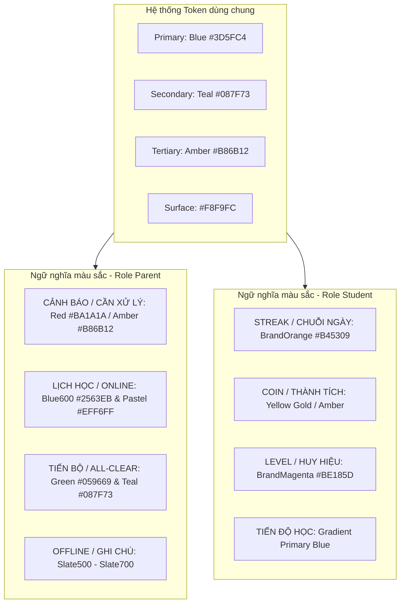

# BÁO CÁO PHÂN TÍCH & SO SÁNH STYLE GIAO DIỆN: ROLE STUDENT VS ROLE PARENT

> **Dự án:** 40Study Mobile App (`mobile/`)  
> **Nhánh công việc:** `tung/refactor_UI_Student`  
> **Tài liệu tham chiếu:**  
> - Hệ thống Theme & Design Tokens: `mobile/lib/theme/*`  
> - Phân hệ Student: `mobile/lib/features/student/*`  
> - Phân hệ Parent: `mobile/lib/features/parent/*` & Kế hoạch Parent V2.0 (`mobile/docs/UI-Parent-plan/*`)  
> **Ngày lập báo cáo:** 08/10/2026  
> **Mục đích:** Đánh giá chuyên sâu sự khác biệt về phong cách thiết kế (UI/UX style), tư duy phân tầng thị giác, cấu trúc component giữa vai trò Học sinh (Student) và Phụ huynh (Parent); từ đó rút ra các bài học và insight then chốt để phục vụ đợt Refactor toàn diện giao diện Student.

---

## MỤC LỤC
1. [TỔNG QUAN & BỐI CẢNH (EXECUTIVE SUMMARY)](#1-tổng-quan--bối-cảnh-executive-summary)
2. [ĐỐI TƯỢNG NGƯỜI DÙNG & TRIẾT LÝ THIẾT KẾ (PERSONA & UX PHILOSOPHY)](#2-đối-tượng-người-dùng--triết-lý-thiết-kế-persona--ux-philosophy)
3. [KIẾN TRÚC ĐIỀU HƯỚNG & PHẠM VI DỮ LIỆU (NAVIGATION & CONTEXT SCOPE)](#3-kiến-trúc-điều-hướng--phạm-vi-dữ-liệu-navigation--context-scope)
4. [HỆ THỐNG MÀU SẮC & PHÂN TẦNG BỀ MẶT (COLORS & SURFACE LAYERING)](#4-hệ-thống-màu-sắc--phân-tầng-bề-mặt-colors--surface-layering)
5. [TYPOGRAPHY, SPACING & VÙNG CHẠM TƯƠNG TÁC (TYPOGRAPHY & TOUCH TARGETS)](#5-typography-spacing--vùng-chạm-tương-tác-typography--touch-targets)
6. [CẤU TRÚC THÀNH PHẦN & WIDGET PATTERNS (COMPONENT ARCHITECTURE)](#6-cấu-trúc-thành-phần--widget-patterns-component-architecture)
7. [XỬ LÝ TRẠNG THÁI RỖNG & TRẢI NGHIỆM TẢI (EMPTY STATES & SKELETONS)](#7-xử-lý-trạng-thái-rỗng--trải-nghiệm-tải-empty-states--skeletons)
8. [MA TRẬN SO SÁNH TỔNG HỢP (SUMMARY COMPARISON MATRIX)](#8-ma-trận-so-sánh-tổng-hợp-summary-comparison-matrix)
9. [KEY INSIGHTS & HƯỚNG ĐI REFACTOR CHO ROLE STUDENT](#9-key-insights--hướng-đi-refactor-cho-role-student)

---

## 1. TỔNG QUAN & BỐI CẢNH (EXECUTIVE SUMMARY)

Ứng dụng **40Study Mobile** phục vụ hai nhóm đối tượng hạt nhân trong hệ sinh thái giáo dục: **Học sinh (Student)** - người trực tiếp tiêu thụ kiến thức, và **Phụ huynh (Parent)** - người giám sát, đồng hành và quản lý tài chính.

* **Phân hệ Phụ huynh (Parent V2.0):** Vừa trải qua đợt tái thiết kế toàn diện theo chuẩn *"Parent-Friendly UX"*, tập trung mạnh vào khả năng quét thông tin nhanh (*Visual Scannability*), phân tầng màu nền rõ nét (*Contrast Surface Layering*), thẻ thông tin độc lập, hỗ trợ đóng/mở khối (*Collapsible Sections*), và thống nhất chuẩn Header (`ParentAppHeader`) trên toàn bộ 5 tab.
* **Phân hệ Học sinh (Student):** Là phân hệ nền tảng ban đầu, sở hữu nhiều tính năng phong phú (học video, giải bài tập, làm quiz, thi đấu, streak điểm danh, portfolio cá nhân). Tuy nhiên, sau nhiều giai đoạn phát triển, giao diện Student đang bộc lộ một số điểm thiếu đồng bộ: header giữa các tab chưa thống nhất (`AppBar` xen lẫn `TabScreenHeader`), cấu trúc khối màn hình Home dùng một container bo góc lớn bao bọc quá nhiều section, mật độ thông tin cao và một số quy ước Design Tokens còn bị phân mảnh.

Bản phân tích này so sánh chi tiết từng khía cạnh giữa hai phong cách để định hình tiêu chuẩn refactor cho phân hệ Student trên nhánh `tung/refactor_UI_Student`.

---

## 2. ĐỐI TƯỢNG NGƯỜI DÙNG & TRIẾT LÝ THIẾT KẾ (PERSONA & UX PHILOSOPHY)

| Tiêu chí | Role Student (Học sinh) | Role Parent (Phụ huynh) |
| :--- | :--- | :--- |
| **Chân dung người dùng** | Học sinh, sinh viên, người trẻ tuổi (Gen Z: 12 - 24 tuổi). Sử dụng smartphone nhanh nhẹn, thích hình ảnh trực quan, tương tác linh hoạt. | Phụ huynh (35 - 55+ tuổi). Thường bận rộn công việc, mắt bắt đầu lão hóa, mong muốn sự an tâm, không có nhiều thời gian tìm kiếm sâu. |
| **Mục đích chính trong app** | **Học tập & Thực hành:** Vào học video HLS, nộp bài tập, làm bài kiểm tra quiz, theo dõi chuỗi streak, tích lũy coin/điểm, đua top leaderboard. | **Giám sát & Quản lý:** Kiểm tra con có nộp bài đúng hạn không, mấy giờ con vào học, tuần này con tiến bộ ra sao, đóng học phí khi đến hạn. |
| **Cảm xúc chủ đạo (Tone & Mood)** | **Trẻ trung, Động lực, Thi đua (Gamified & Action-oriented):** Truyền cảm hứng hành động, kích thích phản hồi nhanh thông qua các cột mốc thành tích. | **Điềm đạm, Minh bạch, Đáng tin cậy (Calm, Trustworthy & Clear):** Giảm thiểu lo âu; hiển thị rõ ràng những gì "cần xử lý gấp" và khẳng định "tất cả ổn định". |
| **Nguyên tắc tương tác cốt lõi** | *Interactive & Fast-paced:* Nhiều thao tác vuốt ngang (horizontal carousel), kéo thả, làm quiz tương tác thời gian thực. | *3-Second Scannability:* Quét mắt trong 3 giây là nắm bắt toàn bộ tình hình học tập và lịch trình của các con. |

---

## 3. KIẾN TRÚC ĐIỀU HƯỚNG & PHẠM VI DỮ LIỆU (NAVIGATION & CONTEXT SCOPE)

### 3.1. Cấu trúc Navigation Bar & 5 Tabs

Cả hai vai trò đều sử dụng Material 3 `NavigationBar` với 5 tab chức năng, nhưng trọng tâm mỗi tab được ánh xạ theo nhu cầu sử dụng thực tế:

```
[STUDENT SHELL]
├── Tab 0: Trang chủ   (Tổng quan ngày, Tiếp tục học, Mục tiêu, Bài tập, Lịch hôm nay)
├── Tab 1: Học tập     (Khóa học của tôi, Thư viện khóa học, Lộ trình bài học)
├── Tab 2: Lịch học    (Lịch tháng, Timeline ca học trong ngày)
├── Tab 3: Thành tích  (Điểm rèn luyện, Streak ngọn lửa, Rank, Huy hiệu, Chứng chỉ)
└── Tab 4: Tài khoản   (Portfolio cá nhân, Ghi chú, Cài đặt)

[PARENT SHELL]
├── Tab 0: Trang chủ   (Cần xử lý, Lịch hôm nay/tiếp theo, Phân tích học tập tuần)
├── Tab 1: Lịch        (Lịch tuần/tháng có dots theo con, Ca học chi tiết)
├── Tab 2: Học tập     (Insights sư phạm 3 bước, Lớp học, Bài tập về nhà, Tiến độ, Gợi ý)
├── Tab 3: Học phí     (Hóa đơn chưa thanh toán, Lịch sử nộp tiền, Tra cứu hóa đơn VAT)
└── Tab 4: Hồ sơ       (Quản lý liên kết con, Thông báo gia đình, Chuyển vai trò)
```

### 3.2. Cơ chế "Scope Context" (Multi-Child vs Single-User)

* **Parent UI:** Sở hữu khái niệm **Family Scope**. Do một phụ huynh có thể có 1 hoặc nhiều con học trên nền tảng, toàn bộ phân hệ Phụ huynh được thiết kế xoay quanh widget `FamilyScopeSelector` ghim cố định (*Sticky Pinned Header*).
  * Khi chọn *"Tất cả các con"*: Dữ liệu hiển thị dạng tổng hợp hoặc nhóm theo từng con với badge màu nhận diện riêng.
  * Khi chọn một người con cụ thể: Dữ liệu lịch trình, học vụ, học phí tự động lọc chính xác theo `child_id` của con đó.
  * Khi chỉ có 1 con: Tự động ẩn nút "Tất cả các con", loại bỏ hoàn toàn nhiễu thị giác.
* **Student UI:** Hoạt động dưới ngữ cảnh **Single-User Scope**. Học sinh chỉ quản lý dữ liệu học tập của chính mình, do đó không có khái niệm chuyển đổi scope trong màn hình.

### 3.3. So sánh cấu trúc Header trên các màn hình

| Tiêu chí | Role Student | Role Parent |
| :--- | :--- | :--- |
| **Mẫu Header** | **Phân mảnh (Fragmented):**<br>- Tab Trang chủ: Dùng `AppBar` chuẩn của Flutter kết hợp drawer hamburger icon.<br>- Tab Học tập: Dùng `TabScreenHeader` riêng (text title lớn + icon tìm kiếm & thông báo).<br>- Tab Lịch học: Dùng `TabScreenHeader` không có nút tìm kiếm. | **Thống nhất tuyệt đối (`ParentAppHeader`):**<br>- 100% màn hình chính dùng chung một layout component.<br>- Có icon tròn đại diện phân hệ (nền pastel).<br>- Có category label chữ hoa nhỏ (`HỌC VỤ & TIẾN ĐỘ`, `PHỤ HUYNH 40STUDY`).<br>- Tiêu đề 18sp w700.<br>- Chuông thông báo có badge đỏ + Avatar bo tròn. |
| **Độ ổn định khi chuyển Tab** | Header bị "giật" độ cao và vị trí icon khi người dùng chuyển giữa Home (AppBar 56dp) sang Learning (TabScreenHeader padding rộng). | Hoàn toàn liền mạch, không giật layout do chung kích thước khung tiêu đề. |

---

## 4. HỆ THỐNG MÀU SẮC & PHÂN TẦNG BỀ MẶT (COLORS & SURFACE LAYERING)

### 4.1. Bản đồ màu sắc ngữ nghĩa (Semantic Palette)

Cả hai phân hệ đều thừa hưởng hệ thống nền tảng `MaterialTheme` từ `mobile/lib/theme/style.dart` và `app_colors.dart`. Tuy nhiên, cách phối màu phản ánh rõ hai mục đích khác nhau:



### 4.2. Phân tầng bề mặt (Surface Layering)

* **Parent UI (Mô hình High-Contrast Layering V2.0):**
  1. **Tầng Header:** Nền trắng tinh khiết (`#FFFFFF`) tạo sự sạch sẽ, trang trọng.
  2. **Tầng Canvas:** Nền xám dịu `surfaceBg` pha nhẹ sắc xanh (`Color.alphaBlend(primary.withValues(alpha: 0.045), surfaceContainer)` hoặc `#F8FAFC`).
  3. **Tầng Thẻ nội dung (Cards):** Mỗi ca học, mỗi hóa đơn, mỗi nhóm thông tin là một **Card trắng độc lập** (`#FFFFFF`) nổi bật trên nền xám dịu, bo góc lớn `AppRadius.borderLg` (16px), viền mảnh `outlineVariant` (0.8px) và đổ bóng mềm.
  4. **Tiêu đề Section:** Nằm **HOÀN TOÀN BÊN NGOÀI CARD**, tạo độ thoáng đãng và dẫn dắt mắt đọc tự nhiên.

* **Student UI (Mô hình Two-Tier Curved Container hiện tại):**
  1. **Nửa trên:** Header và Thẻ Tiếp tục học (`ContinueLearningCard`) nằm trên nền `surface` phẳng.
  2. **Nửa dưới:** Bọc toàn bộ các phần còn lại (Lịch hôm nay, Mục tiêu, Bài tập, Thành tích) vào trong một **Container bo góc khổng lồ** (`BorderRadius.vertical(top: Radius.circular(28))`) có nền xám phủ kín tới đáy màn hình.
  3. **Vấn đề của Student UI:** Việc nhồi nhét tất cả section vào một container lớn tạo cảm giác phân cấp bị đóng khung, độ sâu thị giác chưa cao và khó áp dụng hiệu ứng đóng/mở khối linh hoạt.

---

## 5. TYPOGRAPHY, SPACING & VÙNG CHẠM TƯƠNG TÁC (TYPOGRAPHY & TOUCH TARGETS)

### 5.1. Bảng đối chiếu Typography

| Thành phần | Role Student | Role Parent | Nhận xét so sánh |
| :--- | :--- | :--- | :--- |
| **Headline / Lời chào** | `headlineLarge` (32sp), w700, `'Chào buổi sáng, Tùng'` | `titleMedium` / `headlineSmall` (18-20sp), w700, kết hợp giờ thực tế + tên | Student nhấn mạnh cá nhân hóa với font rất to; Parent cân đối, điềm đạm. |
| **Tiêu đề Section** | `SectionHeader`: 16sp, w600, kèm nút action `'Xem tất cả'` nhỏ | Section Title: 14sp uppercase w700, letter-spacing 1.1, có badge số lượng bên cạnh | Parent dùng chữ hoa có khoảng cách chữ giúp người lớn tuổi quét mục lục nhanh hơn. |
| **Thẻ thời gian / Giờ học** | Nằm trong timeline dọc, text 13-14sp trung tính | Khối giờ nổi bật: 16-18sp bold, đi kèm nhãn thời lượng riêng (`60p`, `90p`) | Parent làm nổi bật thời gian học hơn hẳn để phụ huynh nhắc nhở con. |
| **Body / Mô tả chi tiết** | 13 - 14sp, line-height chuẩn Material | 14 - 16sp, line-height 1.45 - 1.5, độ tương phản cao chống nhòe chữ | Parent ưu tiên khả năng tiếp cận (*Accessibility*). |

### 5.2. Spacing & Touch Targets

* **Parent UX Rules:**
  * Khoảng cách giữa các Section: chuẩn mực `AppSpacing.vGap20` (20px).
  * Vùng chạm tương tác (*Touch Target*): Nghiêm ngặt $\ge 48 \times 48\text{ dp}$ cho tất cả chip chọn con, nút đóng mở section, nút xem chi tiết.
* **Student UX:**
  * Mật độ thông tin dày đặc hơn (*Higher Density*), các chip bộ lọc có kích thước nhỏ hơn (chiều cao 32 - 36dp), phù hợp với thao tác ngón tay nhanh của giới trẻ trên màn hình di động.

---

## 6. CẤU TRÚC THÀNH PHẦN & WIDGET PATTERNS (COMPONENT ARCHITECTURE)

### 6.1. Section Header & Khả năng Thu gọn (Collapsible Architecture)

* **Parent UI:**
  * Toàn bộ 3 section lớn trên Home (`CẦN XỬ LÝ`, `HÔM NAY / TIẾP THEO`, `PHÂN TÍCH HỌC TẬP`) đều tích hợp cơ chế **Collapsible** độc lập sử dụng `AnimatedCrossFade`.
  * **Quy tắc vàng:** Mặc định luôn ở trạng thái **MỞ TOÀN BỘ** khi vào app để người dùng không bị bỏ lỡ thông tin khẩn; phụ huynh có thể chủ động bấm vào thanh tiêu đề để thu gọn phần không quan tâm.
* **Student UI:**
  * Hiện tại các section của Student là danh sách tĩnh, không có cơ chế thu gọn. Nếu học sinh có nhiều bài tập và nhiều mục tiêu, trang Home sẽ kéo dài đáng kể.

### 6.2. Hiển thị Lịch trình (Schedule Representation)

* **Parent UI (Card độc lập theo ca):**
  * Mỗi buổi học là một **Card trắng tách biệt**.
  * Phân biệt rõ loại hình: Khối giờ có nền xanh pastel cho học **Online** (kèm link phòng học); nền xám dịu cho học **Offline** (kèm địa chỉ phòng học).
  * Gắn tag tên con cụ thể (`[Minh]`, `[Lan]`) để phụ huynh không bị nhầm lẫn giữa các con.
* **Student UI (Timeline liền mạch):**
  * Dùng component `ScheduleTimeline` với đường kẻ trục thời gian nối liền các ca học (vòng tròn chấm biểu thị giờ học đang diễn ra hoặc đã kết thúc). Phù hợp với góc nhìn lịch trình cá nhân trong ngày.

### 6.3. Gamification vs Utility

* **Student UI sở hữu hệ thống Gamification đặc thù:**
  * `TodaySummary`: Đếm nhanh số bài tập cần nộp và số ca học hôm nay.
  * `AchievementCard`: Biểu đồ streak ngọn lửa, xếp hạng học tập, tổng số bài đã nộp.
  * `QuizCard` & `AnswerOption`: Trải nghiệm thi đấu trắc nghiệm tương tác với hiệu ứng đổi màu đáp án.
* **Parent UI hướng hoàn toàn về tiện ích quản lý (Utility):**
  * `InvoiceDueHeroCard`: Thẻ cảnh báo học phí sắp hết hạn với nút thanh toán tức thì.
  * `Pedagogical Insights`: Báo cáo 3 bước (Kết quả -> Nhận xét AI -> Đề xuất khắc phục).

---

## 7. XỬ LÝ TRẠNG THÁI RỖNG & TRẢI NGHIỆM TẢI (EMPTY STATES & SKELETONS)

| Tình huống | Trải nghiệm Role Student | Trải nghiệm Role Parent |
| :--- | :--- | :--- |
| **Không có dữ liệu bài tập / việc tồn** | Thường ẩn mục hoặc hiển thị text đơn giản | **All-Clear Hero Card:** Thẻ xanh pastel với icon khiên bảo vệ, khẳng định rõ *"0 việc tồn đọng - Tất cả ổn định"* kết hợp tên thật của con để tạo tâm lý an tâm tuyệt đối. |
| **Chưa có khóa học / Chưa ghi danh** | **Action-Driven CTA:** Hiển thị `ExploreCoursesCard` khuyến khích bấm nút *"Khám phá khóa học ngay"*. | **Guidance View:** Hiển thị `ParentNoChildView` hướng dẫn phụ huynh từng bước gửi yêu cầu kết nối với tài khoản con. |
| **Ngày không có lịch học** | Hiển thị widget `FreeDay` với icon thư giãn nhẹ nhàng. | Thẻ phẳng thông báo *"Hôm nay không có ca học nào"*. |
| **Trạng thái tải (Loading)** | Kết hợp `CircularProgressIndicator` ở giữa màn hình và skeleton một vài nơi. | Áp dụng Shimmer Skeleton toàn phần, giữ nguyên cấu trúc khung của trang trong lúc tải API. |

---

## 8. MA TRẬN SO SÁNH TỔNG HỢP (SUMMARY COMPARISON MATRIX)

| Tiêu chí so sánh | Role Student (Hiện tại) | Role Parent (V2.0) | Mức độ phù hợp / Đánh giá |
| :--- | :---: | :---: | :--- |
| **1. Tính nhất quán Header** | ⚠️ Trung bình (khác biệt giữa các tab) | ⭐️ Xuất sắc (`ParentAppHeader` 100%) | Cần áp dụng chuẩn Header chung cho Student |
| **2. Phân tầng thị giác (Layering)** | ⚠️ 2 tầng (bị bọc trong curved container) | ⭐️ 3 tầng rõ nét (Header -> Canvas -> Cards) | Phong cách Parent thông thoáng và hiện đại hơn |
| **3. Độ scannability (quét nhanh)** | ⚠️ Trung bình (nhiều text nhỏ, mật độ cao) | ⭐️ Xuất sắc (Section ngoài Card, icon ngữ nghĩa) | Cần học hỏi cách tách Section của Parent |
| **4. Tính tương tác (Gamification)** | ⭐️ Xuất sắc (Streak, coin, quiz, badges) | ➖ Không áp dụng (không cần thiết với PH) | Giữ nguyên và phát huy thế mạnh của Student |
| **5. Thân thiện thao tác (Touch)** | ⚠️ Một số chip hơi nhỏ | ⭐️ Đạt chuẩn accessibility ($\ge 48\text{dp}$) | Tăng nhẹ kích thước các nút chính của Student |
| **6. Quản lý Scope dữ liệu** | ⭐️ Tối ưu cho cá nhân (Single-user) | ⭐️ Tối ưu cho gia đình (Multi-child selector) | Mỗi bên phục vụ đúng bản chất người dùng |
| **7. Trải nghiệm Empty State** | ⭐️ Tốt (Kêu gọi hành động rõ ràng) | ⭐️ Xuất sắc (All-Clear tạo tâm lý an tâm) | Học hỏi cách hiển thị empty state tinh tế |
| **8. Dynamic Data Binding** | ⭐️ Khá tốt (kết nối Bloc/Repository) | ⭐️ 100% dynamic, format ngày tiếng Việt chuẩn | Chuẩn hóa format ngày tháng theo thời gian thực |

---

## 9. KEY INSIGHTS & HƯỚNG ĐI REFACTOR CHO ROLE STUDENT

Từ những điểm mạnh đã được kiểm chứng trên phân hệ Parent V2.0, đợt refactor trên nhánh `tung/refactor_UI_Student` cần tập trung vào **5 định hướng cải tiến chiến lược**:

### 9.1. Chuẩn hóa `StudentAppHeader` dùng chung
* Xây dựng widget `StudentAppHeader` tương tự `ParentAppHeader` để dùng xuyên suốt cho các Tab (Trang chủ, Học tập, Lịch học, Thành tích).
* Đảm bảo đồng bộ tuyệt đối về chiều cao, padding, avatar học sinh và chuông thông báo; loại bỏ hiện tượng giật layout khi chuyển tab.
* Tích hợp lời chào thông minh theo thời gian thực kết hợp tên thật từ `AuthBloc`.

### 9.2. Phá vỡ cấu trúc "Container nguyên khối", tách rời Section Header
* Ở màn hình Home của Student: Loại bỏ việc bọc toàn bộ nội dung phía dưới vào một container cong khổng lồ.
* Thay vào đó, áp dụng phong cách nền canvas xám dịu (`#F8FAFC` / `surfaceContainerLowest`) và đưa các `SectionHeader` ra ngoài card.
* Mỗi khối (Lịch hôm nay, Mục tiêu ngày, Bài tập cần nộp) là các thẻ card trắng độc lập với viền mỏng và đổ bóng nhẹ, giúp trang chủ thoáng đãng và dễ theo dõi.

### 9.3. Nâng cấp trải nghiệm thẻ khóa học & bài học
* Tinh chỉnh `MyCourseCard` và `ContinueLearningCard`: Nâng cấp thanh tiến độ với gradient mềm mại, bố trí lại thông tin bài giảng tiếp theo để học sinh tiếp tục học chỉ với 1 chạm.
* Sử dụng tỷ lệ ảnh thumbnail chuẩn (16:9) kèm huy hiệu danh mục rõ ràng.

### 9.4. Chuẩn hóa Design Tokens & Loại bỏ Hardcoded Values
* Rà soát và thay thế toàn bộ padding/margin thủ công bằng `AppSpacing` (`AppSpacing.screenPadding`, `AppSpacing.md`, `AppSpacing.lg`, `AppSpacing.vGap20`).
* Đồng bộ bo góc theo `AppRadius` (`AppRadius.borderMd` = 12, `AppRadius.borderLg` = 16, `AppRadius.borderXl` = 24).
* Đảm bảo hỗ trợ trơn tru cả Light Theme và Dark Theme thông qua `Theme.of(context).colorScheme`.

### 9.5. Tăng cường Empty State & Trải nghiệm tương tác
* Giữ nguyên các nét đặc trưng của Student (streak lửa, badge huy hiệu, bảng xếp hạng), nhưng nâng cấp các trạng thái trống (khi chưa có bài tập, chưa có lịch học) với hình minh họa vector sắc nét và nút bấm Call-To-Action mời gọi học tập tích cực.

---

*Tài liệu được biên soạn nhằm phục vụ trực tiếp cho quá trình hiện thực hóa mã nguồn trên nhánh `tung/refactor_UI_Student`.*
